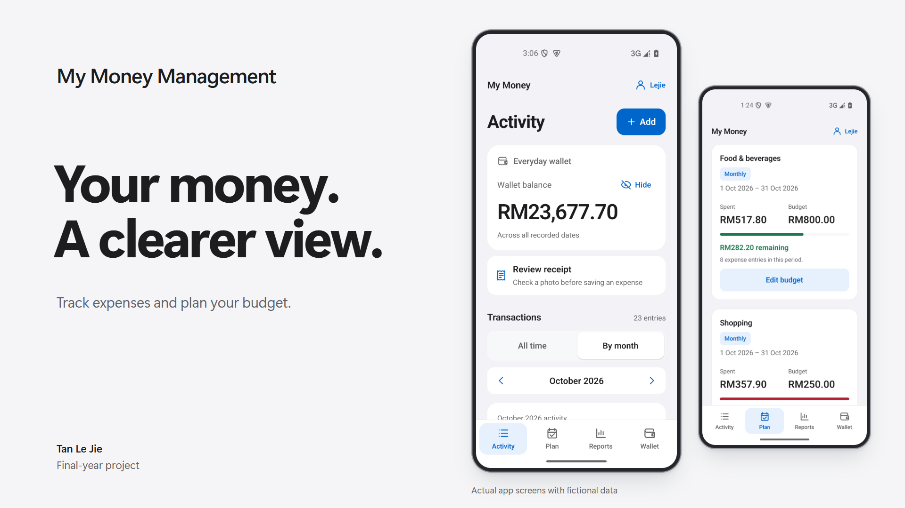
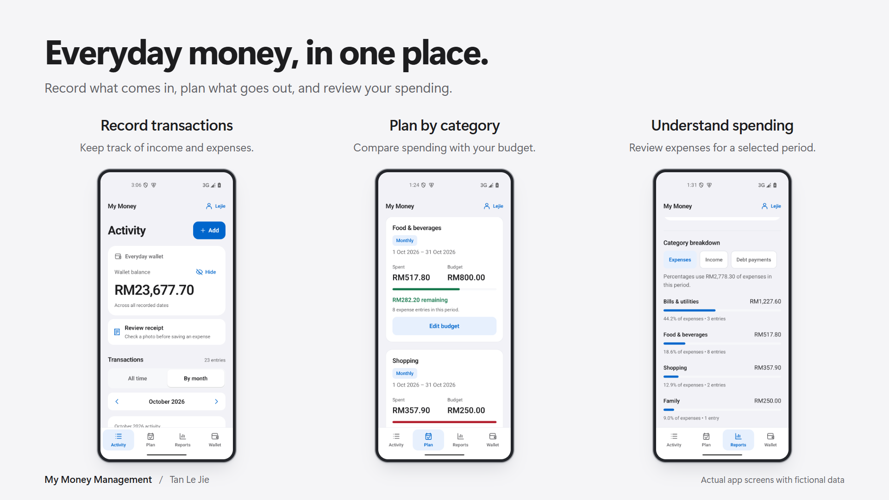
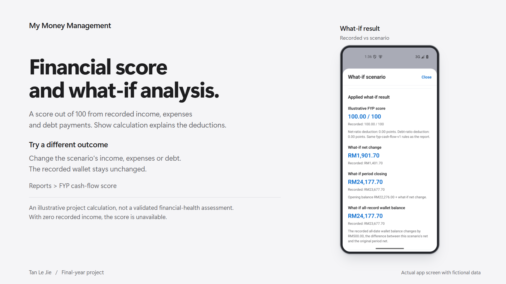
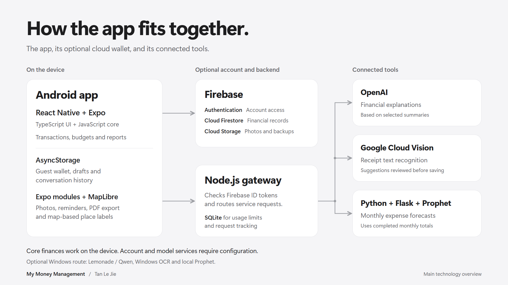

# My Money Management

[](docs/images/portfolio/cover.png)

My Money Management is a personal finance app built with React Native and Expo. I developed it for my 2024 final-year project around three objectives: a financial score, an assistant for financial questions, and expense forecasting. I revisited the project in 2026 to improve calculations, data recovery and the mobile interface. The current development build targets Android.

[Project objectives](#project-objectives) | [Financial score](#financial-score-and-what-if-analysis) | [Screenshots](#screenshots) | [Architecture](docs/ARCHITECTURE.md) | [Run locally](#run-the-android-app) | [Verification](VERIFICATION.md)

This is a portfolio and development project. Native walkthroughs used an Android emulator; a production APK is not distributed here. Public backend deployment and live OpenAI/Google Cloud Vision calls remain unverified. The [verification record](VERIFICATION.md) separates source tests, local services and native checks.

## Project objectives

### Financial score

Reports calculates a **cash-flow score out of 100** from recorded income, expenses and debt payments. The what-if simulator uses the same formula. This is an illustrative project calculation and requires positive recorded income. [Calculation and examples](docs/HEALTH_AND_SIMULATOR.md)

### Financial assistant

A configured OpenAI backend explains selected financial summaries and supports follow-up questions. The assistant cannot change financial records. Live OpenAI calls remain unverified. [Assistant guide](docs/FINANCIAL_ASSISTANT.md)

### Expense forecasting

Flask/Prophet estimates six future expense months from completed monthly history. A separate device calculation works offline. Real Prophet runs were checked locally on Windows; the estimates do not establish future accuracy. [Forecast guide](docs/MONTHLY_FORECAST.md)

## Everyday finances

[](docs/images/portfolio/features.png)

A fresh installation opens an empty guest wallet on the device. Transactions, budgets, reports and device calculations work without an account or server. Signing in opens a separate account wallet; copying guest records requires a preview and confirmation, and the source records are retained.

- Record income, expenses and debt payments, with categories and optional notes or photos.
- Compare spending with category budgets and follow a savings target based on the wallet balance.
- Review period balances and category breakdowns, export a PDF, or calculate loan repayments.
- Review receipt-recognition suggestions before saving an expense.

The [feature and navigation guide](docs/FEATURES.md) covers currencies, reminders, achievements, sharing, drafts and optional connections.

## Financial score and what-if analysis

[](docs/images/portfolio/financial-score.png)

Open **Reports**, choose a month or date range, and scroll below **Recorded cash flow** to **FYP cash-flow score**. **Show calculation** explains the two deductions. **Try a what-if scenario** compares hypothetical income, expenses and debt payments with the recorded period, while leaving saved transactions unchanged.

The score starts at 100 and applies deductions when net cash flow is below 25% of income or debt payments exceed 30% of income, bounded to 0 through 100. Those thresholds are project assumptions, not financial recommendations. Zero recorded income makes the score unavailable; budgets and savings-goal targets do not alter it. The [score guide](docs/HEALTH_AND_SIMULATOR.md) gives the formula, worked examples and limits.

## Screenshots

The [full screenshot tour](docs/SCREENSHOTS.md) covers the financial score, assistant, forecasts, planning tools, receipt review, backup and PDF export. All financial records shown are fictional. The [original captures and captions](docs/SCREENSHOTS.md#original-captures) remain available at full resolution.

Captions identify Windows OCR with a manually entered receipt amount, a local Prophet run, Firebase-emulator backup previews and an OpenAI form before submission. They do not establish live OpenAI/Google Cloud Vision calls or a public deployment.

## How it is built

[](docs/images/portfolio/technology.png)

| Part                    | Technologies and purpose                                                                                                                                                                                          |
| ----------------------- | ----------------------------------------------------------------------------------------------------------------------------------------------------------------------------------------------------------------- |
| Mobile app              | React Native, Expo and TypeScript UI, with JavaScript calculation modules. AsyncStorage holds device records, drafts and conversation history. Expo modules support native tools; MapLibre supports place labels. |
| Optional account wallet | Firebase Authentication provides account access, Firestore stores financial records and backup indexes, and Cloud Storage holds photos and recovery snapshot content.                                             |
| Service backend         | Node.js checks Firebase ID tokens and routes explicit requests. SQLite stores usage limits and request identities, not wallet records.                                                                            |
| Connected tools         | OpenAI explains selected summaries, Google Cloud Vision recognises receipt text, and Python/Flask/Prophet provides expense forecasts.                                                                             |

Firebase, OpenAI, Google Cloud Vision and Flask/Prophet were also part of the original project. The [integration guide](docs/ORIGINAL_SERVICE_INTEGRATIONS.md) explains the architecture changes. Use your own Firebase project and private server configuration for hosted services.

Cloud saves require server confirmation. Offline viewing uses the last confirmed copy; offline edits are not merged automatically. The optional Windows route provides Lemonade/Qwen, Windows OCR and local Prophet, and must be selected explicitly. See [features and service limits](docs/FEATURES.md#what-works-where), [architecture](docs/ARCHITECTURE.md) and [backend setup](tools/backend/README.md).

## Run the Android app

[Android setup](docs/ANDROID_SETUP.md) covers the Windows toolchain, project generation, native build, installation and first launch. The recorded environment uses Node 24.22.0, JDK 17 and Expo SDK 58. Dependencies are pinned in `package-lock.json`.

Install the pinned dependencies from the repository root:

```powershell
npm.cmd ci --ignore-scripts
```

After building and installing the debug app, launch it with:

```powershell
npm.cmd run android -- --project-app
```

The launcher expects the configured `FYP_API35` emulator and Metro on port 8081. It checks the installed app and checkout before launch. It reuses a running emulator; new project-app emulator starts skip VM snapshots but keep installed apps and userdata. Keep Metro running while you use the debug app.

Expo Go previews only part of the app and lacks native capabilities such as the project's PDF repair. Its saved data is separate from the installed app. Do not uninstall the app or clear its storage to switch preview modes.

On 18 October 2026, a newly generated Android project from this source passed a debug build and an API 35 emulator walkthrough covering persistence and native PDF generation. The check used an existing Windows toolchain and dependency caches. Setup on a clean computer is unverified; iOS work is deferred. See [Verification](VERIFICATION.md) for the check details and limits.

[Architecture](docs/ARCHITECTURE.md) follows one expense from the editor through validation and confirmed storage into reports, with a worked exercise.

Hosted Firebase Storage requires a billing plan. The [Firebase guide](tools/firebase-backup/README.md) explains the requirement and the separate local demo-emulator setup. Cloning this repository does not enable hosted services or incur their usage charges.

Optional service setup:

- [Firebase accounts, everyday cloud records and backup setup](tools/firebase-backup/README.md)
- [Deployable OpenAI, Vision and Prophet backend](tools/backend/README.md)
- [Standalone local Auth emulator](tools/auth-emulator/README.md), when cloud backup is not configured
- [Windows companion and provider selection](scripts/companion/README.md)
- [Flask/Prophet service and local verification](tools/forecast/README.md)

## Source checks

Run the application, companion, Auth-helper and backend JavaScript suites, then check TypeScript:

```powershell
npm.cmd run check
```

With Python 3.12 or newer available as `python`, run `npm.cmd run test:python` for the companion, Auth-lifecycle and backend-supervisor suites. They use synthetic data and simulated native/provider effects. Android rendering, persistence, permissions, PDF/QR output, OCR and model behavior need separate checks. Hosted CI is unverified.

Firebase emulator checks and real Flask/Prophet fits have their own prerequisites and commands; neither runs in the default source checks. Backend JavaScript tests are included in `check`. To run them separately:

```powershell
node --test --test-concurrency=1 "tools/backend/tests/*.test.cjs"
```

The checks recorded on 19 and 20 October 2026 include 1,224 JavaScript tests and TypeScript at the receipt correction, and 51 optional Python checks at the completion checkpoint. Firebase-emulator and native Android results are recorded separately. [Verification](VERIFICATION.md) lists the source revisions, completed workflows and remaining limits for those runs.

## Feature guides

| Topic                               | Read more                                                                                                                                                                                     |
| ----------------------------------- | --------------------------------------------------------------------------------------------------------------------------------------------------------------------------------------------- |
| Money, dates and persistence        | [Wallet and ledger](docs/WALLET_LEDGER.md), [Budgets and goals](docs/BUDGETS_AND_GOALS.md)                                                                                                    |
| Reports and calculations            | [Financial reports](docs/FINANCIAL_REPORTS.md), [Score and simulator](docs/HEALTH_AND_SIMULATOR.md), [Loan calculator](docs/LOAN_CALCULATOR.md), [Monthly forecast](docs/MONTHLY_FORECAST.md) |
| Device features and sharing         | [Achievements and reminders](docs/ACHIEVEMENTS_AND_REMINDERS.md), [Transaction details](docs/TRANSACTION_CONTEXT.md), [PDF and QR](docs/PDF_AND_QR.md)                                        |
| Optional account and model features | [Account access](docs/ACCOUNT_ACCESS.md), [Receipt capture](docs/RECEIPT_CAPTURE.md), [Financial assistant](docs/FINANCIAL_ASSISTANT.md)                                                      |

## Scope and data

Production use has not been verified. The cash-flow score is illustrative, forecast error measures a bounded historical comparison, and generated explanations can be wrong. The feature guides explain their assumptions; [Dependency notes](DEPENDENCY_NOTES.md) covers compatibility and audit history.

Keep real records, credentials, connection tokens, emulator exports, model files and generated runtime data out of source control. Guest records stay on the device until you copy or export them. For a configured Firebase account, Save confirms the financial records and selected attachments with the server. Manual backup creates a separate recovery snapshot. A cloud wallet supports up to 768 KiB of validated financial data and 100 attached photos. Auth-emulator exports alone contain no wallet or photo backup.

Unfinished forms and assistant conversations stay on the device, separated by owner. Each account can keep 20 conversations with the latest 12 exchanges each. A follow-up sends at most the latest three exchanges with the selected calculated facts. Your question may include personal information you type. Receipt recognition sends the selected image only when requested. The app shows the destination before sending either request. The original submission archive and report are not included in this repository.

Developed with assistance from AI tools.

Project code is available under the [MIT license](LICENSE); preserve the [third-party notices](THIRD_PARTY_NOTICES.md) when reusing it.
