# My Money Management

My Money Management is a personal finance app I originally developed for my 2024 final-year project. I have since refined its financial calculations, data recovery and mobile interface, with expense tracking, budgeting, reports, receipt recognition and forecasting.

The project preserves its original Firebase, OpenAI, Google Cloud Vision and Flask/Prophet direction. A configured account uses Firebase for everyday financial records and attached photos; a separately deployable backend connects the phone to the original assistant, receipt-recognition and forecasting services. Future users supply their own project and private server configuration.

A fresh installation starts with an **empty device-local guest wallet**. Transactions, budgets, reports and device calculations work without an account or server. Signing in opens a separate account wallet; existing guest records are copied only after an explicit preview and confirmation. Existing supported device wallets are retained.

## Screenshots

The feature tour uses real Android screens and the first page of a report generated by the app. All financial records shown are fictional; a fresh installation starts with an empty wallet. Each connected-tool caption identifies the provider and workflow shown.

### Record and plan

| Activity                                                                                                                           | Transaction details                                                                                                                                                   |
| ---------------------------------------------------------------------------------------------------------------------------------- | --------------------------------------------------------------------------------------------------------------------------------------------------------------------- |
| <a href="docs/images/activity.png">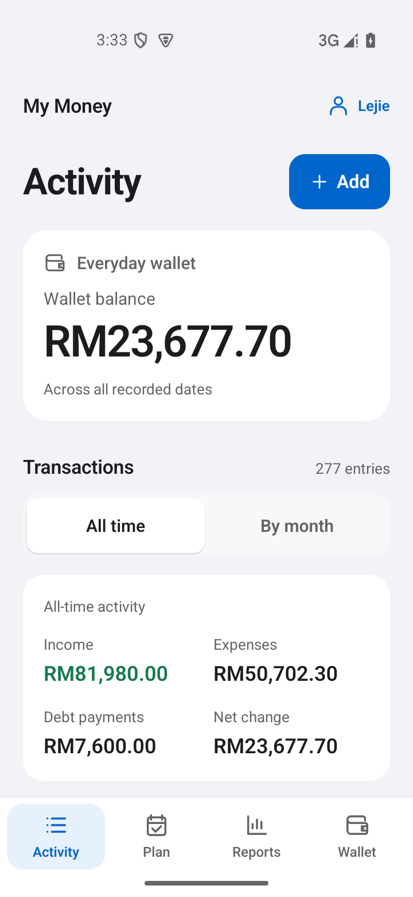</a> | <a href="docs/images/transaction-details.png">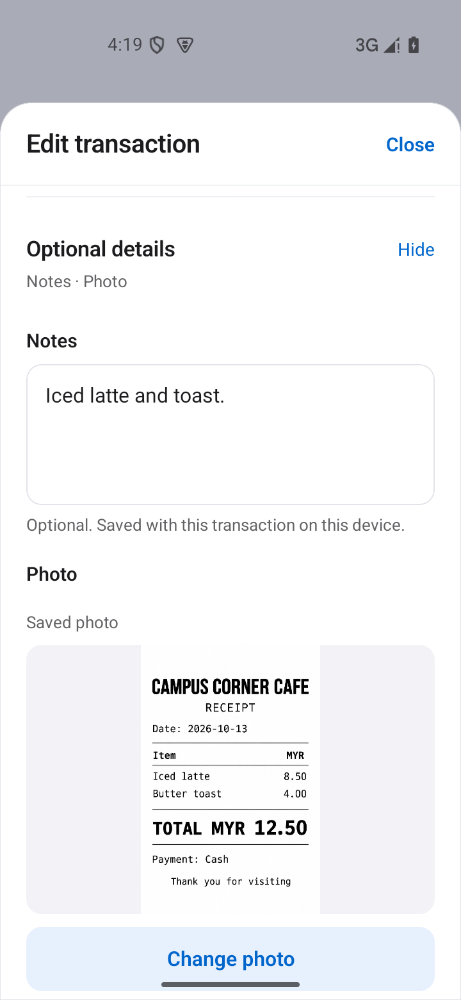</a> |
| View the all-date wallet balance and select October 2026 activity, containing 23 recorded entries.                                 | Keep a receipt photo and optional details with an ordinary transaction.                                                                                               |

| Category budgets                                                                                                                         | Savings goal                                                                                                                                 |
| ---------------------------------------------------------------------------------------------------------------------------------------- | -------------------------------------------------------------------------------------------------------------------------------------------- |
| <a href="docs/images/plan.png">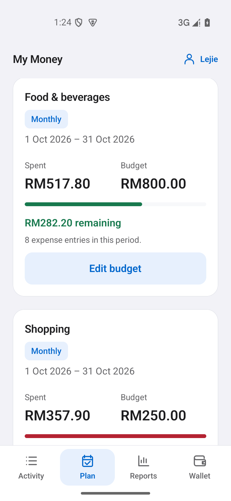</a> | <a href="docs/images/goal.png">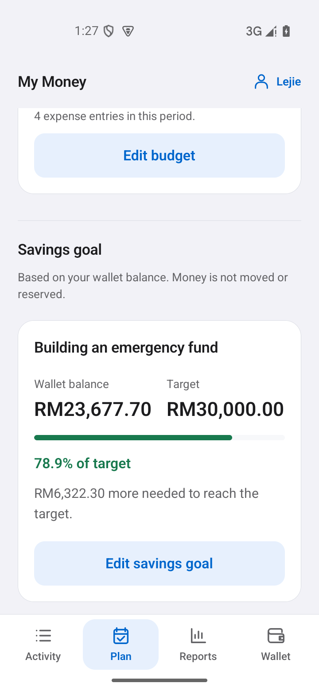</a> |
| Compare category spending with its own budget, dates and remaining amount.                                                               | Follow progress toward a savings target using the recorded wallet balance.                                                                   |

### Understand and explore

| Reports                                                                                                                                                         | What-if simulator                                                                                                                                      |
| --------------------------------------------------------------------------------------------------------------------------------------------------------------- | ------------------------------------------------------------------------------------------------------------------------------------------------------ |
| <a href="docs/images/reports.png">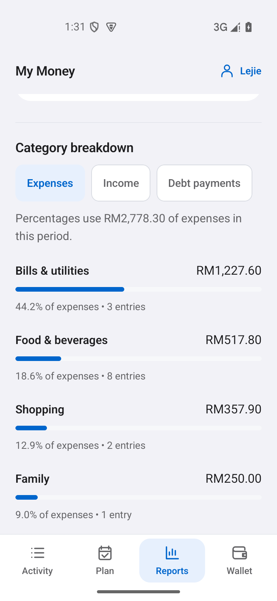</a> | <a href="docs/images/simulator.png">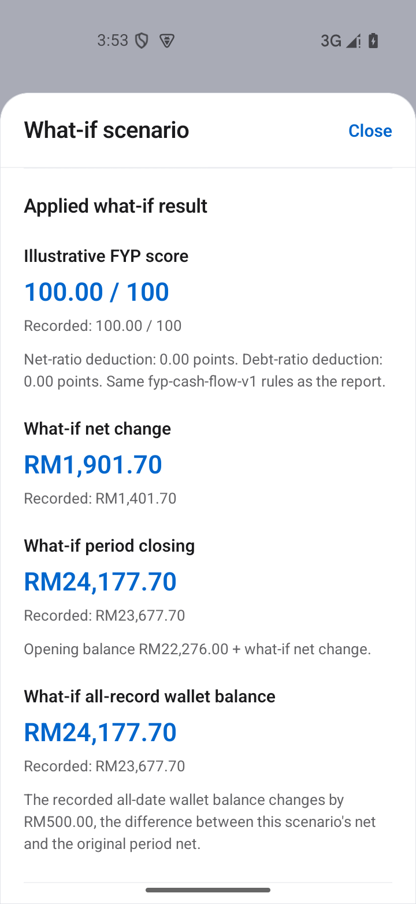</a> |
| The leading four of seven October expense categories. Shares use the full RM2,778.30 expense total.                                                             | Explore how RM500 less in October expenses changes the calculated result, without changing saved records.                                              |

| Loan calculator                                                                                                                    | Expense forecast                                                                                                                                             |
| ---------------------------------------------------------------------------------------------------------------------------------- | ------------------------------------------------------------------------------------------------------------------------------------------------------------ |
| <a href="docs/images/loan.png">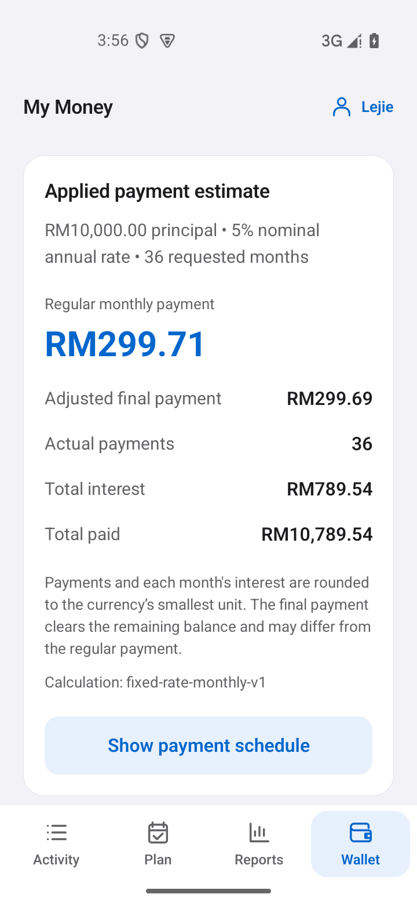</a> | <a href="docs/images/forecast.png">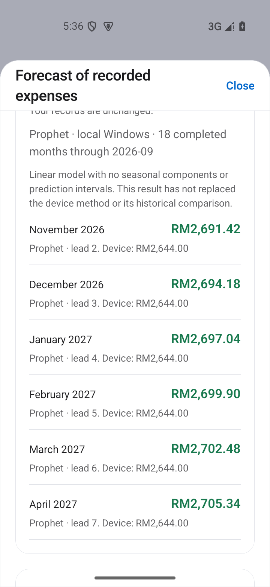</a> |
| Calculate fixed-rate payments, interest and repayment totals from explicit inputs.                                                 | Six local Prophet estimates trained on 18 completed expense months through September 2026, shown beside the device method.                                   |

### Capture, explain and preserve

| Receipt review                                                                                                                                                                | Financial assistant                                                                                                                                                             |
| ----------------------------------------------------------------------------------------------------------------------------------------------------------------------------- | ------------------------------------------------------------------------------------------------------------------------------------------------------------------------------- |
| <a href="docs/images/receipt.png">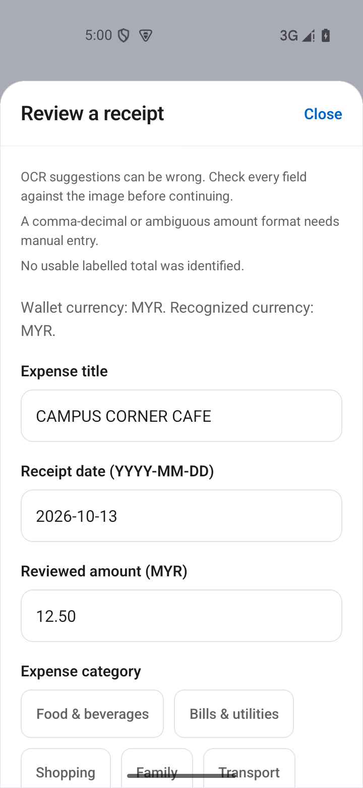</a> | <a href="docs/images/assistant.png">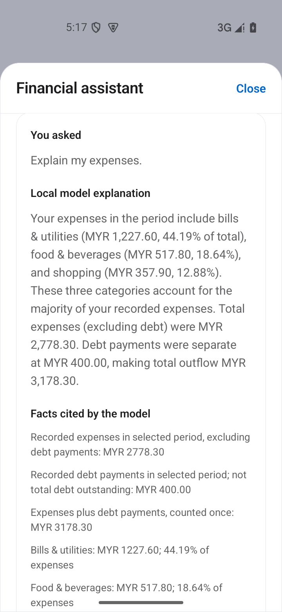</a> |
| Windows OCR suggested the title, date and currency. No total was auto-filled; RM12.50 was entered manually after checking the receipt.                                        | Review the applied dates and selected financial summaries before asking OpenAI. The question form is shown before submission; no generated answer is displayed.                 |

| Backup preview                                                                                                                                                            | Exported report                                                                                                                                                                                |
| ------------------------------------------------------------------------------------------------------------------------------------------------------------------------- | ---------------------------------------------------------------------------------------------------------------------------------------------------------------------------------------------- |
| <a href="docs/images/cloud-backup.png">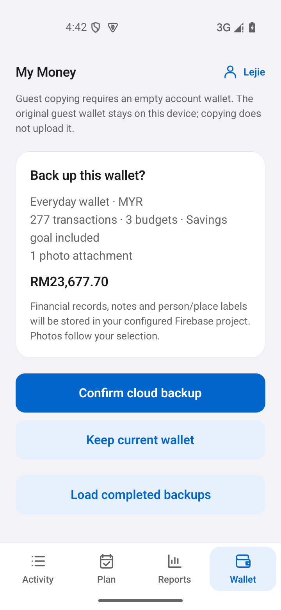</a> | <a href="docs/images/report-export.png">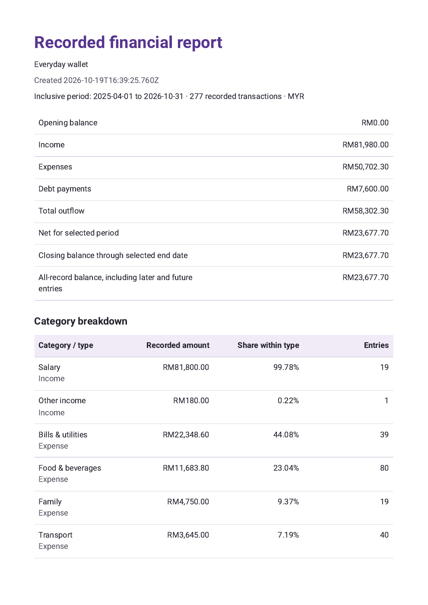</a> |
| Preview the wallet and selected receipt photo before confirming a separate recovery backup. This view uses local Firebase emulators.                                      | First of three pages of the app-exported report for April 2025 through October 2026, covering 277 transactions and 19 monthly rows. Rendered locally for readability.                          |

The receipt view uses real Windows OCR; the forecast uses the real Prophet service running locally. The assistant shows the OpenAI interface before a request, and the backup preview uses local Firebase emulators. The report image is a faithful PDF page rendering; the other eleven views are native Android captures. Open an image for its full resolution. The [UI guide](docs/UI_DESIGN.md#native-android-gallery) adds three supplementary views from an earlier checkpoint; [Verification](VERIFICATION.md) records the completed checks and limits.

## What works where

| Capability                   | Implementation                                                                                                                                            | Setup and boundaries                                                                                                                          |
| ---------------------------- | --------------------------------------------------------------------------------------------------------------------------------------------------------- | --------------------------------------------------------------------------------------------------------------------------------------------- |
| Guest finances               | Transactions, eight currencies, categories, calendar budgets, one savings goal and reconciled reports                                                     | Device-local records with exact minor-unit amounts; no account or server required                                                             |
| Firebase account wallet      | Auth, everyday Firestore records and owner-scoped Storage attachments; explicit device-wallet copying; separate recovery backups                          | Use your own Firebase project. Writes require server confirmation; offline access shows the last confirmed copy. No automatic offline merging |
| Financial assistant          | OpenAI explains selected summaries and offers budgeting/saving suggestions, with editable dates, comparisons and device-local conversation history        | Configure the authenticated backend and a compatible model. No financial actions are executed by the assistant                                |
| Receipt recognition          | Google Cloud Vision supplies editable suggestions; the user reviews the image, amount, date, currency and category before saving                          | Explicit recognition request through the configured backend; photo retention is a separate choice                                             |
| Prophet forecast             | Flask/Prophet projects six future expense months from completed monthly totals                                                                            | Configured backend with its Python environment; a separate device calculation remains available offline                                       |
| Calculators and native tools | Illustrative cash-flow score, what-if simulator, loan schedule, achievements, reminders, photos, selected contact/place labels, PDF export and QR sharing | Installed project app and relevant permissions; map tiles/address lookup need network/provider availability                                   |
| Display and unfinished work  | System/Light/Dark appearance, Activity balance visibility, retained transaction/budget/goal drafts                                                        | Device-local preferences and drafts. Hiding the home balance does not hide transaction amounts or reports                                     |
| Optional local service route | Qwen through Lemonade, Windows OCR, the Auth-only emulator and local Prophet                                                                              | Explicit Windows helper setup. A failed hosted request never switches to these providers automatically                                        |

[Original service integrations](docs/ORIGINAL_SERVICE_INTEGRATIONS.md) explains the architecture and the differences from the original implementation. [Backend setup](tools/backend/README.md) prepares an independent service that can be deployed without keeping a Windows computer beside the phone. Source/configuration support is separate from live service verification: no live OpenAI/Vision calls or public backend deployment are claimed. Windows local Prophet execution has separate recorded evidence; native Linux/container execution remains unverified.

## Find your way around

- **Activity:** add and review transactions, with an all-date balance distinct from the selected month's activity. Show/Hide affects only the balance at the top of this screen.
- **Plan:** manage category budgets and a savings target without moving or reserving money. Unfinished transaction, budget and goal fields can be resumed from a device-local draft.
- **Reports:** inspect applied-period balances, export a PDF, simulate changes and explore an eligible expense forecast.
- **Wallet:** choose System, Light or Dark appearance, edit wallet settings and open tools. **Wallet > Connections** (under Tools) contains Account, Cloud wallet, Cloud backup, receipt recognition, the financial assistant and forecasts. Choose a report before opening the assistant, then review or change its applied dates.

Configured services add useful shortcuts to the relevant screens. A configured connection means its settings are present; availability is checked when the feature is requested. The main header stays focused on the wallet and shows meaningful action or recovery feedback without a permanent readiness message.

The [UI guide](docs/UI_DESIGN.md) describes the Apple-inspired grouping, platform fonts, readable amounts and keyboard-aware sheets, with additional native screens. [Verification](VERIFICATION.md) records the completed local and optional-service walkthroughs and their limits.

## Run the Android app

Start with [Android setup](docs/ANDROID_SETUP.md) for the supported Windows toolchain, Android project generation, native build/install steps and first launch. The development baseline uses Node 24.22.0, JDK 17 and Expo SDK 58; dependencies are pinned in `package-lock.json`.

From this repository's root, install the pinned dependencies:

```powershell
npm.cmd ci --ignore-scripts
```

After following the native build/install guide, launch the installed debug app:

```powershell
npm.cmd run android -- --project-app
```

The tracked launcher expects the configured `FYP_API35` emulator and Metro on port 8081. It verifies the installed app and this checkout before opening it. New project-app emulator starts skip VM snapshots while retaining installed apps and userdata; an already-running emulator is reused. Keep Metro running while using the debug app.

Expo Go can preview a subset of the app, but it does not provide all required native capabilities, including the project's PDF repair. It also has separate saved data from the installed app. Do not uninstall an app or clear its storage to switch preview modes.

A freshly generated Android project from this source completed its debug build and an API 35 emulator walkthrough on 18 October 2026, including persistence and native PDF generation. This used an existing Windows toolchain and dependency caches; it does not establish setup on a clean computer. See [Verification](VERIFICATION.md) for the exact checks and limits. No production APK is distributed here, and iOS work is deferred.

For a practical reading path, start with [Architecture](docs/ARCHITECTURE.md). It follows one expense from the editor through validation, confirmed storage and calculated reports, with a worked exercise.

Hosted Firebase Storage has a billing-plan prerequisite; the [Firebase guide](tools/firebase-backup/README.md) explains the current requirement and separates it from local demo emulators. No hosted service is enabled or billed merely by cloning the source.

Optional services have separate setup guides:

- [Firebase accounts, everyday cloud records and backup setup](tools/firebase-backup/README.md)
- [Deployable OpenAI, Vision and Prophet backend](tools/backend/README.md)
- [Standalone local Auth emulator](tools/auth-emulator/README.md), when cloud backup is not configured
- [Windows companion and provider selection](scripts/companion/README.md)
- [Flask/Prophet service and local verification](tools/forecast/README.md)

## Source checks

Run the application, companion, Auth-helper and backend JavaScript suites, then check TypeScript:

```powershell
npm.cmd run check
```

With Python 3.12 or newer available as `python`, run `npm.cmd run test:python` for the companion, Auth-lifecycle and backend-supervisor Python suites. These checks use synthetic data and injected native/provider effects. They do not replace actual Android rendering, persistence, permissions, PDF/QR output, OCR or model verification. Hosted CI has not been verified for this repository.

Actual Firebase emulator checks and real Flask/Prophet fits have separate prerequisites and commands in their guides; neither runs as part of the default source gates. Backend JavaScript tests are already included in `check`. To run only that subset:

```powershell
node --test --test-concurrency=1 "tools/backend/tests/*.test.cjs"
```

The current integrated check passed **1,224 JavaScript tests and TypeScript**; the optional Python gate passed **51 checks**. Actual Firebase-emulator and native Android checks are recorded separately. Use [Verification](VERIFICATION.md) for source revisions, completed workflows and remaining limits.

## Feature guides

| Topic                               | Read more                                                                                                                                                                                     |
| ----------------------------------- | --------------------------------------------------------------------------------------------------------------------------------------------------------------------------------------------- |
| Money, dates and persistence        | [Wallet and ledger](docs/WALLET_LEDGER.md), [Budgets and goals](docs/BUDGETS_AND_GOALS.md)                                                                                                    |
| Reports and calculations            | [Financial reports](docs/FINANCIAL_REPORTS.md), [Score and simulator](docs/HEALTH_AND_SIMULATOR.md), [Loan calculator](docs/LOAN_CALCULATOR.md), [Monthly forecast](docs/MONTHLY_FORECAST.md) |
| Device features and sharing         | [Achievements and reminders](docs/ACHIEVEMENTS_AND_REMINDERS.md), [Transaction details](docs/TRANSACTION_CONTEXT.md), [PDF and QR](docs/PDF_AND_QR.md)                                        |
| Optional account and model features | [Account access](docs/ACCOUNT_ACCESS.md), [Receipt capture](docs/RECEIPT_CAPTURE.md), [Financial assistant](docs/FINANCIAL_ASSISTANT.md)                                                      |

## Scope and data

The project has not been verified as a production financial service. The score is illustrative, forecast error describes a bounded historical comparison, and generated explanations can be wrong. See the feature guides for the exact assumptions and [Dependency notes](DEPENDENCY_NOTES.md) for compatibility and audit history.

Keep real records, credentials, connection tokens, emulator exports, model files and generated runtime data out of source control. Guest records remain on the device until an explicit copy or export. In a configured Firebase account, ordinary Save confirms financial records and selected attachments with the server; manual backup is an additional recovery snapshot. Cloud wallets support up to 768 KiB of validated financial data and 100 attached photos. Auth-emulator exports alone do not back up wallets or photos.

Unfinished financial forms and assistant conversations stay on the device, separately scoped to their owner. Conversation history holds up to 20 conversations per account, retaining the latest 12 exchanges in each; an explicit follow-up sends at most the latest three exchanges with the selected calculated facts. Typed questions can contain personal information the user chooses to enter. Receipt actions send the selected image only after explicit recognition. The destination is disclosed before either action. The original submission archive and report are not included in this repository.

Developed with assistance from AI tools.

Project code is available under the [MIT license](LICENSE); preserve the [third-party notices](THIRD_PARTY_NOTICES.md) when reusing it.
