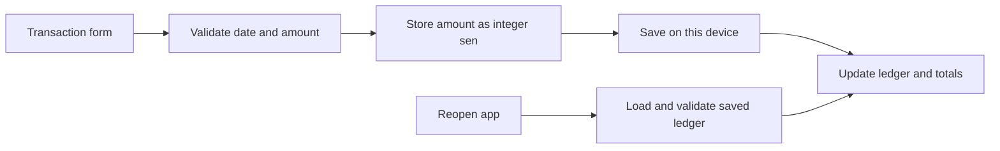

# Earlier verification records

## Monthly Prophet foundation checkpoint: 18 October 2026

The optional [Flask/Prophet source](tools/forecast/README.md) passed **33 Python tests**: 20 monthly-contract/Flask checks, nine Windows worker checks and four evaluation-contract checks. The worker tests exercised actual child processes, including unread stdin, oversized output, timeout with a descendant, output/input completion races and parent-crash cleanup. The crash check retained verified exact process handles and confirmed that children stopped when the non-inherited Job handle closed. Independent relocation review preserved all 81 original test assertion calls and checked the repository-local runtime boundary.

Two real calls through the relocated source also passed: direct owned-model execution and the Flask in-process test client using that worker. Both matched the earlier synthetic reference, preserved their input and confirmed stopped owned processes; their combined duration was 9.531 seconds on the test host. This used the existing isolated Python 3.12 environment with the locked Prophet 1.5.0/Flask 3.1.3 dependencies. It started no listening HTTP service and exercised no Android provider path.

The earlier controlled model evaluation covered increasing monthly expenses, constant expenses and whole-yen inputs, followed by an identical repeated result. A nine-fold two-month-ahead comparison restricted all four methods to the same target dates and training prefixes. Prophet's observed MAE on that invented increasing series was 34.44 minor units, compared with 2,000 for last value, 3,000 for trailing mean and 560 for damped trend. These figures establish that particular synthetic comparison, not a general prediction-quality advantage. No real financial records, cloud credentials or paid services were used.

The repository's reproducible `tools/forecast/verify_fit.py` command subsequently passed on the frozen source. It performed all 13 fits through the owned worker: three scenarios, a repeated Flask result and nine common historical folds. The observed results matched the earlier comparison, all owned processes stopped, and input/source hashes stayed unchanged. It completed in 62.454 seconds on the test host. Its output stays under ignored `.runtime/forecast-evaluation`; the guide gives the command and its Windows/Python/Node prerequisites.

Service launch/pairing, user cancellation through transport, provider selection, mobile session binding, result presentation and an Android walkthrough remain unfinished. The ordinary app continues using its device forecast. The current workflow does not run these optional dependency-heavy checks in hosted CI.

## Optional provider adapter checkpoint: 18 October 2026

The source includes inactive server adapters for OpenAI explanations and Google Vision receipt recognition. The full `npm.cmd run check` gate passed **890 JavaScript tests**, followed by TypeScript, with no failures, skips or cancellations. This adds 22 OpenAI and 18 Vision offline tests to the 850-test local-app checkpoint below. The tests inject provider responses and reject accidental real fetch calls. No cloud account, actual provider credential or live API request was used.

Independent review checked the fixed HTTPS destinations, explicit server-only credential inputs, selected-data bounds, streamed response bounds, monotonic deadlines, cancellation, late-body cleanup and truthful provider identity. Review findings for Vision fallback text and stream/deadline behavior were repaired and covered by regressions. All 174 original assertions in the two reviewed adapter suites were retained when moving the files into their repository locations.

These modules are not imported by the running companion, selected by pairing, or enabled in the mobile client. Existing local model/OCR behavior, UI, native configuration and data storage are unchanged by this adapter checkpoint. No new Android walkthrough is claimed for cloud features. Configuration, route/client/session contracts, destination disclosure and live provider evaluation remain unfinished; see [OpenAI](scripts/companion/assistant/OPENAI.md), [Google Vision](scripts/companion/ocr/GOOGLE_VISION.md) and the [integration plan](docs/ORIGINAL_SERVICE_INTEGRATIONS.md).

## Local-app and Android checkpoint: 18 October 2026

The current ordinary app starts with an empty device-local wallet. Optional account, receipt and assistant setup is discoverable under Wallet → Tools → Connections; configured services can add shortcuts without claiming that the service is reachable. Existing saved wallets, including earlier sample wallets, remain authoritative. Final gallery preparation waits for the required original-service integrations.

| Check | Observed result | Boundary |
| --- | --- | --- |
| Source checks | `npm.cmd run check`: 850 JavaScript tests passed, then TypeScript passed | Local application, companion and Auth-helper checks; no hosted CI run |
| Python helper checks | 21 companion and 19 Auth lifecycle tests passed | Injected/local helper behavior; not live provider validation |
| Dependency install | Pinned npm installation completed with lifecycle scripts disabled | Existing Node 24.22.0 and network/cache environment |
| Native generation | Expo generated a new Android project using its installed template; protected source/configuration files stayed unchanged | Existing JDK 17 and Android SDK toolchain |
| Native compilation | x86_64 debug build succeeded in 11 minutes 54 seconds, 256 tasks | Existing Gradle/Maven caches; no clean-computer or ARM build claim |
| APK checks | Android debug signature and 16 KiB ZIP alignment checks passed | Development-signed APK, not a production release |
| Native walkthrough | Seven check groups completed on an isolated Android API 35 emulator | Synthetic records, font scales 1.0 and 1.3; no physical device or iOS |

The native walkthrough established an empty RM0.00 guest wallet with no automatic sample records. An invalid amount left its draft open; Close cancelled without saving. A confirmed RM12.50 Food expense produced the exact −RM12.50 balance. A RM250.00 Food monthly budget and RM1,000.00 savings target saved through the ordinary forms, with the goal showing the correct RM1,012.50 shortfall.

Connections exposed account setup, receipt review, manual entry and report selection for assistant facts without requiring an active service. Manual entry returned to Activity; the assistant used the report's applied dates. A fresh app process restored the saved expense, and all four tabs plus Connections remained reachable at font scale 1.3. The scale was restored afterward. These are navigation/layout observations, not a complete accessibility or screen-reader audit.

After those checks, the newly generated APK replaced the prepared test binary with `install -r`. It restored the saved expense, budget and goal and successfully generated a real native report PDF through the source-compiled Print repair. No document was sent to a recipient and no live cloud provider was called.

Exact ledger-byte comparisons confirmed no changes across the read-only optional-tool checks. A second comparison, after deliberately saving the budget and goal, confirmed identical bytes across app restart, larger-text navigation and the APK update/PDF check. These comparisons cover the isolated wallet used in this checkpoint, not every historical store on the machine. Separate source tests cover existing wallet preservation, supported migrations and refusal to reseed unreadable or missing confirmed stores.

The fresh build used standard generated Android trust configuration, without a machine-specific certificate. Map-provider network access, notifications, camera/gallery acquisition, live Auth/OCR/model requests, hosted CI, production signing, clean-computer setup and iOS were not rerun in this checkpoint. Earlier feature evidence below retains its own scope. Firebase cloud records/photos, OpenAI, Google Vision and Flask/Prophet integration work remains incomplete; see [Original service integrations](docs/ORIGINAL_SERVICE_INTEGRATIONS.md).

## Earlier restoration evidence

The following sections record earlier implementation stages. Their commit identifiers refer to the original development history, which is not included in this source repository. Their sample-wallet defaults, test counts and diagnostic screenshots describe those earlier stages and do not override the current checkpoint above. Diagnostic images are not the final public gallery.

## Visible emulator snapshot recovery

The subsequent visible launch exposed a separate path not covered by the headless cold-start gate: headless starts disabled Quick Boot, while visible starts could restore it. Read-only inspection confirmed `load_succeeded` in the emulator's snapshot trace. The new launch reused an app process whose boot and initial Metro-failure timestamps predated the current emulator process, and its hierarchy contained no rendered application content. The restored process logged an Expo CLI connection warning without a fresh `Running "main"` event. This was a stalled restored development session, not evidence of slow financial calculations or ledger reads.

New project-app emulator starts now disable snapshot load/save in both presentation modes while retaining the device's installed apps and userdata. Existing running emulators are left alone, and the visible Expo Go mode retains its previous snapshot behavior. Boot polling is reduced from ten seconds to one second, with bounded deadlines and less-frequent progress messages. The existing native checks establish the cold-start path; wrapper regressions separately cover the visible launch flags and preserved reuse behavior. The visible window was inspected read-only and not restarted in that gate, so recovery after the changed launch flags required a separate close/relaunch.

All 823 integrated JavaScript checks, including 56 focused launcher checks, and TypeScript passed after this follow-up. Four new wrapper regressions cover the visible project-app snapshot flag without a data wipe, unchanged running-device reuse, one-second boot readiness detection and the preserved hardware/software timeout bounds. Existing assertions remain intact.

Timing from the two earlier successful cold starts was approximately 77 and 104 seconds from kernel startup to JavaScript `Running "main"`. Their app Activity-to-JavaScript intervals were approximately 21 and 14 seconds; the first Metro bundle took 7.542 seconds and a subsequent bundle took 138 milliseconds. These are development-environment measurements, not final-screen-ready timings or release-build performance. No storage-phase measurement in those runs supports attributing the delay to saved wallet data.

## Android development-app startup readiness

Verified on 2026-10-18 against the merged restored app. A cold Android emulator reproduced an `Unable to load script` screen while the Windows Metro status and project manifest were already valid. Native logs showed React Native's first `10.0.2.2:8081` status connection failing before the device's default network route became available. React Native then selected an embedded bundle fallback that this debug APK does not contain. Successful Activity launch alone did not establish a working app.

The launcher now verifies the app-selected Metro endpoint from Android after host/project and forwarding checks, retries bounded transient connection failures, and rechecks the endpoint before opening the Activity. It changes no application screen, financial calculation, storage schema, native package or saved debug preference. Existing owner/process safeguards remain in place.

All 819 integrated JavaScript checks and TypeScript passed. The 52 focused launcher/readiness checks cover host selection, bounded HTTP handling, retry/deadline behavior, changed preferences, owned-process cleanup and ordering before Activity launch. The first full run exposed an existing launcher test harness that did not model the new read-only Android calls; its responses were extended without removing any original assertions, and an additional wrapper-level regression verifies the real gate and foreign-response rejection. Independent review found no actionable source or test issue.

Two actual headless Android cold starts rendered the accepted interface: one with a newly started Metro server, and one through the prepared project-app launcher with Metro already running. The latter exercised the original failing condition and logged a wait for the Android connection before opening successfully. Both native logs reported a successful Metro check and `Running "main"`; neither captured the earlier load-script error. The Activity screen showed the expected three-record sample wallet and RM3,088 balance.

A stopped-app database comparison preserved all 36 preexisting financial-storage entries byte for byte. The first ordinary guest launch created its previously absent canonical wallet and two related stores. The second cold start preserved all 39 resulting entries exactly. No app data was cleared or reinstalled. These checks cover the installed API35 emulator and the tested launch conditions, not every host, physical device or iOS. The public screenshot showcase is a separate presentation task; the diagnostic startup screenshots are not its gallery.

## Apple-inspired interface refresh

The redesign builds on the complete restored feature set at `8601ca4`. It changes the shared light theme, outline icons, controls/sheets, compact navigation and the Activity, Plan, Reports and Wallet layouts. Add in the Activity header retains the accessible name Add transaction and the existing action ID. Review receipt keeps the capture entry separate from Setup, which exposes the full connection explanation and Recheck.

The final integrated automated suite passes **805 checks**, TypeScript passes and the diff whitespace check is clean. The existing financial and persistence checks remain present. Focused shared-component checks cover busy Android Back/Close dismissal, retained input/focus/blur callbacks and grouped-row accessibility. Independent review covered account/owner gates, current-account naming, selected versus all-date totals, report applied ranges, separate edit/share actions, wallet currency restrictions and reset confirmation. Plan and transaction layouts adapt for larger text without changing their calculations.

Reproduce the combined 805-check suite from the repository directory with the supported Node runtime, including the companion tests:

```powershell
node --test --test-concurrency=2 "tests/*.test.cjs" "scripts/companion/tests/*.test.cjs"
npm.cmd run typecheck
```

Selected normal-text/action color pairs were checked at 4.85:1 or higher; this is not a full accessibility audit. The map marker and native switch colors use the light-theme semantics. No font download, new native dependency, financial schema migration or provider change is part of this redesign.

The final Android presentation completed **eight native check groups** in an isolated synthetic namespace at a 360dp viewport: seven UI/data groups and one complete preview lifecycle group. All four tabs rendered, with wallet/goal values MYR2,680.00/MYR4,000.00 and report opening/closing MYR750.00/MYR2,200.00 preserved. The transaction form remained usable with the keyboard; zero amount was rejected while its draft remained open, and Close cancelled without saving. A real MYR250.00 Food monthly budget saved through the existing ledger flow.

All four tabs remained navigable at font scale 1.3 with readable goal/report amounts. Receipt Setup revealed the guarded connection control, Recheck stayed disabled when recognition was disabled, and receipt/account navigation remained usable. A maximum permitted MYR9,999,999.99 income produced the exact aggregate balance MYR10,002,679.99 at large text; deleting that test entry restored MYR2,680.00. A fresh Android process restored the original ten transactions and the newly saved budget.

Raw saved bytes were identical before and after the read-only navigation and cancelled-entry checks. After the deliberate save/add/delete operations, an independent data comparison confirmed the exact ten original transactions, unchanged wallet and savings goal, and exactly one new Food budget for 25,000 minor units covering 1–31 October 2026. Achievement metadata was allowed to update through the ordinary saved-event flow; the entire post-mutation ledger is therefore not claimed byte-identical.

A separate complete lifecycle check gracefully stopped the owned design emulator and Metro server, then relaunched the isolated headless preview using already-installed assets. The app restored the ten original transactions and saved budget. Every saved ledger byte matched the post-interaction snapshot after this full stop/relaunch, beyond the earlier app-process-only restart. Six private launcher-ownership guard checks also passed. That check did not exercise the launcher's visible-window path and does not claim integration of the separately prepared public CLI cold-start repair.

Five synthetic diagnostic screenshots were inspected at original resolution during that stage; those images are not included in this repository. These checks cover the tested viewport, font scales 1.0 and 1.3, and maximum-amount fixture. They are not a full screen-reader/accessibility audit, physical Android-device verification or iOS verification. Provider-backed Auth/OCR/model flows were not rerun for this presentation gate; their earlier feature evidence below remains separate. A scoped audit of 341 code/document files found no matching credential literals in its checks, and the core, platform/services, dependencies and native configuration had no changes in that UI diff.

## Local monthly projection of recorded expenses

Integrated after financial-assistant checkpoint `c897efb`. The reviewed twelve-file change adds eight forecast source/test files and makes narrow additions to App, Reports and verification fixtures. It preserves the latest assistant modal-session key, existing PDF/assistant applied ranges and the account storage gates. No dependency, service, financial schema or storage mutation is added.

The source preparation passed 56 transformed feature/preserved-fixture checks and an actual-current-app TypeScript overlay with zero diagnostics. The actual integrated app/public-companion suite now passes **800 tests with normal Node per-file isolation and concurrency 2**, with zero failures, cancellations or skips; `tsc --noEmit` also passes. The first full run exposed two existing Reports test hosts that lacked the new ForecastEntry import; adding the component stub and required owner/date props preserved their original PDF/assistant applied-range assertions. The failed log is retained separately from the final successful run.

Independent review covers forecast/calendar arithmetic, source-bound UI and full owner replacement. Eleven integration-guard tests exercise source/output/baseline changes, narrow transforms, atomic no-overwrite new-file publication, changed paths/bytes after flush and wrong-branch refusal. Independent review of the two existing Reports test-host changes confirmed all 93 assertions across their 20 tests were preserved.

The fixed reference uses an isolated sample wallet with eighteen Food expense months from April 2025 through September 2026, increasing from MYR100.00 to MYR270.00. As of 18 October 2026, training ends on 30 September. The October partial amount is MYR10,041.99 across All categories, MYR9,999.99 for Food and MYR42.00 for Transport. Large records after the as-of date and separate income/debt outliers are intentionally excluded from the forecast target.

The expected damped-trend rows for November 2026 through April 2027 are MYR284.40, 289.52, 293.62, 296.89, 299.51 and 301.61. Twelve two-month-ahead historical folds yield MAE MYR5.60, compared with MYR20.00 for last value and MYR30.00 for trailing mean. Transport has no completed selected history and must show insufficiency without prediction rows. These are independently specified synthetic references, not measured future accuracy.

Seven recorded Android checks passed. The rendered applied date, September cutoff, eighteen completed/active months, excluded October amount, all six future rows, selected damped method and twelve-fold error comparison matched the independent literal reference. Transport showed insufficiency with MYR42.00 partial expense and no prediction panel; returning to Food restored its reference projections and MYR9,999.99 partial amount. Applying invalid date `2026-02-30` kept the labelled 18 October result and showed an error. A verified Android process restart recomputed the same reference from saved transactions.

The selection, predictions, historical comparison, insufficient and invalid-input screens were visually inspected without observed clipping at the tested setting. Direct before/after byte comparison confirmed the 26-record synthetic wallet stayed identical. Native history pagination, source-change Refresh, font-scale 1.3, physical devices and iOS were not covered by this gate. Forecasts remain read-only, and the method is not presented as Prophet, a confidence interval, financial advice or a validated model of complete real-world spending. The exact fixture proves implementation behavior, not general prediction accuracy.

## Read-only financial assistant

Integrated after receipt checkpoint `ec72f8c`. The initial 20 allowlisted assistant UI, root-binding and source-bound test files matched their reviewed output hashes, with 23 dependency guards preserving the receipt/account fixes and existing public companion. The subsequent narrow modal fix is recorded below. The helper and financial calculation modules were already present in the receipt checkpoint; this integration adds no app package, schema or financial write path.

The initial actual app and public companion JavaScript suites passed **752 tests with normal Node per-file isolation and concurrency 2**, with zero failures, cancellations or skips. `tsc --noEmit` passed. Independent staging review covered applied-date preservation, explicit optional context, exact-owner/session binding, cancellation, Strict Mode replay, connection and ledger changes, account transitions and stale results after an awaited response. These are local source checks, not remote CI or Android execution.

During debug Android verification, reopening the assistant after a debug reload/Activity return left Reports visible despite a live, valid assistant session. A runtime inspection confirmed the open handler succeeded, all session guards matched and no editor or receipt blocked it. The assistant Sheet now uses the unique session key so an explicit reopen creates a new native subtree even when the prior JS session remains present. A new source-bound App regression checks that replacement while preserving the key during ordinary same-session renders; 23 affected checks and TypeScript pass, and independent review is clear. The final normally isolated full suite passes **753 tests**, and the native retry opens the sheet. Separately, rapid ADB hardware-key text injection triggered React Native's debug double-R reload shortcut; that explains the observed typing reload and is not evidence of the same behavior with a normal soft keyboard. Subsequent native request results are recorded below.

The deterministic fact builder and response validator were separately exercised against the actual local Qwen3-4B-Instruct-2507 Q4_K_M model, using Lemonade 2026.42.1 and llama.cpp b11393 Vulkan. The final private run completed **18 of 18 checks**, covering nine distinct scenarios twice. All nine distinct answers were read against a fixed factual rubric, and each repeated answer was byte-identical. The cases covered opening/period-closing/all-date balance separation, recorded zero income and undefined ratios, empty history, expense-plus-debt outflow, negative balance versus a goal, category-share denominators, whole-yen formatting, omitted context and a hostile request to invent a value or save data.

That final pass followed two unsuccessful quality iterations. The first completed eight responses before its memory guard stopped the owned run; every completed response was rejected for invented numeric fact IDs, and balance-scope wording was also wrong. The next completed 18 responses with valid string IDs, but semantic review still found incorrect opening-balance scope and weak evidence for an omitted goal. Those runs are retained as failed evidence and are not counted as successful evaluations. Some keyword checks in the second run also produced false negatives; correcting those checks did not remove the separate semantic failures.

The final repair used a host-derived JSON schema with the exact supplied string fact IDs, an explicit selection fact and an opening-balance definition. A separate actual nonce probe confirmed that the schema reached the backend. The final run verified the effective nonpersistent Vulkan load with 2,048 context tokens, four threads, one parallel slot, 128 batch/microbatch, disabled prompt cache and unchanged f16 K/V precision. Requests used temperature 0, seed 7 and a 160-token output limit. Observed prompts were 716–865 tokens and every answer finished normally within 134 output tokens. The schema and known-defect checks constrain output; they do not establish general financial correctness.

On the tested Windows workload, the final 18 requests took 10.556–33.304 seconds each, with a median of 19.219 seconds. Whole-system available memory started at 5,974,642,688 bytes and reached a minimum of 1,575,378,944 bytes; these are observations alongside other running development workloads, not model-only memory measurements or a device guarantee. The earlier private guard used a decimal 1 GB threshold. The public launcher separately requires 6 GiB available before model startup and stops its owned run after two consecutive one-second samples below 1 GiB. All private evaluation processes were stopped after verification.

The public assistant-mode launcher has now started and verified its actual local model load, and the installed Android debug app sent a question through the private paired companion. The rendered answer correctly identified MYR750.00 as the balance before 1 October, MYR2,200.00 as the selected period's closing balance, and MYR2,680.00 as the all-date balance including later records. The UI displayed the answer with its cited fact rows. This establishes the actual public-model-to-app request path for that synthetic example, separately from the earlier private 18-response quality run and the earlier OCR gates.

Five native checks cover the applied facts, explicit request, displayed answer, cancellation of a real second request, and explicit close/reopen with a visible fresh modal and no prior answers. Cancel ended the pending presentation; this does not by itself prove when the host computation stopped. A direct before/after byte comparison confirmed the ten-record wallet remained identical throughout the chat checks.

The final public run confirmed all owned processes stopped, request threads drained, the connection removed and pairing cleared, with no failed outcome or unconfirmed owned process. Its memory guard did not trip; observed minimum whole-system available memory was 3,965,485,056 bytes. That runtime observation does not establish a universal memory requirement. Native account switching during an assistant request, broader questions, other models, full assistant-form large-text coverage, physical devices, iOS and production distribution remain unverified. Source tests exercise owner/connection cancellation and stale results, but do not substitute for those separate native observations. Accepted model explanations stay separate from the exact calculated facts and cannot write financial records.

## Receipt capture and reviewed expenses

Integrated after account checkpoint `822b614`. The exact 64-file receipt/public-companion allowlist matched its reviewed output hashes after application. The preserved dependency guards include the account fixture-isolation and feedback fixes, existing PDF controller and launcher. The separate camera configuration matches the reviewed camera-capable debug APK input; camera permission is enabled while microphone recording, contact writes and background location remain blocked.

The actual integrated app and public companion JavaScript suites pass **687 checks with normal Node per-file isolation**. The public companion's **21 Python injected checks** and `tsc --noEmit` also pass. The earlier full prospective overlay was separately exercised before copying. Reviews covered receipt parsing/currency ambiguity, real-byte image validation, temporary and permanent attachment ownership, cancellation/late results, account recovery, private pairing and copy boundaries. No new app package or financial schema was added.

The public Windows OCR-only helper has a separate completed real gate: its owned launcher and Node stdin boundary started, the public client/parser recognized two synthetic receipts and left the blank image empty, and the authentication/browser-origin/disabled-assistant boundaries returned the expected results. Verified stop removed the connection, left no OCR jobs, stopped owned processes and released port 8787. That earlier host gate used no model or Android pairing; the subsequent native checks below exercised the actual private pairing and app request path.

The installed Android debug app completed 11 recorded receipt checks using private pairing with the public OCR helper. A selected synthetic receipt reached real Windows OCR and produced the expected vendor, date and MYR12.50 review. The wallet bytes stayed unchanged during recognition; saving required explicit field acknowledgement and confirmation. Confirm created exactly one ordinary expense for 1,250 minor units with the requested owned photo. The resulting four-record wallet and balance survived app restart.

The retained photo's bytes matched the original synthetic receipt after temporary capture cleanup and deletion of the owned gallery source. The saved photo, receipt review and camera frames were visually inspected. Denied camera permission produced an explicit error without saving; after permission was granted, actual emulated camera capture returned a decoded preview. Cancelling a later camera attempt restored the prior selection. Successful OCR/expense persistence was verified with the selected receipt image; the camera checks establish permission/capture/preview/cancellation, not general camera-photo OCR accuracy or physical-camera behavior.

Real blank-image OCR produced no invented fields or confirmation action. A stopped companion produced an explicit unavailable result, and manual entry remained reachable; cancelling that manual path created no transaction. The post-save wallet bytes remained identical through the camera, blank, unavailable-service and cancelled manual paths. Final native inspection found zero owned temporary capture files while retaining the requested permanent photo.

The public OCR run finished with its owned children stopped, pairing cleared and no failure reported. These checks used an isolated API35 x86_64 debug app and synthetic images. Ambiguous/foreign-currency interpretations, late-result races and save/cleanup failure combinations have source-level tests; this native record does not claim every such case was repeated on-device. iOS, full receipt-form large-text coverage and physical-device camera behavior remain unverified. The optional assistant backend has no conversation UI at this checkpoint.

## Local account access and reproducible Auth lifecycle

Integrated on 2026-10-18 after the PDF/QR checkpoint `53e7faa`. The installed Firebase package and direct manifest both specify 13.0.0. An explicit 54-file allowlist checked reviewed source hashes, destination baseline hashes and transformed output hashes before applying account core, SDK binding, UI, dynamic ownership hooks and tests. A second check found all 54 targets identical to the reviewed outputs. The existing PDF implementation, native Print repair and launcher were outside this integration's source replacements.

All **569 automated checks** passed with the real installed dependency graph using ordinary Node per-file test isolation and concurrency 2, and `tsc --noEmit` passed. An earlier restricted execution refused worker creation with `spawn EPERM`; the final ordinary-process run completed all 569 checks with no failures or skips. The supported in-process run also passed. No package workaround or host-policy change was used. These local checks are not remote CI or native execution.

The account checks exercise isolated guest/A/B families, restoration leases before SDK publication, rejection during unresolved financial writes, old-owner notification/photo cleanup, exact target adoption, uncertain storage recovery without reseeding, optional-profile failure, and stale UI/session callbacks. Source-bound App tests verify that old wallet content stays behind the data gate and that an explicitly discarded hidden editor can unblock account recovery. The minimal PhotoManager drain change preserves existing copy/cleanup work. Independent staging reviews covered the coordinator, opaque persistence guard, SDK adapter, reset flow and complete root integration.

Post-integration review found that a verification scenario without an isolated namespace could read a preexisting canonical store before later validation rejected it. Configuration now validates before ledger reads/writes, identity acquisition and account-family/profile adapter access. The recovery view remains renderable with a normal display date while invalid fixture configuration still refuses storage and activation. Four regressions cover preexisting canonical data, the actual account coordinator and direct account store, unknown scenarios, and valid isolated/ordinary restoration. The independent original repro now reports zero reads and zero writes; its affected checks and TypeScript pass. Leftover staging-only source comments were also removed.

Native UI inspection also exposed duplicate failed-sign-in feedback and a stale account message in the independent local-reset view. Global account status/errors now appear only on Account home and sign-out; credentials, profile and reset own their form feedback. Reset-session creation failures return home with the relevant page error. Two actual-content rendering regressions cover those routes, and all nine account UI tests passed independently.

The installed API35 x86_64 Android debug app completed the 18 recorded native account checks in an isolated synthetic namespace. Registration created empty A and B wallets without guest or other-account records; each account saved its own expense, signing back into A restored only A's records, and signing out restored the guest sample wallet. Android process restart restored the SDK session and the exact A wallet. Display-name editing and optional local profile details persisted, including the birthday across sign-out and password reset.

The real native reset inbox verified the requested account and changed its password; signing in with the new password reopened the same A wallet and saved display name. An incorrect password was rejected. With Auth disconnected, the final UI showed one current form error, retained recovery controls and did not expose another wallet. Restoring the local service and explicitly checking the saved session recovered the guest identity. No real email was delivered.

Native scheduler inspection confirmed one pending A reminder before sign-out and zero afterward. Separate raw-storage comparison confirmed that all three saved wallet byte strings stayed unchanged through the profile/reset/reminder operations. The app was stopped before the subsequent Auth export. These observations verify the tested owner transitions and persistence; they do not establish every device policy or failure combination.

The unavailable-account screen was visually inspected. At font scale 1.3, the captured screen was the restoration gate after Android Activity recreation, so larger-font verification is limited to that gate; it does not cover every account/profile/reset form. Font scaling was restored to 1.0. iOS, physical-device behavior, cross-account native photo/export stress and production signing remain outside this checkpoint's account evidence.

The public Auth helper completed its separate 12-check real lifecycle gate. Three owned helper runs each confirmed an export before graceful shutdown and confirmed all owned processes stopped. The gate exercised an empty export/import, created two distinct synthetic accounts with profiles, then imported the populated snapshot into a new run and verified the same UIDs, display names and password login. Final inspection found all three expected Auth/hub/logging listeners clear; no owner remained running and no control outcome was unconfirmed.

That lifecycle gate used a separate synthetic account set from the native UI checks. The earlier native-account records were retained in a hash-verified export; their reimport/login is not claimed as part of this public-helper gate. The public tooling also passed 19 Python and four Node injected checks. No production Firebase project, delivered email, cloud financial synchronization or production account security is claimed. These are local runtime results, not remote CI.

## PDF exports and transaction QR

Verified on 2026-10-18. All 426 automated checks and TypeScript passed, with independent reviews of output snapshots, HTML escaping, file ownership and recovery, UI/session boundaries, native printing repair, dependency changes and the launcher. Native verification used the installed Android 35 x86_64 debug app, not a mock printer or QR renderer.

Seven accepted native PDFs contain 17 pages in total: a seven-page JPY report with 67 transactions and 65 used categories; a one-page multilingual transaction; a summary-only transaction; a two-page transaction with its explicitly selected notes, person, place and photo; two report generations around a deliberate cache-file loss; and the October reconciliation report. Android's returned/journalled page counts agree with both PDF parsers. Every page was rendered and visually inspected. All 64 numbered categories and Food appear once in the large report, with expenses of 9,991 yen. The October fixture prints opening RM750, income RM2,000, expenses RM250, debt payments RM300, outflow RM550, net RM1,450, closing RM2,200 and the separate all-record RM2,680 balance. The Chinese/Japanese/accented text and markup-looking notes render correctly. PyMuPDF extraction matches the expected text; pypdf's text extraction substituted some glyphs, so its text output was not used as the sole money or Unicode oracle.

The real Android print-preview and share surfaces opened and were cancelled without submitting a print job or choosing a recipient. The PDF remained available. Removing one known test export from app cache cleared its ready/share controls and prompted explicit regeneration, which succeeded. Default transaction exports omit optional details; selecting the photo and text includes the intended content without changing its recorded amount. The four-record wallet and 67-record stress wallet stayed byte-for-byte unchanged, and the earlier v4 wallet bytes also remained unchanged.

An independent ZXing decoder read five actual native QR screenshots: MYR summary, selected notes, multilingual JPY, the exact 1,024-byte boundary, and summary recovery after oversized optional text. The decoded currency and integer amount fields match the records; no image, file path or unselected detail was encoded. Oversized details were rejected without truncation. An unfinished invalid report-date draft continued to export the applied October dates.

Native testing exposed an upstream Android Print lifecycle problem and an incorrect page estimate: one request wrote valid bytes but left its promise pending, and another reported ten pages for a two-page PDF. The version/hash-guarded repair compiles Expo Print from source, retains the renderer through terminal cleanup, waits for layout, handles failure/cancellation/timeouts, and reads page counts with Android PdfRenderer on a worker thread. The exact initiating lifecycle gap in the first pending request is not claimed as proven. The final APK contains the repaired helper and native capability marker; older binaries and Expo Go cannot silently use the estimated count. Source/guard checks do not replace the seven successful real PDF generations.

The Windows SVG build needed Expo's supported 240-character CMake object-path bound; the rebuilt native object paths stayed within that limit. The final debug APK's signature, alignment and native modules were checked. A separate release manifest/resource merge excludes the private local debug trust configuration. A real cold manifest request also exceeded the former five-second launcher check; newly owned Metro startup now retries only transient reads within one shared 120-second deadline. The updated launcher opened the project app successfully. iOS, physical printers/recipients, physical-device behavior and production signing remain outside this checkpoint's evidence. See [PDF and QR sharing](docs/PDF_AND_QR.md) and [the printing repair](plugins/expo-print-58.0.6/README.md).

## Transaction context and owned attachments

Verified on 2026-10-18. All 339 automated checks and TypeScript passed. Independent reviews covered context migration, retained-reference cleanup, file-copy uncertainty, native adapters, editor races, owner-bound hooks and map state. The native build includes Expo ImagePicker, Contacts, Location and MapLibre; it retains the same debug signing identity so saved application data survives upgrades.

The Android gate passed five manual-detail workflows, seven photo workflows, three contact workflows, two location/map-failure fallback checks, four rendered-map workflows and one final restart/larger-text check. The original v4 store's SHA-256 stayed unchanged while v5 received the new transaction details. An amount-only edit retained the original date and context; cancelling a note edit preserved its saved value.

The real Android photo picker was cancelled and used successfully. The copied receipt's bytes matched the synthetic source, and the owned photo still rendered after both gallery and picker-cache source copies were removed and the process restarted. Confirmed removal removed its reference and owned file; reattachment worked on the same transaction. Native contact permission denial preserved manual entry, while allowing access, selecting a synthetic contact and confirming it saved exactly its name/source without a contact ID, phone or email.

MapLibre rendered actual OpenFreeMap tiles and attribution, accepted a native map tap, obtained a platform reverse-geocoded address, and saved it only after confirmation. Saved context contains the label/source, not coordinates. A single high-accuracy position request produced an emulator fix; the no-address fallback was separately observed. These are emulator observations, not physical GPS accuracy evidence. The selected name, owned image and confirmed place survived restart. Long place labels wrap and the photo/save controls remain reachable at font scale 1.3; scaling was restored afterward.

The managed test network initially caused Android to reject the map server's TLS chain. A local, ignored debug source set now trusts the computer's existing approved CA only for the map host, retaining certificate and hostname verification. The release manifest/resource merge contains no such certificate or trust configuration. A stalled native build target completed under the approved build execution scope; no source/cache workaround or TLS bypass was used. Native form automation was adjusted to swipe the parent gutter rather than a text input or map surface. Neither environment correction changes the financial model.

The [transaction context guide](docs/TRANSACTION_CONTEXT.md) explains limits and conservative cleanup. iOS, physical-device behavior, offline maps, camera capture and receipt OCR are outside this checkpoint's verification.

## Earned milestones and recoverable reminders

Verified on 2026-10-18 at checkpoint `5806fee`. All 244 automated checks and TypeScript passed, with independent review of achievement rules, uncertain-write recovery, reminder ownership, scheduler reconciliation and the Android launcher.

Android verification passed seven achievement checks, three permission-denial/recovery checks, six manual-reminder checks, five automatic-notice/reset checks, three debug-launch/sample/restart checks and one Expo Go capability check. A manual reminder and an opt-in budget-crossing notice were actually displayed by Android. Editing, ordinary process restart, cancellation/deletion and fresh-wallet cancellation were verified separately. Achievement and reminder screens were visually inspected at font scale 1.3, then restored to 1.0.

Both a bundled release-mode test APK and a Metro debug APK were built, signature/alignment checked and exercised on the owned API35 x86_64 emulator. The final release source map matched all 35 first-party bundled source files. These artifacts use the template Android Debug key and are not production releases. Windows incremental-build failures from long Ninja paths were corrected by a shorter isolated Gradle cache; subsequent dependency scans passed.

Expo Go 58.0.4 lacks the notification-channel provider needed by the installed SDK module. Its UI now explains that the installed project app is required, disables scheduling, and avoids futile permission/settings prompts. The project app's native notification workflows passed. No iOS, physical-device power-policy, remote-push or closed-app financial-monitoring claim follows from these checks. See [Achievements and reminders](docs/ACHIEVEMENTS_AND_REMINDERS.md) for the rules and failure behavior.

## Exact loan calculator

Verified on 2026-10-18. All 127 automated tests and TypeScript passed. The 17 new loan tests include independent Decimal reference values, exact half-unit rounding, rejected zero/nonreducing payments, 600-month terms, tiny positive rates, and schedule reconciliation across 120 parameter combinations. Independent review found no actionable model, UI-state, or navigation issue.

Eight Android checks passed in an isolated loan test store: zero-interest RM1,200 over 12 months; the positive 12-percent example with RM106.62 regular/RM106.60 final payments and RM79.42 interest; first and last schedule-page reconciliation; invalid-rate rejection preserving the applied result; the 600-month 0.0001-percent calculation with 599 actual payments after minor-unit rounding; Clear resetting drafts and result; unchanged RM3,088 wallet after return/restart; and reachable inputs, summary, and final schedule at font scale 1.3. This exercised the actual BigInt arithmetic in Hermes, rather than only compiling or testing it in Node. Summary screens at both text sizes were visually inspected, and font scaling was restored to 1.0 afterward.

The calculator assumes fixed nominal interest, monthly compounding/payments, and no fees or rate changes. Results are temporary estimates and do not write the ledger. iOS and standalone release execution remain unverified at this checkpoint.

## Shared score and what-if simulator

Verified on 2026-10-18. All 110 automated tests and TypeScript passed. Independent review found no actionable issue in the shared formula, aggregate limits, frozen baseline, goal helper, or UI state handling.

Eight native checks passed in the isolated health-goal scenario: the recorded 100.00 illustrative score; the RM1,000/RM800/RM400 example producing 45.00, −RM200 net, RM550 period closing, and RM1,030 all-record balance; 25.75 percent goal progress with RM2,970 remaining; unchanged results after repeated Apply; Reset restoring the original values; negative-input rejection preserving the previous result; valid zero inputs producing no score while retaining RM750 closing/RM1,230 all-record balance; and closure/restart preserving the real RM2,680 wallet, ten records, and RM4,000 target. The resulting goal comparison was visually inspected.

These checks establish the implementation of the inherited illustrative formula and the hypothetical calculations. They do not validate that formula as a measure of complete financial health. Scenarios remain unsaved, and iOS remains unverified.

## Financial reports

Verified on 2026-10-18. All 88 automated tests and TypeScript passed. This includes 20 report tests, six isolated-fixture initialization tests, and 12 launcher regression tests. Independent review found one date-mode draft-reset issue; selecting the already-active mode now preserves the draft and validation state.

Nine native checks passed using the explicit report-reconciliation fixture: correct isolated fixture selection; distinct RM750 opening/RM2,200 closing/RM2,680 all-date balances; reconciled income, expenses, debt, outflow, and net; Food RM200/80 percent and Transport RM50/20 percent; inclusive custom dates with unavailable zero-income ratios; invalid-date rejection preserving the applied report; wallet persistence after app/server restart; repeated Custom range selection preserving an unfinished draft; and an inactive December retaining RM2,680 opening and closing. No goal or budget was required to obtain the report. The rendered report and all four tab labels were inspected at font scale 1.3, then the virtual device was restored to 1.0. No JavaScript or Android runtime error entries were returned by the final filtered check.

The Android test environment needed a connection and rendering recovery during this checkpoint. ADB logs showed repeated failed reverse connections while the development server was absent. The overnight restart helper now stops the owned preview before replacing its server. The virtual device was then gracefully restarted with hardware graphics while retaining its disk. The saved wallet became visible after 25.7 seconds; namespace-only stage tracing measured its storage read at approximately 0.14 seconds. The earlier runtime had taken about 74 seconds to begin JavaScript and logged long garbage-collection pauses. These observations do not establish a single root cause. No wallet data was cleared to obtain a passing result.

New launcher sessions now use the host graphics driver. `--software-graphics` keeps the previous graphics fallback with hardware CPU acceleration; `--software` also disables CPU acceleration. Tests verify the distinct flags and that an existing verified emulator is reused unchanged.

The app remains an Android development preview. iOS and native release builds remain unverified at this checkpoint.

## Budgets and savings goals

Verified on 2026-10-17. All 50 model/storage tests and eight launcher regression tests passed; TypeScript passed. Independent review found no budget, goal, reference, or migration defect. The planning tests include inclusive calendar boundaries, editing/deleting transactions, overlapping periods, duplicate rejection, negative balances, JPY, and v2-before-v1 migration without overwriting earlier bytes.

Seven native workflow checks passed in an isolated Android test store: empty planning state; a RM100 October food budget showing RM86.40 spent and RM13.60 remaining; changing the plan to RM80 and seeing RM6.40 over; a RM4,000 goal showing 77.2 percent and RM912 needed; restart persistence of both plans; duplicate-budget rejection; and confirmed removal of both plans with the original RM3,088 wallet balance and three transactions intact. The over-budget and goal screens were visually inspected.

The native harness needed bounded waits for modal/keyboard layout and scrolling based on the visible scroll container. These were test-harness corrections; the remaining checks were completed against the real forms afterward. An ADB server stall also exposed a launcher defect: uncertain discovery could start a duplicate emulator. The launcher now rejects ambiguous discovery/reconnection, accepts either verified local alias, and checks the AVD identity. Regression tests cover those cases, and a real headless boot-only run reused the existing device successfully.

The unchanged native error log was empty at the final check. iOS, native release builds, and original service-dependent features remain outside this checkpoint's evidence.

## Wallet and transaction foundation

Verified on 2026-10-17 after the initial preview checkpoint. All 25 automated tests and TypeScript passed. Independent review covered exact money calculations, category references, date boundaries, migration, and failed storage writes. The resulting month-navigation boundary correction was included before committing.

Seven headless Android checks passed in a separate synthetic store: initial balance, wallet rename, rename persistence after restart, custom category creation, previous-month navigation, confirmed fresh JPY wallet creation, and fresh-wallet persistence. The rendered screen was also inspected with Android font scaling at 1.3; the Activity tab remains on one line. Font scaling was restored to 1.0 afterward.

The canonical preview store was not reset. These checks do not establish iOS compatibility, release-build behavior, or completion of the remaining original features.

## Initial local preview checkpoint

Verified on 2026-10-17 in the prepared Windows environment. This record covers the local restoration preview, not the original application's complete feature set.

| Check                         | Observed result                                                                         |
| ----------------------------- | --------------------------------------------------------------------------------------- |
| Node.js                       | 24.22.0                                                                                 |
| Java                          | Eclipse Temurin 17.0.20.1                                                               |
| Android tooling               | Command-line tools 22.0; emulator 37.2.12; Android 15 / API 35 Google APIs x86_64 image |
| Emulator acceleration         | WHPX reported installed and usable                                                      |
| Native runtime                | Expo Go 58.0.4; Expo SDK 58.0.14; React Native 0.88.0                                   |
| Automated model/storage tests | All 8 passed using the ordinary Node test runner outside the command sandbox            |
| TypeScript                    | `tsc --noEmit` passed                                                                   |
| Android application launch    | JavaScript bundle loaded and the local demo rendered in a headless emulator             |
| Initial sample totals         | Income RM3,200.00, expenses RM112.00, balance RM3,088.00                                |
| Native edit/save              | Changed the sample transport expense from RM25.60 to RM26.60; balance became RM3,087.00 |
| Native persistence            | Force-stopped and reopened the demo; the changed balance and saved transaction remained |
| Test cleanup                  | Restored the original RM25.60 sample expense and confirmed RM3,088.00 balance           |
| Native error log              | No ReactNativeJS or AndroidRuntime errors were returned by the final filtered log check |
| Dependency compatibility      | Xcode UUID generation passed after the scoped UUID override                             |

The initial 2 GB, 1080-pixel emulator displayed a System UI not-responding dialog during first boot. The test device was adjusted to 4 GB RAM, a 720 x 1560 display, and SwiftShader graphics with WHPX CPU acceleration. The adjusted headless device booted and completed the checks above.

Windows requested a restart when Hypervisor Platform was enabled. The acceleration check and Android launch succeeded in the same session. A Windows restart was not performed by the setup.

iOS, standalone native release builds, all original cloud features, and public-release readiness remain unverified. The dependency audit still has the upstream limitations recorded in `DEPENDENCY_NOTES.md`.

## Understand the preview

`App.tsx` presents the screens and handles user actions. The current `src/core/model.js` validates dates and amounts and calculates totals. `src/core/storage.js` validates, migrates and saves the ledger through AsyncStorage. Keeping those calculations separate makes them testable without an emulator.



The sample balance is `320000 - 8640 - 2560 = 308800` sen, or RM3,088.00. Using integer sen avoids adding money through imprecise decimal fractions.

Try adding a RM12.34 expense. The expected balance is RM3,075.66. Edit that new expense to RM20.00: the balance should become RM3,068.00. Delete it: the balance should return to RM3,088.00. Closing and reopening the app after each step should preserve the last saved result.
