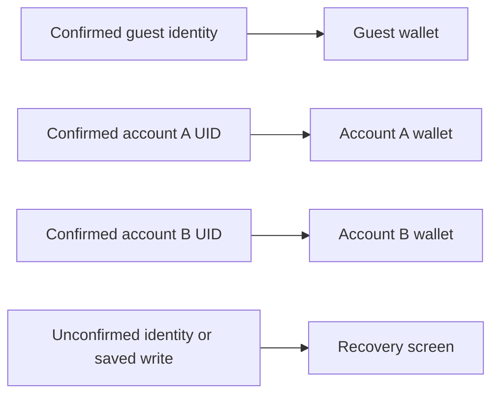

# Guest and local account access

The app has one guest wallet and a separate wallet for each local demo account on this device. Sign-in selects a wallet; it does not upload financial records or copy the guest wallet into the account. Registration, sign-in and password reset use a Windows-hosted Firebase Auth emulator for the fixed `demo-fyp-local` project. No production Firebase project is configured.

## What is kept where

| Information | Storage and purpose |
| --- | --- |
| Guest transactions, budgets, goal and achievements | The existing device-local guest store, with earlier migration bytes preserved |
| Each account's financial records | A separate device-local store identified by the exact account UID and storage scope |
| Transaction photos and local reminders | Bound to the same account family and wallet incarnation; earlier owners cannot publish into a newly selected wallet |
| Email, password credentials and display name | The local Auth emulator; a verified export/import preserves its accounts across helper restarts |
| Saved SDK session | Device AsyncStorage under an isolated scope; checked against the SDK's actual identity before opening financial content |
| Optional gender and birthday | That account's local profile on the device; initially unset and not inferred from other information |

The app does not add its own encryption layer to AsyncStorage or its local financial files. Android backup is disabled in the native configuration. The Auth emulator and its exports are development tools; use synthetic identities and passwords that are not reused elsewhere. Production authentication and cross-device synchronization require a separate design and verification scope.

## Use the account screen

Open Wallet → Account. With account mode disabled, the screen identifies the guest wallet and explains that the local account service is not configured. Guest financial features remain available.

With local account mode enabled, register using an email, password and display name, or sign in to an existing local account. A newly encountered account starts with its own empty wallet. If account creation succeeds but its display name cannot be confirmed, the account remains available and Profile offers an explicit name retry. No demographic field is filled automatically.

Sign out to reopen the guest wallet. Signing out does not delete an account's wallet. Signing back into the same UID selects its previous records on this device. Removing and recreating an emulator account normally gives it a new UID, so reusing the same email does not identify the old wallet. Preserve the emulator export when you need the original account identity.

Before an identity change, the app blocks new financial writes, waits for owned photo operations and cancels or pauses the previous owner's reminders. It refuses the change while an editor or unconfirmed financial write needs attention. Exports close, and financial content stays hidden until the SDK identity, saved session and exact target wallet are confirmed. A previous account's balance is never used as a loading placeholder for another account.

If a recheck hides an unfinished editor, an explicit Discard transaction draft and recheck action remains reachable outside the financial screen. This discards unsaved form edits only. A failed or uncertain saved operation instead requires Check saved session; the app reads the actual stored result and does not automatically repeat registration, login or financial writes. A restart-required state means that the SDK's saved identity could not be safely reconciled in the current process. Restarting is a recovery step, not permission to clear app data.

## Local password reset

Choose Local password reset from Account. Enter the demo account email and request a local reset message. Only that requested address's new message is offered in the local inbox. Open and verify the message, then enter matching new passwords and explicitly confirm.

**No email is delivered.** The reset code remains inside the reset controller and does not appear in the UI, logs, financial records or exported reports. A consumed or invalid message cannot reset another password. If requesting or confirming a reset has an uncertain outcome, follow the displayed inbox/recheck guidance; another request is not silently sent. Closing the reset view cancels its pending inbox read and releases that view's operation gate.

## Optional developer setup

Guest mode needs no Auth process. For local accounts, use the separately pinned [Auth emulator helper](../tools/auth-emulator/README.md), whose installation is independent of the app's Firebase SDK dependency. Its exact version, package installation review, loopback ports, export/import checks and ownership rules are documented there. Keep its `.runtime` directory and exports ignored.

The helper's normal sequence, from `tools/auth-emulator`, is:

```powershell
npm.cmd ci --ignore-scripts --no-audit --no-fund
python run_auth.py --run-name learning-001 --node "C:\path\to\node.exe"
```

Use an installed Node24 executable. The helper refuses occupied Auth/hub/logging ports or another owner lock. Keep its terminal running. From another terminal in that tool folder, explicitly export or stop:

```powershell
python control.py export --run-name learning-001
python control.py stop --run-name learning-001
```

A normal stop confirms a new Auth-only snapshot and its integrity before stopping the owned service. If export fails, the running service is retained. Start again with a new run name to import the last confirmed snapshot. An abnormal owner lock or uncertain export is retained for inspection; do not delete it merely to force an empty service to start.

In the app's Metro terminal, enable local account mode before starting a new server:

```powershell
$env:EXPO_PUBLIC_LOCAL_AUTH_EMULATOR = '1'
npm.cmd run android -- --project-app
```

Changing this flag requires restarting the selected development server. The runtime connects Auth to `http://127.0.0.1:9099` synchronously before its first awaited initialization step. For an Android emulator, configure `adb -s <emulator-serial> reverse tcp:9099 tcp:9099` for that verified target; the ordinary app launcher forwards Metro's 8081 port, not Auth's 9099 port. The helper binds its service to loopback and never logs into a cloud Firebase account.

The public helper's real 12-check lifecycle gate passed separately from the 18 recorded Android account checks. It verified empty and populated export/import, two synthetic accounts retaining their UIDs/profiles/password access, and three owned graceful shutdowns with final listeners clear. [Verification](../VERIFICATION.md) records the exact fixture scope and platform limits. The app's working guest mode does not by itself establish that optional account mode or the emulator is running.

## Worked example

Suppose the guest wallet has RM40.00, account A records RM12.50 and account B records RM80.00. Moving among Guest, A and B should show those three separate balances, including after an app restart. Editing A must not change either other wallet. A rejected sign-in must return only to an identity whose SDK persistence and financial store were confirmed; it must not show a blank replacement wallet.



Exercise: the guest has a saved budget and photo. Register account A, then sign out. Where should those items appear?

Answer: the new account begins with its own empty wallet, and the guest budget/photo appear again only when the confirmed guest wallet is reopened. There is no automatic transfer. The original owned photo remains protected by retained-reference checks; account changes do not delete it merely because it is not visible in the newly selected wallet.
