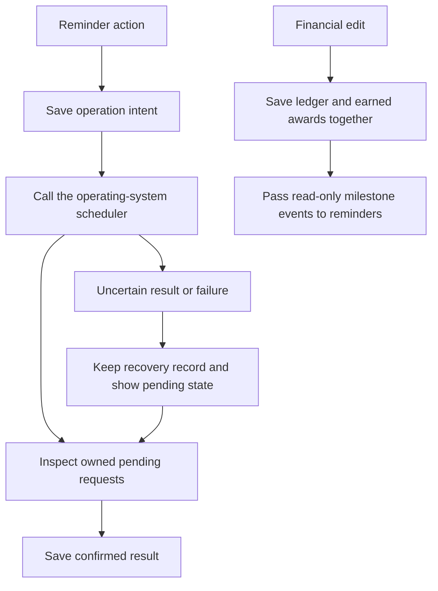

# Recorded milestones and local reminders

Open Wallet, then Achievements or Reminders. Achievements describe activity in this wallet's recorded data. Reminders ask the operating system to show a one-off notification. Neither feature invents transactions or changes a financial total.

## What each achievement means

| Badge | Rule |
| --- | --- |
| First Budget | Create a category budget. |
| First Transaction | Record an entry dated today or earlier. |
| Weekly Saver | Record activity on seven consecutive completed dates, with positive combined income minus expenses and debt payments. |
| Budget Master | Have at least one monthly budget in a completed month, stay within every monthly budget for that month, and have matching recorded spending. |
| Expense Tracker | Record expenses on five consecutive transaction dates. |
| Consistent Tracker | Record any transaction type on seven consecutive transaction dates. |
| Savings Goal Achiever | Reach the saved target using the balance of entries dated through today. |
| No Spend Day | Explicitly confirm a completed day since tracking began, with no recorded expense or debt payment that day. |
| Category Guru | Use six distinct category identities in transactions dated through today. Renaming one category still counts as one. |
| Review Expert | Explicitly complete a review in four consecutive Monday–Sunday weeks. |

Future-dated records do not earn these badges. Recorded-date streaks can include entries entered later; they are not login streaks. Goal qualification excludes future records even though the ordinary wallet balance includes every recorded date. A completed monthly budget can be recognized from currently recorded plans; the app does not claim to know when an old plan was first made.

A badge is earned only after its award is saved. It retains its original observation date, rule version, and supporting evidence, even if those transactions are later edited or deleted. The current rule's progress may therefore differ from a historical earned award. Sample wallets show preview progress and cannot save real awards, check-ins, or weekly reviews. Recheck milestones retries a pending update against saved records.

## Explicit confirmation and review

No Spend Day requires a completed date before today and on or after this wallet's tracking start. An empty wallet does not establish that a person spent nothing. Income is allowed on that date; expenses and debt payments prevent confirmation.

The weekly review presents expenses and debt payments from Monday through the displayed date. It also lists budgets intersecting that week. Each budget row uses its own full budget period through the displayed date; a monthly budget is not divided into an invented weekly allowance. Complete review records those facts once for the current week. Reopening the screen does not add another review, and the form does not let a user backdate four reviews at once.

For example, seven completed dates each containing RM100 income and RM10 expense have a combined RM630 positive cash flow. They qualify for Weekly Saver, Expense Tracker, and Consistent Tracker. Seven entries on one date do not qualify for the date streaks. Add RM700 debt repayment within the same seven-day window before an award is earned, and the negative net prevents Weekly Saver.

## Reminder timing and permissions

A reminder contains a title, message, and delay. The delay must be a whole number of seconds from 1 through 31,536,000. The app converts it to one absolute date/time when submitted. Restarting the app does not restart the countdown, and changing timezone does not change that saved instant.

Enable notifications explicitly. If permission or the Android notification channel is disabled, the app keeps the draft and shows the problem. Financial recording remains available. Scheduling is best effort: a successful request is different from an observed notification, and battery policies or operating-system settings can delay presentation. A past reminder is labelled as elapsed rather than assumed delivered.

Editing schedules a replacement before cancelling the old request. Deleting cancels the owned pending requests before removing the row. Pending or uncertain operations remain visible with recovery actions. Removing a future schedule does not claim to dismiss a notification that has already appeared.

Automatic budget, goal, and achievement notices are separate opt-in choices. Enabling them records the current baseline so historical achievements do not produce a notification burst. Later saved threshold crossings are deduplicated by budget period, goal target, or award identity. These are changes observed while the app processes records; there is no promised closed-app financial monitoring service.

## Why reminders have a separate store

The phone's notification scheduler and local storage cannot perform one shared atomic transaction. The app therefore saves its intent before calling the scheduler, retains identifiers and operation stages, and reconciles uncertain results. Its reminder coordinator cannot write a financial ledger snapshot. A delayed scheduling result cannot replace a transaction saved in the meantime.

Every wallet creation has a new incarnation identity, distinct from its familiar name or logical wallet ID. Start fresh first pauses and drains the old reminder work and cancels its pending requests. Only then does it save the new empty wallet. If that write reports an error, the app reads the actual active saved data before restoring old reminders. If the outcome cannot be read, it blocks further financial edits until saved data can be reopened.

Schema v4 preserves the earlier v3, v2, and original preview stores byte for byte during migration. Tracking starts when this version creates or migrates the wallet, without fabricating past check-ins. Starting fresh clears the active wallet's transactions, plans, goal, awards, check-ins, and reviews; an old reminder cannot silently acquire the new wallet's identity.

## Try it

Start with an empty local wallet. Add one transaction dated today and inspect First Transaction. Reopen the app: the earned time should remain the same. Delete that transaction: the historical award should remain, while the current qualification can change. Set a short reminder, observe its notification, then create a later reminder and delete it before its time.

Question: if saving reminder metadata fails after the operating system accepted a request, should Retry blindly schedule another copy? No. It should inspect the owned candidate first and recover its recorded intent. The focused fault tests exercise that distinction; the verification record separately describes actual native behaviour and platform limits.

Local notification behaviour follows the [Expo SDK 58 notification API](https://docs.expo.dev/versions/v58.0.0/sdk/notifications/). This implementation does not request remote push tokens.

## Completed verification

The branch's 244 automated checks cover the application and launcher, including failed writes, write-then-throw readback, uncertain scheduler results, remount races, retained reminder ownership, full event-history limits, and supported calendar boundaries. TypeScript checks the active app. Review findings were fixed before the branch checkpoint.

On the owned API 35 Android emulator, seven achievement checks verified all ten rules, explicit confirmations, saved evidence, restart persistence, and retained awards after financial edits. Three permission checks in the installed project APK exercised denial and recovery. Six manual-reminder checks verified an actual Android notification, editing, ordinary process restart, deletion, and unchanged financial totals. Five further checks verified an opt-in budget crossing, an actual automatic notification, cancellation before wallet replacement, and the new wallet's empty persisted finances and reminder history.

Three debug-app checks verified the localhost Metro launcher, explicitly labelled sample progress, persisted sample records after restart, and the usable notification runtime at font scale 1.3. The final Expo Go UI check verified the capability explanation, disabled scheduling, and absence of futile permission/settings actions. These are x86_64 emulator builds signed with a local template debug key, not distributable production releases. The release test APK contained an isolated synthetic fixture; the debug APK loads the selected Metro namespace. iOS, physical-device power policies, remote push, and closed-app financial monitoring have not been verified.
