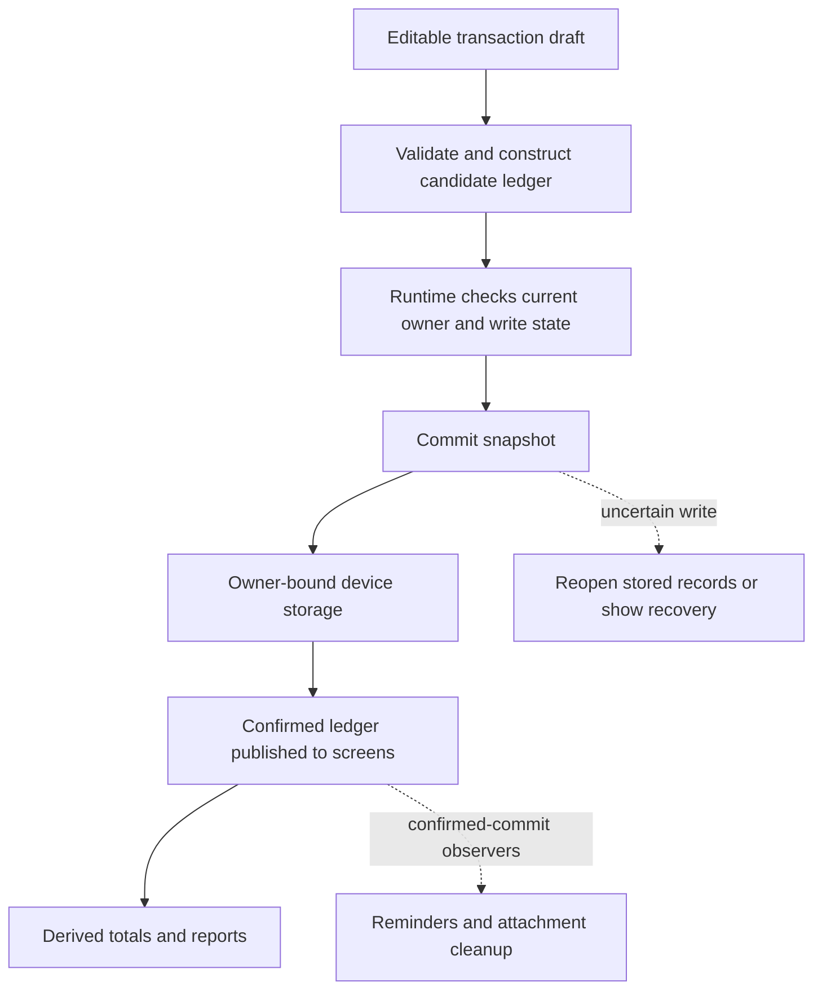

# Architecture and a practical reading path

My Money Management is a React Native application with a device-local financial ledger. Its main screens are Activity, Plan, Reports, and Wallet. A normal first launch creates an empty wallet. Demonstration records require an explicitly selected isolated scenario; existing saved records take precedence over any initial-data factory.

Start with one transaction rather than reading every feature at once. The important boundary is between a draft, a validated candidate, confirmed saved records, and optional work performed afterward.

## Module map

| Location                                                                                                                                               | Responsibility                                                                                                                                   |
| ------------------------------------------------------------------------------------------------------------------------------------------------------ | ------------------------------------------------------------------------------------------------------------------------------------------------ |
| [`App.tsx`](../App.tsx)                                                                                                                                | Connect the active account, ledger, main screens, editors, and feature panels.                                                                   |
| [`src/ui/`](../src/ui)                                                                                                                                 | React Native screens, shared controls, formatting, and hooks that bind user actions to the application runtime.                                  |
| [`src/core/model.js`](../src/core/model.js)                                                                                                            | Validate wallets, currencies, categories, dates, amounts, transactions, budgets, and goals; construct updated ledger values.                     |
| [`src/core/`](../src/core)                                                                                                                             | Financial reports, illustrative score, simulator calculations, loan schedules, forecasts, receipt parsing, exports, and achievement rules.       |
| [`src/ui/ledgerRuntime.js`](../src/ui/ledgerRuntime.js)                                                                                                | Coordinate the current ledger, writes, restore, ownership transitions, recovery state, and subscribers.                                          |
| [`src/core/commitLedger.js`](../src/core/commitLedger.js) and [`storage.js`](../src/core/storage.js)                                                   | Persist validated snapshots, resolve uncertain writes, and migrate supported older formats without replacing their source records.               |
| [`src/accounts/`](../src/accounts)                                                                                                                     | Account sessions, owner-specific storage, profiles, and coordination between account changes and financial operations.                           |
| [`src/cloud/`](../src/cloud) and [`tools/firebase-backup/`](../tools/firebase-backup)                                                                  | Explicit Firebase configuration, project-aware snapshots, pending operations, SDK ports, native photo staging, access rules and emulator checks. |
| [`src/attachments/`](../src/attachments), [`src/reminders/`](../src/reminders), and [`src/exports/`](../src/exports)                                   | Native files, notifications, and PDF operations with explicit ownership and failure handling.                                                    |
| [`src/receipts/`](../src/receipts), [`src/assistant/`](../src/assistant), [`src/forecast/`](../src/forecast), and [`src/companion/`](../src/companion) | Provider transports, selected context, response checks, and the private local-service connection.                                                |
| [`scripts/companion/`](../scripts/companion), [`tools/forecast/`](../tools/forecast), and [`tools/auth-emulator/`](../tools/auth-emulator)             | Optional Windows services; these are separate processes from the mobile app.                                                                     |
| [`tests/`](../tests) and [`src/verification/`](../src/verification)                                                                                    | Automated checks and explicitly isolated synthetic scenarios.                                                                                    |

Many financial modules use JavaScript with adjacent TypeScript declarations. The declarations describe their public interfaces to the typed UI, while Node tests can load the JavaScript directly. Changing a module's public contract means reviewing both files and its callers.

## Follow an ordinary expense

Suppose the wallet is MYR and the user enters “Lunch,” `12.50`, a valid date, and a Food category in [`TransactionEditor.tsx`](../src/ui/TransactionEditor.tsx).

1. The editor holds an editable draft. Typing has not saved anything. `transactionFromDraft` checks the inputs against the wallet and produces a transaction with an integer amount of **1,250 minor units**. Currency precision is explicit: MYR uses sen; JPY uses whole yen. Invalid input does not become a financial record.
2. `saveTransaction` constructs a candidate ledger. It does not write storage. Creation and editing remain distinct operations, with checks for missing or duplicate transaction identifiers.
3. The editor calls the save function supplied through [`useLedger.ts`](../src/ui/useLedger.ts). The runtime confirms that the callback still belongs to the current owner and binding, rejects overlapping or uncertain operations, and evaluates achievement changes against the candidate.
4. `commitLedger` validates and captures the previous and proposed snapshots, then asks the bound storage adapter to save. The underlying adapter uses AsyncStorage. Writes and retained-photo-reference checks share a per-key queue.
5. Only the confirmed result is published to subscribed screens. If storage reports failure, the commit logic reopens the current saved value. It can confirm a write that actually completed, restore the observed records, or block further changes when the outcome remains unknown.
6. After a confirmed commit, observers may update reminders or attachment cleanup. A failed follow-up is reported separately; it does not pretend that the already saved financial transaction disappeared.

Reports derive their values from recorded transactions. A selected period's closing balance and the wallet balance across all dates can legitimately differ. Keep those meanings distinct when changing the UI; see [Financial reports](FINANCIAL_REPORTS.md) for the calculation and worked example.

## Ownership and restoration

A data family combines the local/test scope with the guest or account identity. A wallet incarnation distinguishes a newly created wallet from the earlier wallet under that family. Storage, reminder ownership, attachment operations, and open feature sessions use these boundaries for different purposes; a filename or visible account label alone is not proof of ownership.

Account changes pause financial operations while the coordinator confirms the session and target wallet. The financial bridge closes old editors/exports and coordinates outstanding photo and reminder work. An unreadable store is a recovery condition, not permission to seed replacement records. [Account access](ACCOUNT_ACCESS.md) explains the user-visible behavior.

## Explicit Firebase backup and restore

Configured Firebase accounts use a project-plus-UID actor in a separate identity format. Existing guest, test-scope and Auth-emulator tokens retain their old encodings. Signing in still selects a separate device-local wallet. It does not upload records or copy the guest wallet.

[`backupCoordinator.js`](../src/cloud/backupCoordinator.js) captures a source snapshot for preview, then checks the current owner and source again on confirmation. [`pendingJournal.js`](../src/cloud/pendingJournal.js) serializes durable intent operations per storage key, refuses a new operation while existing intent is unresolved, and preserves one backup ID across retries. A write/read failure never means that the journal is empty. Discard acknowledgement belongs to the exact pending operation.

[`backupFormat.js`](../src/cloud/backupFormat.js) projects a strict supported financial schema and strips device photo references. [`transport.js`](../src/cloud/transport.js) uploads selected content-addressed photos and a hashed snapshot before publishing the immutable Firestore index. On retry, a matching index is insufficient: the snapshot and photo bytes are read and checked. The separate rules restrict each namespace to its authenticated owner; a client query is not access control.

Guest copy and cloud restore stage optional photos under a fresh wallet incarnation, then use the ledger runtime's owner-and-snapshot compare-and-save boundary. The target must remain empty and exactly unchanged. The guest source is preserved. Cleanup warnings are kept separate from an already confirmed financial save. Synchronous owner checks hide a previous owner's preview, pending summary and backup list before React effects run.

The [Firebase setup guide](../tools/firebase-backup/README.md) documents emulator commands, own-project configuration, manual rule deployment, exclusions and remaining verification limits. There is no automatic synchronization, cloud merge, populated-wallet replacement or in-app remote-backup deletion.

## Local services and other providers

Core calculations and ledger persistence do not call OCR or a language model. Receipt recognition returns suggestions for review; only explicit expense confirmation saves money data. The assistant receives selected calculated facts and the current question, and cannot edit the ledger. Prophet receives completed monthly expense totals, dates and currency, and cannot save estimates as transactions.

The optional Auth-only emulator remains separate from the configured Firebase backup path above. Recognition, explanations and Prophet use a paired Windows companion. Version 2 pairing advertises an explicit descriptor for each selected capability: Windows OCR or Google Cloud Vision, local Lemonade/Qwen or OpenAI, and optional local Prophet. A null capability is disabled. The mobile transport stays on its fixed paired loopback endpoint; changing that URL is not how a cloud provider is selected.

[`providerContract.js`](../src/companion/providerContract.js) binds a request to its run, capability and provider descriptor. The companion checks this binding before forwarding work, then echoes it in successful responses. Mobile clients validate the echo and actual provider provenance. Provider, connection, owner or captured-context changes retire outstanding work; the live financial-owner check also covers changes before a child component rerenders. Services never receive a ledger writer.

The [companion owner](../scripts/companion/README.md) loads explicitly selected private configuration. OpenAI and Vision credentials remain in the Windows process and are excluded from pairing data and the mobile bundle. The mobile panels disclose the destination before the user requests work. There is no automatic cloud fallback, background request or automatic retry. Cancellation discards stale cloud responses but cannot promise that an external provider stopped processing or avoided charging.

The [Prophet service](../tools/forecast/README.md) starts under the same owner only when selected. An authenticated loopback Node route forwards bounded monthly input to Flask. Each fit runs in an owned Windows Job with a computation deadline; cancellation and shutdown confirm owned-process cleanup before accepting more work. The forecast panel keeps its device calculation visible and requests a separate Prophet comparison only on explicit action. Its device-baseline historical error is not a Prophet accuracy score; common-fold model evaluation is a separate command.

Completed API 35 Android checks exercised real Windows OCR and the owned local Flask/Prophet path with synthetic inputs, including all six displayed forecast values and unchanged financial records. OpenAI and Vision passed native interaction checks with injected upstream responses and external provider networking blocked; Firebase account, backup and photo-restore checks used isolated Auth/Firestore/Storage emulators. These results complement the adapter, route, client and UI tests. Hosted cloud authentication, live provider/model compatibility, general recognition or answer quality, and billing behavior remain unverified. [Original service integrations](ORIGINAL_SERVICE_INTEGRATIONS.md) explains the boundaries, and [Verification](../VERIFICATION.md) records the current evidence. The existing device forecast is described in [Monthly forecast](MONTHLY_FORECAST.md).

## Tests and a reading exercise

Begin with `tests/core-model.test.cjs` for financial validation, `tests/commit-ledger.test.cjs` for uncertain saves, and `tests/account-storage.test.cjs` for account isolation. Then follow the feature-specific tests and guides. Hook/component tests use controlled hosts; native rendering, permissions, actual services, and operating-system behavior still need their separate checks. See [Verification](../VERIFICATION.md) and [Android setup](ANDROID_SETUP.md).

Exercise: the wallet contains RM500. An RM12.50 expense is written, but the storage promise rejects afterward. Should the UI keep RM500 and automatically create the expense again?

Answer: inspect `commitLedger`. It reads the current store before deciding. If the saved snapshot exactly matches the candidate, it confirms that one expense and publishes RM487.50. If saved data cannot be read reliably, it blocks further writes and asks for recovery. An exception alone does not establish that a write failed, and blindly repeating it can duplicate money records.
