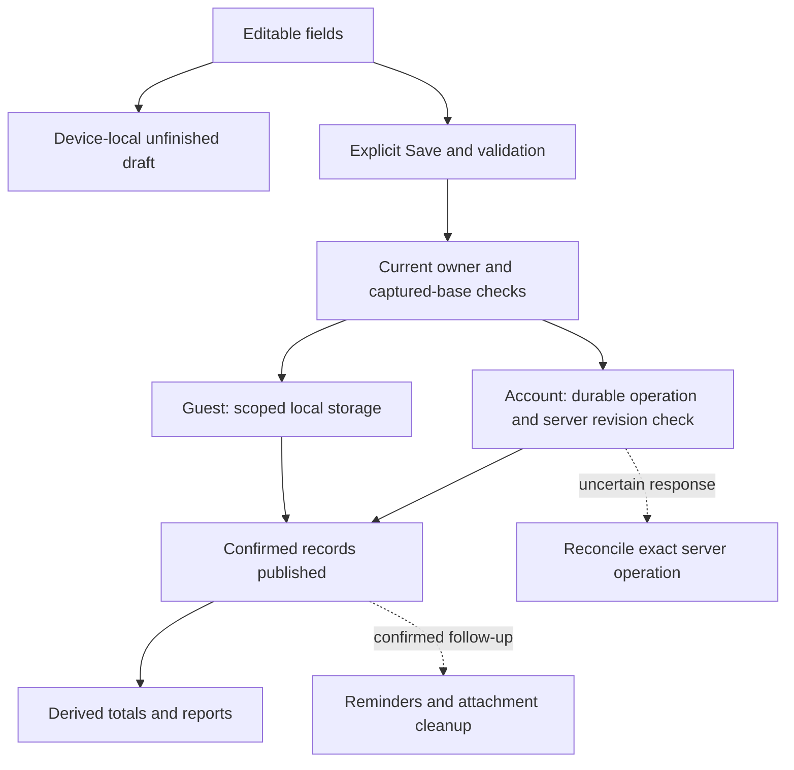

# Architecture and a practical reading path

My Money Management uses React Native/Expo for its Activity, Plan, Reports and Wallet screens. Guest records stay on the device. Configured accounts use Firebase Auth, Firestore for everyday financial records and Firebase Storage for attachments. A separately deployable, authenticated backend connects the app to OpenAI, Google Cloud Vision and Flask/Prophet. Optional Windows helpers support local use.

The save flow below follows one expense through form editing, validation, storage confirmation and cleanup. These steps keep unfinished text and proposed changes separate from saved records. First launch creates an empty guest wallet. Synthetic demonstration history runs only in an explicitly isolated scenario and preserves existing supported records.

## Module map

| Location                                                                                                                                                                          | Responsibility                                                                                                         |
| --------------------------------------------------------------------------------------------------------------------------------------------------------------------------------- | ---------------------------------------------------------------------------------------------------------------------- |
| [`App.tsx`](../App.tsx), [`src/ui/`](../src/ui)                                                                                                                                   | Bind the active account/ledger, screens, editors, service panels and live appearance                                   |
| [`src/core/model.js`](../src/core/model.js), [`src/core/`](../src/core)                                                                                                           | Validate money/calendar/reference rules and calculate reports, budgets, goals, simulations, schedules and projections  |
| [`src/ui/ledgerRuntime.js`](../src/ui/ledgerRuntime.js), [`commitLedger.js`](../src/core/commitLedger.js)                                                                         | Current binding, serialized financial operations, confirmed publication, owner transitions and uncertain-save recovery |
| [`src/core/storage.js`](../src/core/storage.js), [`src/accounts/familyStorage.js`](../src/accounts/familyStorage.js)                                                              | Scoped local stores and source-preserving migration                                                                    |
| [`src/accounts/`](../src/accounts)                                                                                                                                                | Auth persistence, project/UID identity, profile state and financial account leases                                     |
| [`src/cloud/everydayStore.js`](../src/cloud/everydayStore.js), [`everydayController.js`](../src/cloud/everydayController.js), [`firebasePorts.ts`](../src/cloud/firebasePorts.ts) | Everyday cloud cache, durable operation journal, server revision checks, explicit copy and recovery                    |
| [`src/cloud/backupCoordinator.js`](../src/cloud/backupCoordinator.js), [`backupFormat.js`](../src/cloud/backupFormat.js), [`transport.js`](../src/cloud/transport.js)             | Separate explicit recovery snapshots, selected photos and empty-target restore                                         |
| [`src/drafts/`](../src/drafts)                                                                                                                                                    | Local transaction/budget/goal text drafts with explicit recovery and generation checks                                 |
| [`src/attachments/`](../src/attachments), [`src/reminders/`](../src/reminders), [`src/exports/`](../src/exports)                                                                  | Owned files, local schedules and PDF/QR operations                                                                     |
| [`src/assistant/`](../src/assistant), [`src/receipts/`](../src/receipts), [`src/forecast/`](../src/forecast)                                                                      | Selected model context, local conversation history, recognition review and provider-response validation                |
| [`src/services/`](../src/services), [`tools/backend/`](../tools/backend)                                                                                                          | Authenticated hosted-service client, gateway, quota/request identity and portable Prophet supervision                  |
| [`src/companion/`](../src/companion), [`scripts/companion/`](../scripts/companion)                                                                                                | Optional private Windows pairing and local provider lifecycle                                                          |
| [`tools/firebase-backup/`](../tools/firebase-backup), [`tools/auth-emulator/`](../tools/auth-emulator), [`tools/forecast/`](../tools/forecast)                                    | Firebase rules/emulator verification, optional Auth-only helper and forecast core/evaluation                           |
| [`tests/`](../tests), [`src/verification/`](../src/verification)                                                                                                                  | Automated checks and deliberately isolated synthetic scenarios                                                         |

Many pure modules are JavaScript files with TypeScript declarations beside them. The UI uses those declarations, and Node tests load the same JavaScript. Check callers and declarations together when a public contract changes.

## Follow an ordinary expense

Suppose the wallet is MYR and the user enters Lunch, `12.50`, a valid date and a Food category.

1. The editor keeps changed fields in a scoped local draft. Typing does not create a transaction. `transactionFromDraft` validates the input and converts the amount to 1,250 minor units. MYR uses sen; JPY uses whole yen.
2. `saveTransaction` builds a proposed ledger in memory. New-entry and edit paths have separate checks for duplicate or missing identifiers. Preparing optional context or photos does not change the validated amount.
3. The form rechecks the financial state it captured before calling the save function supplied by [`useLedger.ts`](../src/ui/useLedger.ts). The runtime checks the owner/binding, rejects overlapping or uncertain operations and reconciles achievement evidence.
4. `commitLedger` captures the previous and proposed ledgers. Guest/local accounts save through the bound AsyncStorage adapter. Configured Firebase accounts call `saveWithExpected`, which durably records the operation locally before a server transaction checks the expected revision and hash.
5. Screens receive the saved records after confirmation. Following a local write error, the adapter reads back the stored value. An uncertain cloud save requires reconciliation with the server record and operation receipt; the proposed local cache cannot confirm that the server accepted it.
6. After a confirmed commit, observers update reminders or clean up owned files. Errors in that follow-up are reported separately from the financial save. Draft cleanup clears only the matching form-draft generation.

Reports calculate values from transactions. The selected period's closing balance can differ from the all-dates wallet balance; [Financial reports](FINANCIAL_REPORTS.md) defines both.

## Ownership, drafts and restoration

A data family identifies both the local/test scope and the guest or account. Configured accounts include the Firebase project and UID. A wallet incarnation identifies one lifetime of a wallet within that family. The runtime also tracks binding/session generations so old callbacks stay invalid even if the same account and wallet return. A matching display name or balance does not make an old operation current.

Before changing identity, the account coordinator acquires a financial lease. Its bridge closes old editors and exports, coordinates photos and reminders, and validates the saved target before opening it. If the store is unreadable, the app stays in recovery and preserves the existing records. [Account access](ACCOUNT_ACCESS.md) describes the recovery controls.

Form drafts have their own scoped keys and exact revision checks. They hold incomplete fields for Resume/Discard without saving financial records, and compare their captured base with the current records. Revisioned empty markers prevent old callbacks from recreating a discarded draft. Newly picked photo URIs are not durable draft attachments, so recovery asks the user to select the photo again while preserving ownership of existing managed photos.

## Everyday Firebase storage

[`everydayFormat.js`](../src/cloud/everydayFormat.js) checks the versioned ledger payload and photo manifest against a strict format. It supports up to 768 KiB and 100 attached photos. The format differs from the original per-feature collections; both serve everyday cloud storage.

The store keeps the confirmed cache separate from unsubmitted, submitted and conflicted operations. Reads use the server-only SDK path. Before a financial server transaction, the store records the intended save locally. Immutable receipts identify completed operations. If another device changes the expected revision, the store keeps the stale candidate as a conflict and preserves the newer record. Offline access shows the last confirmed records; automatic offline synchronization and merging are not implemented.

Cloud Wallet previews a guest or earlier account-local wallet before copying it. Copying requires explicit confirmation and an unchanged empty cloud target; the source records are retained. Preparation depends on the account session, financial binding and identity-transition state, so returning to the same UID cannot revive an earlier confirmation.

The store uploads attached photos and checks their integrity before confirming the financial record. Downloaded photos become managed local files only after manifest/hash checks. Cleanup preserves files referenced by the cache, pending operations or legacy records. Owner retirement is handled separately from an ordinary missing-photo warning. The app does not automatically remove remote orphan photos.

## Separate recovery backups

[`backupCoordinator.js`](../src/cloud/backupCoordinator.js) captures snapshots for explicit preview. Its pending journal keeps the same backup ID through interrupted uploads and retries. It uploads the selected content-addressed photos and snapshot bytes before writing the immutable Firestore index. Verification checks the bytes and hashes even when the index matches.

Restore stages selected photos under fresh wallet ownership, then uses the current owner and exact empty target for compare-and-save. Confirming a restore to a live Firebase wallet performs a cloud save. Guest copying preserves the source, and Cloud Wallet shows the upload destination. Backup/restore excludes authentication, profile extras, conversations, notification schedules and exports.

[Firebase setup](../tools/firebase-backup/README.md) covers the rules, prerequisites for an owner's project, emulators and recovery. Firestore/Storage rules enforce owner-scoped access outside the mobile client. Hosted Storage has its own billing prerequisite; local emulators use a separate setup.

## Hosted original providers and optional local tools

The [backend](../tools/backend/README.md) verifies Firebase ID tokens and checks that metadata and requests match the project, account, service and provider. Persistent quotas and request identities limit deliberate retries. Provider keys stay on the server; the mobile app's public configuration supplies an exact origin and project identity. The backend does not store the user's ledger, photos or conversation history.

An assistant request contains calculated summaries, the current question and at most the latest three exchanges in that conversation. Earlier answers provide context and are not verified financial facts. Local history holds up to 20 conversations with the latest 12 exchanges each. Receipt recognition sends one selected image after an explicit request and returns suggestions for review. Prophet receives completed monthly expense totals and returns six estimates. These service requests cannot save financial records.

Each private Prophet fit gets its own internal gateway ID, preventing different users from addressing the same worker through a shared external request ID. Windows fits use owned Jobs. The Linux worker source uses owned groups, a guardian and resource bounds. The interface shows the requested processing route and model limitations.

Cancelling a provider request and cleaning up local work are separate operations. OpenAI/Vision adapters track the underlying transport and response-body retirement. An unconfirmed drain stops the gateway from accepting more work. This does not establish that the remote provider reversed completed processing or avoided a charge.

The [Windows companion](../scripts/companion/README.md) provides an explicitly selected route for Qwen, Windows OCR, local Prophet or development use of cloud adapters. Its private pairing contract is separate from hosted Firebase authentication. Hosted failures do not fall back to the companion, and local failures do not silently select a paid provider.

## Verification and reading exercise

The [core-model tests](../tests/core-model.test.cjs), [commit tests](../tests/commit-ledger.test.cjs), [everyday-store tests](../tests/cloud-everyday-store.test.cjs) and [draft tests](../tests/transaction-editor-drafts.test.cjs) cover the flow described here. For other features, read the relevant guide alongside its tests. Controlled hook hosts do not establish native rendering, permissions, provider availability or operating-system behavior.

[Verification](../VERIFICATION.md) records completed checks and their evidence. It distinguishes local Windows Prophet execution, emulated Firebase operations and injected OpenAI/Vision responses. Live OpenAI/Vision, hosted deployment and native Linux/container execution remain unverified.

For a recovery example, a wallet has RM500 when a Save for a RM12.50 expense is sent and its response is lost. The UI must not automatically submit another expense. The local adapter reads back the stored value; the cloud adapter checks the retained operation and server receipt. A matching confirmed result publishes RM487.50 once. If the outcome remains unresolved, another financial write stays blocked while recovery remains available. An exception alone does not establish that the first write failed.
