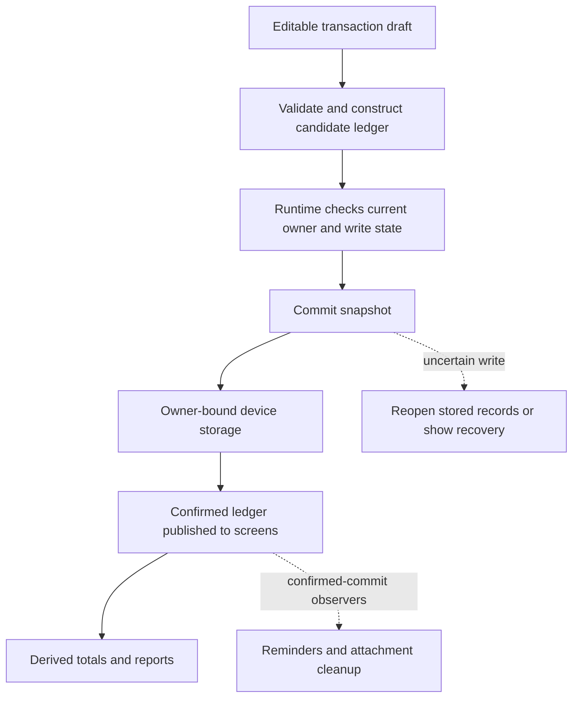

# Architecture and a practical reading path

My Money Management is a React Native application with a device-local financial ledger. Its main screens are Activity, Plan, Reports, and Wallet. A normal first launch creates an empty wallet. Demonstration records require an explicitly selected isolated scenario; existing saved records take precedence over any initial-data factory.

Start with one transaction rather than reading every feature at once. The important boundary is between a draft, a validated candidate, confirmed saved records, and optional work performed afterward.

## Module map

| Location                                                                                                             | Responsibility                                                                                                                             |
| -------------------------------------------------------------------------------------------------------------------- | ------------------------------------------------------------------------------------------------------------------------------------------ |
| [`App.tsx`](../App.tsx)                                                                                              | Connect the active account, ledger, main screens, editors, and feature panels.                                                             |
| [`src/ui/`](../src/ui)                                                                                               | React Native screens, shared controls, formatting, and hooks that bind user actions to the application runtime.                            |
| [`src/core/model.js`](../src/core/model.js)                                                                          | Validate wallets, currencies, categories, dates, amounts, transactions, budgets, and goals; construct updated ledger values.               |
| [`src/core/`](../src/core)                                                                                           | Financial reports, illustrative score, simulator calculations, loan schedules, forecasts, receipt parsing, exports, and achievement rules. |
| [`src/ui/ledgerRuntime.js`](../src/ui/ledgerRuntime.js)                                                              | Coordinate the current ledger, writes, restore, ownership transitions, recovery state, and subscribers.                                    |
| [`src/core/commitLedger.js`](../src/core/commitLedger.js) and [`storage.js`](../src/core/storage.js)                 | Persist validated snapshots, resolve uncertain writes, and migrate supported older formats without replacing their source records.         |
| [`src/accounts/`](../src/accounts)                                                                                   | Account sessions, owner-specific storage, profiles, and coordination between account changes and financial operations.                     |
| [`src/attachments/`](../src/attachments), [`src/reminders/`](../src/reminders), and [`src/exports/`](../src/exports) | Native files, notifications, and PDF operations with explicit ownership and failure handling.                                              |
| [`src/receipts/`](../src/receipts), [`src/assistant/`](../src/assistant), and [`src/companion/`](../src/companion)   | Recognition/explanation transport, selected context, response checks, and the private local-service connection.                            |
| [`scripts/companion/`](../scripts/companion) and [`tools/auth-emulator/`](../tools/auth-emulator)                    | Optional Windows services; these are separate processes from the mobile app.                                                               |
| [`tests/`](../tests) and [`src/verification/`](../src/verification)                                                  | Automated checks and explicitly isolated synthetic scenarios.                                                                              |

Many financial modules use JavaScript with adjacent TypeScript declarations. The declarations describe their public interfaces to the typed UI, while Node tests can load the JavaScript directly. Changing a module's public contract means reviewing both files and its callers.

## Follow an ordinary expense

Suppose the wallet is MYR and the user enters “Lunch,” `12.50`, a valid date, and a Food category in [`TransactionEditor.tsx`](../src/ui/TransactionEditor.tsx).

1. The editor holds an editable draft. Typing has not saved anything. `transactionFromDraft` checks the inputs against the wallet and produces a transaction with an integer amount of **1,250 minor units**. Currency precision is explicit: MYR uses sen; JPY uses whole yen. Invalid input does not become a financial record.
2. `saveTransaction` constructs a candidate ledger. It does not write storage. Creation and editing remain distinct operations, with checks for missing or duplicate transaction identifiers.
3. The editor calls the save function supplied through [`useLedger.ts`](../src/ui/useLedger.ts). The runtime confirms that the callback still belongs to the current owner and binding, rejects overlapping or uncertain operations, and evaluates achievement changes against the candidate.
4. `commitLedger` validates and captures the previous and proposed snapshots, then asks the bound storage adapter to save. The underlying adapter uses AsyncStorage. Writes and retained-photo-reference checks share a per-key queue.
5. Only the confirmed result is published to subscribed screens. If storage reports failure, the commit logic reopens the current saved value. It can confirm a write that actually completed, restore the observed records, or block further changes when the outcome remains unknown.
6. After a confirmed commit, observers may update reminders or attachment cleanup. A failed follow-up is reported separately; it does not pretend that the already saved financial transaction disappeared.

Reports derive their values from recorded transactions. A selected period's closing balance and the wallet balance across all dates can legitimately differ. Keep those meanings distinct when changing the UI; see [Financial reports](FINANCIAL_REPORTS.md) for the calculation and worked example.

## Ownership and restoration

A data family combines the local/test scope with the guest or account identity. A wallet incarnation distinguishes a newly created wallet from the earlier wallet under that family. Storage, reminder ownership, attachment operations, and open feature sessions use these boundaries for different purposes; a filename or visible account label alone is not proof of ownership.

Account changes pause financial operations while the coordinator confirms the session and target wallet. The financial bridge closes old editors/exports and coordinates outstanding photo and reminder work. An unreadable store is a recovery condition, not permission to seed replacement records. [Account access](ACCOUNT_ACCESS.md) explains the user-visible behavior.

## Local services and future providers

Core calculations and ledger persistence do not call OCR or a language model. Receipt recognition returns suggestions for review; only explicit expense confirmation saves money data. The assistant receives the selected calculated facts and question, and cannot edit the ledger. Export and simulation panels also work with captured context so later edits or owner changes cannot silently alter an open request.

The optional Auth emulator authenticates development accounts; it does not synchronize financial records. Windows OCR and the local explanation model run through a separately paired companion. Their runtime credentials and temporary files are outside the tracked source. The connection validators deliberately restrict the current transport to that local setup.

Hosted Firebase records/photos, OpenAI, Google Vision, and Flask/Prophet are optional provider integration work, not completed features enabled by inserting keys. The OpenAI and Vision adapters have offline provider tests. The [Flask/Prophet foundation](../tools/forecast/README.md) has monthly validation, a bounded Windows model worker and local synthetic fit checks. None is connected to the running companion or mobile client. [Original service integrations](ORIGINAL_SERVICE_INTEGRATIONS.md) describes their remaining routes/contracts, Firebase ownership/access work, and verification. The existing device forecast is a separate implementation, explained in [Monthly forecast](MONTHLY_FORECAST.md).

## Tests and a reading exercise

Begin with `tests/core-model.test.cjs` for financial validation, `tests/commit-ledger.test.cjs` for uncertain saves, and `tests/account-storage.test.cjs` for account isolation. Then follow the feature-specific tests and guides. Hook/component tests use controlled hosts; native rendering, permissions, actual services, and operating-system behavior still need their separate checks. See [Verification](../VERIFICATION.md) and [Android setup](ANDROID_SETUP.md).

Exercise: the wallet contains RM500. An RM12.50 expense is written, but the storage promise rejects afterward. Should the UI keep RM500 and automatically create the expense again?

Answer: inspect `commitLedger`. It reads the current store before deciding. If the saved snapshot exactly matches the candidate, it confirms that one expense and publishes RM487.50. If saved data cannot be read reliably, it blocks further writes and asks for recovery. An exception alone does not establish that a write failed, and blindly repeating it can duplicate money records.
