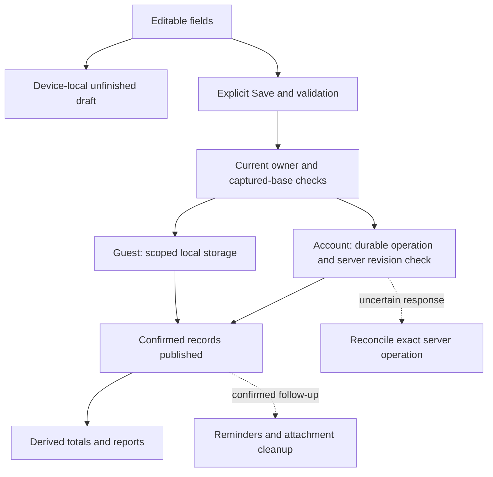

# Architecture and a practical reading path

My Money Management is a React Native/Expo app with Activity, Plan, Reports and Wallet screens. Guest finances remain device-local. Configured accounts use Firebase Auth, Firestore for everyday financial records and Firebase Storage for attachments. OpenAI, Google Cloud Vision and Flask/Prophet are accessed through a separately deployable authenticated backend, with optional Windows helpers retained for local use.

Start with one expense. Keep unfinished form text, a validated candidate, confirmed financial records and later cleanup effects distinct. A first launch creates an empty guest wallet; synthetic demonstration history requires an explicitly isolated scenario and never replaces existing supported records.

## Module map

| Location                                                                                                                                                                          | Responsibility                                                                                                         |
| --------------------------------------------------------------------------------------------------------------------------------------------------------------------------------- | ---------------------------------------------------------------------------------------------------------------------- |
| [`App.tsx`](../App.tsx), [`src/ui/`](../src/ui)                                                                                                                                   | Bind the active account/ledger, screens, editors, service panels and live appearance                                   |
| [`src/core/model.js`](../src/core/model.js), [`src/core/`](../src/core)                                                                                                           | Validate money/calendar/reference rules and calculate reports, budgets, goals, simulations, schedules and projections  |
| [`src/ui/ledgerRuntime.js`](../src/ui/ledgerRuntime.js), [`commitLedger.js`](../src/core/commitLedger.js)                                                                         | Current binding, serialized financial operations, confirmed publication, owner transitions and uncertain-save recovery |
| [`src/core/storage.js`](../src/core/storage.js), [`src/accounts/familyStorage.js`](../src/accounts/familyStorage.js)                                                              | Scoped local stores and source-preserving migration                                                                    |
| [`src/accounts/`](../src/accounts)                                                                                                                                                | Auth persistence, project/UID identity, profile state and financial account leases                                     |
| [`src/cloud/everydayStore.js`](../src/cloud/everydayStore.js), [`everydayController.js`](../src/cloud/everydayController.js), [`firebasePorts.ts`](../src/cloud/firebasePorts.ts) | Everyday cloud cache, durable operation journal, server revision checks, explicit copy and recovery                    |
| [`src/cloud/backupCoordinator.js`](../src/cloud/backupCoordinator.js), [`backupFormat.js`](../src/cloud/backupFormat.js), [`transport.js`](../src/cloud/transport.js)             | Separate explicit recovery snapshots, selected photos and empty-target restore                                         |
| [`src/drafts/`](../src/drafts)                                                                                                                                                    | Local transaction/budget/goal text drafts with explicit recovery and generation checks                                 |
| [`src/attachments/`](../src/attachments), [`src/reminders/`](../src/reminders), [`src/exports/`](../src/exports)                                                                  | Owned files, local schedules and PDF/QR operations                                                                     |
| [`src/assistant/`](../src/assistant), [`src/receipts/`](../src/receipts), [`src/forecast/`](../src/forecast)                                                                      | Selected model context, local conversation history, recognition review and provider-response validation                |
| [`src/services/`](../src/services), [`tools/backend/`](../tools/backend)                                                                                                          | Authenticated hosted-service client, gateway, quota/request identity and portable Prophet supervision                  |
| [`src/companion/`](../src/companion), [`scripts/companion/`](../scripts/companion)                                                                                                | Optional private Windows pairing and local provider lifecycle                                                          |
| [`tools/firebase-backup/`](../tools/firebase-backup), [`tools/auth-emulator/`](../tools/auth-emulator), [`tools/forecast/`](../tools/forecast)                                    | Firebase rules/emulator verification, optional Auth-only helper and forecast core/evaluation                           |
| [`tests/`](../tests), [`src/verification/`](../src/verification)                                                                                                                  | Automated checks and deliberately isolated synthetic scenarios                                                         |

Many pure modules use JavaScript with adjacent TypeScript declarations. The declarations describe their interfaces to the typed UI; Node tests load the same JavaScript. Review callers and declarations when a public contract changes.

## Follow an ordinary expense

Suppose the wallet is MYR and the user enters Lunch, `12.50`, a valid date and a Food category.

1. The editor holds editable fields and retains changed text in a scoped local draft. Typing creates no financial transaction. `transactionFromDraft` validates the fields and constructs an amount of 1,250 minor units. MYR uses sen; JPY uses whole yen.
2. `saveTransaction` constructs a candidate ledger without writing storage. New-entry and edit paths check duplicate/missing identifiers separately. Optional context/photo preparation cannot silently change the validated amount.
3. The form rechecks its captured financial base, then calls the save function supplied by [`useLedger.ts`](../src/ui/useLedger.ts). The runtime checks its owner/binding, rejects overlapping or uncertain operations and reconciles achievement evidence.
4. `commitLedger` captures the previous and proposed ledgers. A guest/local account uses the bound AsyncStorage adapter. A configured Firebase account uses `saveWithExpected`: a durable local operation precedes a server transaction checking the expected revision and hash.
5. Confirmed saved records are published to screens. A local write error is resolved through actual readback; an uncertain cloud dispatch requires server record/receipt reconciliation. A candidate local cache cannot prove that the cloud accepted the edit.
6. Confirmed-commit observers update reminders or owned-file cleanup. Failure in that follow-up is reported separately from the financial save. Only the matching form-draft generation is cleared.

Reports derive values from transactions. A period's closing balance and the all-dates wallet balance may differ; see [Financial reports](FINANCIAL_REPORTS.md) for their exact definitions.

## Ownership, drafts and restoration

A data family combines local/test scope with guest or account identity. Configured accounts include the Firebase project and UID. A wallet incarnation distinguishes a new wallet from the previous wallet under that family. Runtime binding/session generations additionally retire old callbacks even when the same account and wallet return later. A displayed name or identical balance is not proof that an old operation is still current.

The account coordinator acquires a financial lease before changing identity. Its bridge closes old editors/exports and coordinates photos/reminders, then validates the saved target before exposing it. An unreadable store is a recovery state, not permission to create replacement records. [Account access](ACCOUNT_ACCESS.md) explains the visible recovery actions.

Form drafts use separate scoped keys and exact revisions. They preserve incomplete fields without claiming a financial save, offer Resume/Discard and compare their captured base with current records. Revisioned empty markers prevent old callbacks from recreating a discarded draft. Newly picked photo URIs are not durable draft attachments; recovery requests a fresh selection while preserving existing managed-photo ownership.

## Everyday Firebase storage

[`everydayFormat.js`](../src/cloud/everydayFormat.js) validates a strict versioned ledger payload and photo manifest. The supported limit is 768 KiB and 100 attached photos. The current representation differs from the original per-feature collections but retains the original everyday cloud-storage role.

The store separates confirmed cache from unsubmitted/submitted/conflicted operations. Server reads use the server-only SDK path. A save records its intent locally before the financial server transaction; immutable receipts identify completed operations. If another device changes the expected revision, the stale candidate is retained as a conflict and does not overwrite the newer record. Offline access is a last-confirmed view, not automatic offline synchronization or merging.

Cloud Wallet previews a guest or earlier account-local copy and requires explicit confirmation into an unchanged empty cloud target. Source records are retained. Preparation is tied to the account session, financial binding and identity-transition state so returning to the same UID cannot revive an earlier confirmation.

Attached photos are uploaded and integrity-checked before confirming the financial record. Downloads become managed local files only after manifest/hash checks. Retained cache, operation and legacy references protect files during cleanup; owner retirement is not treated as an ordinary missing-photo warning. Automatic remote-orphan removal is not implemented.

## Separate recovery backups

[`backupCoordinator.js`](../src/cloud/backupCoordinator.js) captures explicit snapshots for preview. Its pending journal preserves one backup ID through interrupted upload/retry. Selected content-addressed photos and snapshot bytes precede the immutable Firestore index; a matching index alone is insufficient without byte/hash verification.

Restore stages selected photos under fresh wallet ownership and uses the current owner plus exact empty target for compare-and-save. When the target storage is a live Firebase wallet, confirming restore performs a cloud save. Guest copying likewise preserves the source; the main Cloud Wallet route makes its upload destination explicit. Backup/restore does not import authentication, profile extras, conversations, notification schedules or exports.

See [Firebase setup](../tools/firebase-backup/README.md) for rules, own-project prerequisites, emulators and recovery. The mobile client is not the access-control boundary: Firestore/Storage rules enforce owner-scoped access. Hosted Storage has its own billing prerequisite; local emulators are a separate setup.

## Hosted original providers and optional local tools

The [backend](../tools/backend/README.md) verifies Firebase ID tokens and binds metadata/requests to project, account, service and provider. Durable quotas and request identities bound deliberate retries. Provider keys stay server-side; mobile public configuration supplies an exact origin and project identity. The backend does not store the user's ledger, photos or conversation history.

The assistant sends calculated summaries, the current question and at most the latest three exchanges in that conversation. Previous answers are contextual text, not verified financial facts. Local history holds up to 20 conversations with the latest 12 exchanges each. Receipt recognition sends one selected image after explicit recognition and produces reviewable suggestions. Prophet receives completed monthly expense totals and returns six estimates. None of these paths has a financial writer.

The gateway assigns a separate internal ID to each private Prophet fit, so different users cannot address the same worker through a shared external request ID. Windows fits use owned Jobs; Linux worker source uses owned groups/guardian/resource bounds. The requested processing route and model limitations remain visible.

Provider-facing cancellation and local cleanup are distinct. OpenAI/Vision adapters track the underlying local transport and response-body retirement; an unconfirmed drain retires the gateway instead of admitting more work. This does not prove that a remote provider reversed completed processing or avoided a charge.

The [Windows companion](../scripts/companion/README.md) remains an explicitly selected alternative for Qwen, Windows OCR, local Prophet or development use of cloud adapters. Its private pairing contract stays separate from hosted Firebase authentication. Hosted selection does not fall back to this companion after a failure, and a local failure never silently selects a paid provider.

## Verification and reading exercise

Begin with [core-model tests](../tests/core-model.test.cjs), [commit tests](../tests/commit-ledger.test.cjs), [everyday-store tests](../tests/cloud-everyday-store.test.cjs) and [draft tests](../tests/transaction-editor-drafts.test.cjs). Follow the feature guides and their tests next. Controlled hook hosts do not establish native rendering, permissions, actual provider availability or operating-system behavior.

[Verification](../VERIFICATION.md) records the completed gates and their exact evidence. Windows local Prophet execution, emulated Firebase operations and injected OpenAI/Vision responses have different scopes. Live OpenAI/Vision, hosted deployment and native Linux/container execution remain separate, unverified claims.

Exercise: a wallet has RM500. A Save for a RM12.50 expense is dispatched, but its response is lost. Should the UI automatically submit another expense?

Answer: no. The local adapter uses actual stored-value readback; the cloud adapter checks the retained operation and server receipt. A confirmed matching result publishes RM487.50 once. An unresolved outcome blocks another financial write and remains recoverable. An exception alone does not prove that the first write failed.
