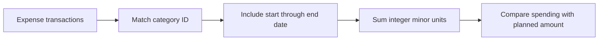

# Budgets and savings goals

A budget compares a planned expense amount with matching transactions during an explicit period. A savings goal compares the wallet's recorded balance with one target amount. Neither control moves money or creates a transaction.

## Budget periods

Choose an expense category, planned amount, period, and a date inside that period. Weeks run Monday through Sunday; months and years use calendar boundaries. The saved start and end dates are inclusive. A transaction on the last day counts; one on the following day does not.

Only expense transactions in the budget's category and date range count as spending. Income, debt payments, other categories, and other dates are excluded. Editing or deleting a transaction recalculates the result. Renaming the category preserves the budget's reference.

The same category can have a weekly and a monthly budget. Their dates may overlap, so their totals must not be added together as if they were separate spending. A second budget for exactly the same category and period is rejected. A category referenced by a budget cannot be deleted until that budget is removed or changed.

## Savings goal

The goal's progress uses the wallet's all-date balance, including income, expenses, and debt payments. It is not a separate savings account or a reserved pot of money. The original nine goal descriptions are retained, but selecting a debt-related goal means tracking funds toward that purpose; it does not prove a lender has been repaid.

A negative wallet balance displays zero progress while retaining the full amount needed to reach the target. A balance equal to the target is reached; a larger balance has exceeded it. The visual bar stays within zero to 100 percent while the numerical amounts remain accurate.

Currency cannot change while the wallet has transaction history, budgets, or a goal. Relabeling an existing monetary amount would change its meaning without converting it. Start fresh explicitly creates an empty wallet and removes its transactions, custom categories, budgets, and goal.

## Saving and resuming a plan

Budget amount, category, period and date fields, and savings-goal kind/amount fields, are retained as unfinished drafts on this device. Partial amounts or dates do not need to be valid financial values to remain editable. Close and reopen the same form, including after an app restart, to choose Resume saved draft or Discard saved draft. Neither action automatically creates a budget or goal.

The draft is scoped to its account family, wallet incarnation and form target. A changed saved financial base prevents a stale form from silently overwriting newer records. Failed persistence keeps the text visible for explicit retry. A confirmed financial save clears only the matching draft generation; a late completion cannot erase another editor's newer draft.

Guest plans save locally. Configured Firebase account plans require server confirmation and become available when another device opens or refreshes the account wallet. Offline views use the last confirmed data; local drafts are not automatic cloud synchronization. An uncertain dispatched Save is handled by Cloud Wallet's separate operation recovery.

## Worked example

Suppose October contains RM1,000 income, RM80 food, RM30 transport, and RM40 debt payments. September contains another RM50 food expense, and November contains RM20 food.

| Question                     | Result                     | Reason                                        |
| ---------------------------- | -------------------------- | --------------------------------------------- |
| October food budget of RM100 | RM80 spent, RM20 remaining | Only October food matches                     |
| October expense total        | RM110                      | Food plus transport; debt stays separate      |
| Wallet balance               | RM780                      | All recorded dates, with debt subtracted once |
| RM1,000 savings goal         | 78 percent, RM220 needed   | RM780 balance divided by RM1,000 target       |

Exercise: edit October food from RM80 to RM120. What changes?

Answer: the October food budget becomes RM20 over its RM100 plan. The wallet balance becomes RM740, and the savings goal becomes 74 percent with RM260 needed. September and November food still do not count toward the October budget.

## Migration and verification

Planning fields were introduced in the v3 store, preserving the original v1 and v2 saved bytes. The current v5 store first checks v4, then v3, then v2, then v1 when its own key is absent. Corrupt newer data stops migration instead of silently substituting an older copy. Existing valid records and extra fields on supported records survive migration. The [achievements guide](ACHIEVEMENTS_AND_REMINDERS.md) explains the additional v4 ownership fields.

Model tests cover period boundaries, matching categories, duplicate budgets, reference safety, edit/delete propagation, negative balances, reached/exceeded goals, and migration failures. The [verification record](../VERIFICATION.md) records completed native checks, draft recovery and current source gates separately.
