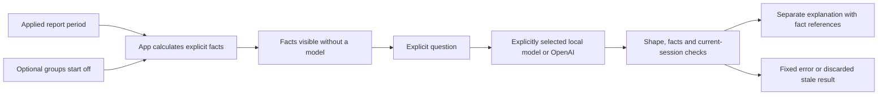

# Ask about selected financial records

Reports → Ask about this period opens a read-only explanation panel for the currently applied report dates. The app calculates the facts itself. An explicitly selected local Windows model or OpenAI can explain those facts after an explicit question; it cannot add a transaction, change a budget, adjust a goal or save a forecast.

The calculated facts remain available when no companion is configured or a request fails. Generated wording appears separately from those facts so that its claims can be checked. A model response is an explanation to review, not a replacement for the recorded amounts or a verified financial conclusion.

## Choose exactly what is included

The initial dates come from the report's applied period. Edit the dates and choose Apply period to use another inclusive range. Invalid date edits preserve the previous facts. Unapplied date edits do not change the question's context; the panel explicitly identifies the period it will use.

The base context includes the currency, period boundaries, transaction count, opening balance, income, expenses, debt payments, outflow, net change and closing balance, with defined income-based ratios. Opening balance covers records strictly before the start date. Closing balance adds the selected period's net change. It is different from the wallet's all-date balance when later transactions exist.

Five optional groups start off:

| Group                      | What is included and why the boundary matters                                                                                                                  |
| -------------------------- | -------------------------------------------------------------------------------------------------------------------------------------------------------------- |
| All-dates wallet balance   | Includes later records as well as the selected period, so it must not be described as period closing.                                                          |
| Expense categories         | Up to three largest expense categories. Each share uses total expenses as its denominator, not income or all outflow.                                          |
| Overlapping budgets        | Up to three plans evaluated over their full own periods, including later records. Their spending is not prorated to the selected report range.                 |
| Current goal target        | The current target compared with the selected period's closing balance. This is a period-specific comparison, not automatically the current wallet's progress. |
| Illustrative project score | The existing cash-flow formula and its stated limitations. It is not a validated financial-health score.                                                       |

The visible fact rows and current question are the model's financial context. The selection itself is an explicit fact, so an omitted goal means that goal details were not supplied, rather than proving no goal exists. Transaction titles, notes, person/contact details, locations, photos and raw receipt text are excluded. Selected category names may appear in an optional group. The whole ledger and earlier model answers are not sent.

Recorded income of zero is a known value. Income-based ratios are then undefined because their denominator is zero. An empty ledger describes the app's recorded history; it does not prove that a person has no real-world income, debt or expenses.

## Ask, cancel and compare

Enter a question of up to 500 characters and choose Ask. Requests are explicit; opening the panel or loading a connection does not trigger inference. Every question is independent. The panel retains up to three successful explanations while it stays open, but previous replies are not sent back as model context.

An answer includes references to the supplied fact rows. Compare its wording with those rows, particularly date scope, category denominators and omitted groups. The host validates a narrow response shape and exact fact identifiers and rejects specific known semantic defects. Those checks can catch malformed or familiar wrong answers; they cannot detect every unsupported conclusion.

Cancel stops waiting and makes a late answer ineligible for display. Host computation may still finish, so the UI does not claim the native process has already stopped. Retry last question is another explicit request. Clear conversation removes the temporary displayed turns. Closing the panel discards the conversation rather than storing it in a ledger or account profile.

Changing an applied period, optional group or saved ledger rebuilds the context and clears previous explanations. Replacing the companion connection, changing account/wallet ownership or leaving the active financial state closes the session and invalidates old callbacks. A response that completes just before a transition still has to pass a final ownership/current-context check before display. An open chat is not an unsaved financial draft and does not block account switching.



## Connect the local Windows model

The [public companion guide](../scripts/companion/README.md) is the setup authority for exact asset versions, hashes, offline preparation, startup, private Android pairing and owned shutdown. Assistant mode uses the same private development connection as receipt OCR. An OCR-only run deliberately has no model endpoint; it cannot answer a question merely because receipt recognition works.

After preparing the pinned local assets, explicitly start assistant mode from the app folder:

```powershell
python scripts/companion/run_companion.py --mode assistant --run-name assistant-001 --node "C:\path\to\node.exe"
```

Follow the companion guide to verify that run and pair the exact installed debug emulator. Enable `EXPO_PUBLIC_LOCAL_COMPANION=1` before starting a new Metro process. After pairing or replacing the helper, open Activity → Setup beside Review receipt, choose Recheck and reopen the assistant from Reports. Setup also reveals the full connection explanation; the Recheck control's accessible name is Recheck connection. The app reads only the known bounded private connection file; the token is not put in UI, command arguments, a ledger or a public environment variable.

“Local connection configured” means valid connection details are present. Availability is tested by Ask. “Local model responded” means that request returned an accepted response; it does not mean the answer is correct. Missing model assets, unsupported output, memory pressure, timeout or stopped service leave the deterministic facts readable and require deliberate recovery/retry. There is no cloud fallback or automatic model download.

The model runs on the Windows computer, not on the phone. The public startup check requires at least 6 GiB of available physical memory and stops its owned run after two consecutive one-second samples below 1 GiB. That floor is a conservative check, not a promise that every combination of emulator, editor and other programs will fit. The helper does not close unrelated programs or automatically restart after a memory stop. Its exact native model settings and process-ownership rules are documented in the companion guide.

## Optional OpenAI provider

Select OpenAI explicitly in the companion's private server configuration and pair the resulting version 2 connection. The provider credential stays on the Windows host. The app receives only the provider/model descriptor and private companion token. See the [OpenAI contract](../scripts/companion/assistant/OPENAI.md) and [companion guide](../scripts/companion/README.md).

The panel labels **Ask OpenAI** and explains the cloud destination before the action. The same visible facts and current question are sent; earlier conversation, raw transactions, photos and contact/location details remain excluded. The configured model can resolve to a returned model snapshot; transport validation preserves both values and rejects provider substitutions.

Opening the panel and rechecking connection do not contact OpenAI. Configuration does not establish reachability. Authentication errors, rate limits, refusals and incomplete responses leave calculated facts available and require deliberate recovery/retry. Cancellation cannot undo work the provider has already processed or guarantee that charges are avoided. There is no automatic cloud fallback.

Provider changes clear the active context/session just like connection and wallet changes. The same known-defect checks reject write claims and familiar scope errors. Offline adapter/route/client/UI tests use invented models and responses; live OpenAI account access, model quality and Android cloud-provider execution require separate evidence.

## Worked example

A selected October period opens at RM750.00, records RM2,000.00 income, RM250.00 expenses and RM300.00 debt payments, and closes at RM2,200.00:

```text
Outflow = 250 + 300 = RM550.00
Net change = 2,000 - 550 = RM1,450.00
Period closing = 750 + 1,450 = RM2,200.00
```

If later records make the all-date wallet balance RM2,680.00, enabling that optional fact allows a question about why the two balances differ. It does not move those later records into October. Similarly, recorded debt payments describe money paid out; they do not establish the remaining loan principal.

Exercise: a period has recorded income RM0.00 and outflow RM200.00, while the goal option is off. What should an explanation say if asked for the savings ratio and progress toward the goal?

Answer: income is recorded as zero, so an income-based ratio is undefined. Goal details were not included, so progress toward a goal cannot be calculated from the supplied context. The model should not call zero income “missing data,” invent a ratio or conclude that no goal is configured.

## Evidence and limitations

The earlier local-model restoration gate recorded 753 normally isolated JavaScript tests and TypeScript. The historical local-provider evidence below does not establish live OpenAI verification. Source-bound tests and independent review cover selection, currentness, failure recovery, modal-session replacement and account transitions. A separate actual private Windows model evaluation passed 18 responses across nine fixed scenarios repeated twice, including zero income, balance scopes, JPY, negative goal progress and a hostile prompt. The nine distinct final answers were also read against a fixed factual rubric.

Earlier runs failed: numeric fact identifiers were rejected, and a later structurally valid run still used incorrect opening-balance scope. The final schema/prompt changes addressed those observed failures; the evaluation is bounded regression evidence, not a general accuracy score. The final run's median request time was about 19 seconds on the tested shared development workload, with individual requests about 11–33 seconds. Those timings are observations, not a performance promise.

The public assistant-mode helper has started with its actual local model load verified. Through real private pairing, the Android app displayed an explanation that correctly distinguished the example's MYR750.00 opening, MYR2,200.00 period closing and MYR2,680.00 all-date balance, with cited facts. This verifies that request path for the synthetic example; the earlier OCR gate alone did not establish assistant inference.

The five recorded Android checks also cover Cancel during a real second request and close/reopen with a visible fresh modal and no prior answers. Direct comparison confirmed the ten-record wallet bytes were unchanged. Final shutdown confirmed the owned processes stopped, requests drained and connection/pairing cleared without a failed outcome. Native account transitions during an assistant request, broader questions, full large-text coverage, physical devices and iOS remain separate limits. See [Verification](../VERIFICATION.md) for the precise completed scope and retained failed evaluation iterations.
