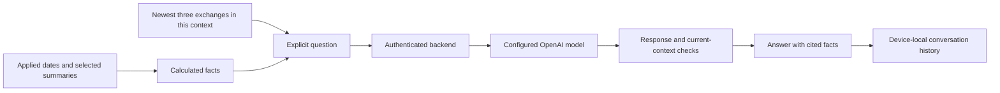

# Financial assistant and saved conversations

Reports > Ask about this period opens the assistant with the report's applied dates. OpenAI is the primary configurable provider for explanations and practical budgeting/saving suggestions. The app supplies calculated summaries; the assistant cannot create a transaction, change a budget or goal, move money or save a forecast.

The configured backend lets the phone use OpenAI without a Windows companion running beside it. Qwen through Lemonade remains an optional local route. Calculated facts remain readable when no provider is configured or a request fails. An answer is generated wording to review against those facts, not a verified financial conclusion.

## Choose the period and summaries

Edit Start date and End date, then choose Apply period. Both dates are inclusive. Invalid edits preserve the previous facts; unapplied text does not silently change a request. The panel identifies the applied dates and currency before Ask.

The base context includes the currency, dates, transaction count, opening balance, income, expenses, debt payments, outflow, net change and closing balance, with defined income-based ratios. Opening covers records strictly before the start date. Closing adds the selected period's net change; it can differ from the all-dates wallet balance when later transactions exist.

The OpenAI and facts-only Reports entries start with categories, budgets, goal and comparisons selected. The optional local Qwen entry starts with categories only to leave room in its smaller model context. All-dates balance and the illustrative project score start off. Every optional group remains available to select; review those choices before asking:

| Summary group              | Included facts and their scope                                                                                                     |
| -------------------------- | ---------------------------------------------------------------------------------------------------------------------------------- |
| Expense categories         | The three largest recorded expense categories and shares of the full expense total                                                 |
| Overlapping budgets        | Up to three overlapping plans, using each budget's full own period, including later records where applicable                       |
| Current goal target        | The current configured target compared with the selected period's closing balance; not a separate savings account                  |
| Previous-period comparison | Calculated income, expense, debt-payment and net changes; category comparisons appear only when category details are also selected |
| All-dates wallet balance   | The recorded balance across all dates, including records after the selected end date                                               |
| Illustrative project score | The project's cash-flow formula with its limitations; not a validated financial-health or credit score                             |

A complete calendar month compares with the preceding calendar month, including February/leap-year differences. Other date ranges compare with the preceding equal number of days. If that earlier range falls outside the supported calendar, comparison is unavailable. Missing recorded entries and partial periods still limit interpretation.

Omitting a group means those details were not supplied, not that the wallet contains no such data. Recorded income of zero is a known value; income-based ratios are undefined because their denominator is zero. An empty ledger says nothing about unrecorded real-world finances.

## What is sent

On Ask, the selected provider receives the visible calculated facts, the current question and at most the newest three exchanges from the same conversation. Earlier answers provide conversational context only; current calculated facts govern numerical claims. The model is instructed to suggest practical non-numerical options without inventing new amounts, merchants, causes, recurring subscriptions or missing history.

Automatic assistant context excludes raw transaction titles/notes, contact records, person/place labels, coordinates, photos, raw OCR text and account profile fields. It does not upload the entire ledger. Selected category names are user text, and a typed question can include names or other information the user chooses to enter; the app does not claim that all summaries or questions are anonymous.

The authenticated backend uses the current Firebase identity for access control. That identity is separate from the financial summaries sent to OpenAI. Provider credentials stay in private server configuration. See [Backend setup](../tools/backend/README.md) and the [OpenAI adapter contract](../scripts/companion/assistant/OPENAI.md).

## Ask, cancel and compare

Enter up to 500 characters and choose Ask OpenAI, or the explicitly configured local-model action. Opening the panel, viewing saved history or applying dates does not request inference. A hosted metadata check authenticates the connection; it does not ask OpenAI a financial question.

Answers cite supplied fact IDs and are bounded in shape and length. Response checks reject malformed output, invented evidence IDs and specific known scope/write-claim defects. They cannot prove every claim is correct. Compare advice with the displayed period, amounts, denominator, category coverage and omitted groups.

Cancel prevents a late answer from entering the current conversation. Provider work may already have been processed; cancellation cannot guarantee that a cloud charge is avoided. Retry is a new deliberate request. Authentication, quota, provider-change and timeout errors remain visible; there is no automatic cloud/local fallback.

Changing the applied period, selected groups, saved wallet figures, owner or provider starts a fresh financial context. A response that settles just before a transition must still pass current-owner/context checks. An open chat is read-only and does not become a financial draft or block account switching.

## Saved conversations

Accepted conversations are stored locally and separately for each account/guest family. They are not synchronized to Firebase and are not included in wallet backups. The limits are:

- Up to 20 saved conversations for an account on this device.
- The latest 12 exchanges in each conversation.
- At most the latest three exchanges sent with a follow-up.

Close and reopen the panel to find Saved conversations. View conversation shows its captured dates, wallet, provider, answers and cited facts without making a provider request. Continue is available only when the current wallet, selected summaries and provider match the saved context. If financial records changed, the saved discussion remains historical; return to the current conversation to ask about the new figures.

Start a new conversation clears the active discussion without deleting saved history. Deleting a saved conversation requires a separate confirmation. If saving history fails, the accepted answer stays visible and an explicit retry is offered. A malformed or unreadable history store is retained instead of replaced with an empty one. Uninstalling the app or clearing app storage can remove this local history even when Firebase financial records still exist.



## Configure the primary OpenAI route

Follow [Backend setup](../tools/backend/README.md) to configure Firebase authentication, HTTPS, durable usage limits and a private OpenAI key/model. The mobile build receives only its selected Firebase client configuration and the backend's exact origin/project identity. The model must support the adapter's Chat Completions structured-output contract; no original credential or specific account entitlement is assumed.

The backend is source for a future deployment. Configuring a compatible model name is not proof of real account access, response quality, availability or billing behavior. The repository does not perform a deployment or paid request as part of app setup.

## Optional local Qwen route

The [Windows companion guide](../scripts/companion/README.md) documents pinned assets, integrity checks, private Android pairing and owned shutdown. It runs the model on the connected Windows computer, not on the phone. Its requirements are separate from the Android app; OCR-only mode deliberately has no assistant.

The pinned local model has a 2,048-token context. Categories-only is its initial summary selection; selecting additional groups or carrying longer follow-ups can exceed that limit. A context-limit error offers starting a new conversation, selecting fewer summaries or shortening the question. The helper does not silently truncate facts or history.

After preparing the documented assets, an explicit local assistant run uses:

```powershell
python scripts/companion/run_companion.py --mode assistant --run-name assistant-001 --node "C:\path\to\node.exe"
```

Enable the documented local companion mode before starting Metro, pair the verified debug emulator and use Connections > Recheck connection. Hosted service selection takes precedence when explicitly configured; an invalid hosted setup does not silently choose the companion. A local failure does not download another model or select OpenAI automatically.

The older Windows-companion OpenAI route is also retained for local development. Its provider key remains on that host and is never embedded in the phone. For independent phone use, the deployable backend is the intended route.

## Worked example

October opens at RM750.00, records RM2,000.00 income, RM250.00 expenses and RM300.00 debt payments, and closes at RM2,200.00:

```text
Outflow = 250 + 300 = RM550.00
Net change = 2,000 - 550 = RM1,450.00
Period closing = 750 + 1,450 = RM2,200.00
```

The assistant may explain those calculated figures and suggest reviewing an included category budget. It should not invent how much could be saved at a particular merchant. If later entries make the all-dates balance RM2,680.00, enabling that group can explain the difference without moving later records into October.

Exercise: recorded income is RM0.00 and outflow RM200.00, with goal details disabled. What can the assistant say about a savings ratio and goal progress?

Answer: the ratio is undefined because recorded income is zero. Goal details were not selected, so the supplied context cannot establish progress toward a goal. It should neither call zero income missing data nor conclude that no goal exists.

## Evidence and limits

[Verification](../VERIFICATION.md) records the exact source gates, Android checks and provider evidence. Earlier local Qwen evaluations and the local-model gallery frame used real local inference; they do not verify OpenAI. Injected OpenAI responses exercise contract, ownership, cancellation and display behavior without contacting the provider. Live OpenAI access/model quality and a deployed backend remain unverified. The current date/comparison/history flow requires its own recorded native evidence; an older screenshot is not proof of those additions.
