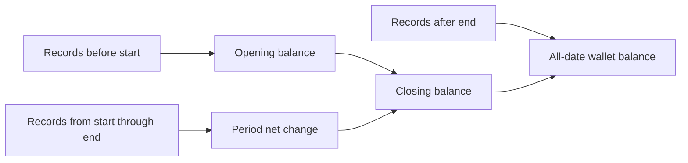

# Reading a financial report

A report answers what happened between two calendar dates. Its opening balance is the money recorded before the first date; its closing balance includes activity through the last date. The wallet's all-date balance can be different because it also includes later entries.

## Definitions that reconcile

| Figure                  | Calculation                                             | Purpose                                             |
| ----------------------- | ------------------------------------------------------- | --------------------------------------------------- |
| Opening balance         | Earlier income minus earlier expenses and debt payments | Carries recorded history into the period            |
| Income                  | Income dated inside the selected range                  | Shows recorded inflow                               |
| Expenses                | Expense entries inside the range                        | Keeps ordinary spending separate from debt payments |
| Debt payments           | Debt entries inside the range                           | Counts repayment outflow once                       |
| Total outflow           | Expenses + debt payments                                | Shows all recorded money leaving                    |
| Net change              | Income − total outflow                                  | Measures the period's effect on the balance         |
| Closing balance         | Opening balance + net change                            | Reconciles to all records on or before the end date |
| All-date wallet balance | All recorded income − expenses − debt                   | Includes dates outside this report                  |

Both selected dates are included. A transaction on 31 October counts in an October report without relying on a timestamp ending at midnight. A date with no entries contributes zero activity; an entire inactive month can still carry an existing balance.

## Categories and percentages

The category breakdown adds transactions by their stable category ID. Renaming Food to Meals changes the label without splitting historical spending. Two food transactions of RM120 and RM80 produce one RM200 food category total.

Each percentage states its denominator. Expense-category percentages use only the period's expenses; debt payments have their own breakdown. This prevents a category's apparent share from changing merely because income is included in the denominator.

Recorded cash-flow ratios divide net change, expenses, or debt payments by the same period's income. They are unavailable when income is zero. A negative net ratio or a share over 100 percent remains visible instead of being clamped into a more favorable value. These ratios describe recorded activity; they do not establish a person's complete financial position.

## Worked example

September contains RM1,000 income, RM200 food spending, and RM50 debt payments. October contains RM2,000 income on the first day, RM120 food on the fifteenth, RM80 food on the thirtieth, and RM50 transport plus RM300 debt on the thirty-first. November contains another RM500 income and RM20 food.

For October:

- Opening: `1000 - 200 - 50 = RM750`.
- Expenses: `120 + 80 + 50 = RM250`.
- Outflow: `250 + 300 = RM550`.
- Net change: `2000 - 550 = RM1,450`.
- Closing: `750 + 1450 = RM2,200`.
- All-date wallet balance: `2200 + 500 - 20 = RM2,680`.
- Food share of expenses: `200 / 250 = 80%`; transport is 20 percent.

Changing the range to 15 through 31 October moves the October salary into earlier history, so the opening balance becomes RM2,750. This range has no income and RM550 outflow, giving a net change of −RM550. Closing stays at RM2,200. Income-based ratios are unavailable for this range, even though income exists elsewhere in the wallet.

## Implementation and verification

`src/core/reports.js` performs all report calculations. `periodReport` produces a single range; `monthlySeries` produces chronological month entries, including inactive months and explicitly clipped partial months. Adjacent monthly closing and opening balances reconcile. Money remains integer minor units, including whole yen for JPY.

The Reports screen applies valid custom dates explicitly. An invalid draft displays an error while retaining the previously applied report. Editing the wallet's transactions or category names recalculates the report from current data; no second set of report totals is saved.

Twenty report tests cover the example above, empty/inactive/debt-only periods, date boundaries, category identity, edits and deletions, JPY, exact large totals, and immutable inputs. Native checks are recorded separately in `VERIFICATION.md`; automated calculation tests alone do not prove rendering or keyboard behavior.

For repeatable native checks, see [Verification scenarios](VERIFICATION_SCENARIOS.md). These synthetic stores are separate from the normal preview.
