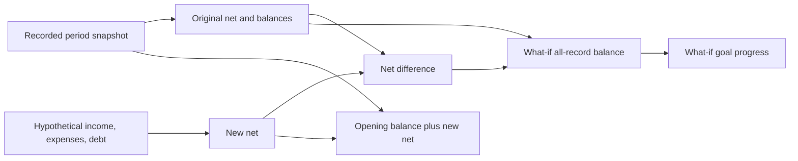

# The illustrative score and what-if simulator

Reports and the simulator use the same cash-flow formula, with debt payments included in net cash flow. The score is a project calculation based on two rules. It has not been validated as an assessment of someone's complete financial position.

## One explicit formula

For a selected period with positive recorded income:

```text
Net = income - expenses - debt payments
Net-ratio deduction = max(0, 0.25 - net / income) * 100
Debt-ratio deduction = max(0, debt payments / income - 0.30) * 100
Score = 100 - the two deductions, bounded to 0 through 100
```

The 25 percent and 30 percent thresholds are project assumptions. The interface shows both deductions and the formula version, `fyp-cash-flow-v1`. It has no additional good/bad bands or recommendations based on these thresholds. Budgets and goals do not affect the score.

If income is zero, the score and its income-based ratios are unavailable. Outflow and net change still have exact values. The app does not substitute a default score of 75 or treat zero income as zero spending.

For RM1,000 income, RM800 expenses, and RM400 debt payments:

- Net is `1000 - 800 - 400 = -RM200`.
- The net ratio is −20 percent, producing a 45-point deduction from the 25 percent threshold.
- The debt ratio is 40 percent, producing a 10-point deduction from the 30 percent threshold.
- The score is `100 - 45 - 10 = 45.00`.

Debt is subtracted once in the money calculation. Its separate influence on the illustrative score is visible in the second rule.

## Replace a period's totals hypothetically

Opening the simulator captures the selected report's original values and optional goal target. Applying a scenario replaces only that period's income, expenses, and debt totals hypothetically. Every result is recalculated from the captured values; previous scenario results are never added again.



The two balance calculations answer different questions:

- What-if period closing = recorded opening + scenario net.
- What-if all-record wallet balance = recorded all-date balance + scenario net − original period net.

The second value retains records outside the selected period. Goal progress uses that all-record value, matching the Plan screen's interpretation. Negative balances retain their complete shortfall; a goal's bar does not conceal the amount still needed.

## Worked example

The report example opens October at RM750. It records RM2,000 income, RM250 expenses, and RM300 debt, giving RM1,450 net, RM2,200 closing, and an all-date wallet balance of RM2,680 after later entries.

Apply the RM1,000 / RM800 / RM400 scenario:

| Result                              |    Value |
| ----------------------------------- | -------: |
| Scenario net                        |   −RM200 |
| Change from the original period net | −RM1,650 |
| What-if period closing              |    RM550 |
| What-if all-record wallet balance   |  RM1,030 |
| Illustrative score                  |    45.00 |
| Progress toward a RM4,000 goal      |   25.75% |
| Amount needed toward that goal      |  RM2,970 |

Applying these same inputs again leaves every result unchanged. Reset restores the recorded inputs, RM2,200 closing, RM2,680 all-date balance, and their 100.00 illustrative score. Closing the sheet leaves the real ledger unchanged.

Setting all three scenario amounts to zero leaves a period net of zero and a closing balance of RM750, the original opening amount. The what-if all-date balance is `2680 + 0 - 1450 = RM1,230` because it still includes entries outside October. The score is unavailable because scenario income is zero.

## Validation and limits

Scenario amounts accept zero and exact nonnegative minor units. They support aggregate amounts larger than a single transaction, while enforcing the ledger-derived maximum and safe-integer calculations. JPY remains whole yen. Invalid input leaves the last valid result visible, with an error next to the form.

Aggregate scenarios do not establish how money would be allocated across categories, so they do not invent budget or category forecasts. They are not persisted, do not move money, and do not measure actual debt repayment. Monthly forecasting is a separate feature.

The pure model is in `src/core/health.js`; goal calculations share `goalProgressForBalance` with the actual wallet. Tests cover formula boundaries, zero income, negative and exceeded goals, JPY, large aggregates, immutable baselines, input order, repeated application, reset, and reconciliation. Executed native checks are recorded separately in `VERIFICATION.md`.
