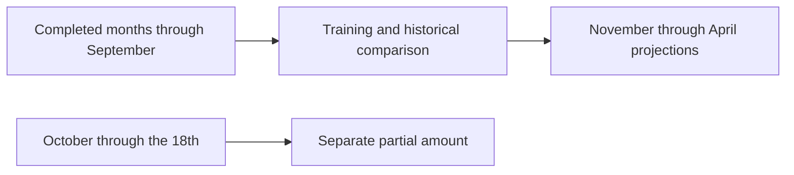

# Forecast recorded monthly expenses

Reports → Open expense forecast projects six future months from the expenses recorded in the current wallet. The default deterministic calculation runs on the device without a companion, network request, or Python installation. An optional local Prophet comparison can be requested explicitly from the same panel. Forecasts do not create transactions or change budgets, goals or balances.

The target is recorded expenses, including an expense saved from receipt review. Income and debt payments are excluded. Missing transactions and changes in spending can make the projection a poor description of future real spending. The feature does not claim that the wallet contains a complete financial history.

## Choose the date and category

The forecast opens with the account/ledger's current local date. Its as-of date and expense category are separate from the report range. Changing a report's un-applied date text does not silently change the forecast's training data.

Choose All expense categories or an existing expense category, then Apply forecast. Category search and pagination keep large category sets accessible. History, partial-month figures and projections all use the applied category. Invalid input preserves the prior labelled result and shows an error. A removed category requires selecting another existing category or All.

The result is a captured calculation. If recorded expenses, category labels, currency or wallet labels change while it is open, the previous result remains labelled and a Refresh applied forecast action appears. Refresh recalculates the applied date/category; it does not apply unrelated pending input edits. Close and reopen to begin a new selection. Account or wallet replacement resets the view, and unconfirmed ownership hides it.

## Why the current month is excluded

An as-of date does not make that month's expenses complete. The calculation always trains through the end of the preceding month, even when the as-of date happens to be month-end. It shows current-month expenses only through that date in a separate partial-month section. Later records cannot enter that partial total or the training history.

For an as-of date of 18 October 2026:

October is the excluded gap. The first projection, November, is two months after September, the final training month. The six outputs therefore have leads 2–7. No completed-history row or partial October row is presented as a prediction.

History starts at the first selected expense in a completed month. Subsequent completed months without a selected expense remain as zero rows; they are not compressed out of the calendar. Earlier income or debt does not invent extra expense history. A zero row means no expense was recorded for that month and filter, not proof that no money was spent.

At least eight completed history months and three months with selected expenses are required. These are engineering availability rules, not a statistical guarantee. Short or sparse histories show the actual counts and an insufficient-history state with no forecast rows. The app never inserts synthetic history to make an ordinary wallet eligible.

## The three methods

The implementation compares three explicit candidates using the same completed history and the same evaluation dates:

| Candidate                 | Calculation                                                                                                                                                      |
| ------------------------- | ---------------------------------------------------------------------------------------------------------------------------------------------------------------- |
| Last completed month      | Repeat the final training month's expense amount. This is the displayed baseline.                                                                                |
| Trailing three-month mean | Average the last three completed values, retaining zero months.                                                                                                  |
| Damped local trend        | Fit a line to the latest six completed values, or the available shorter prefix with at least three values. Extend its slope with fixed 0.8 damping at each lead. |

The trend damping is a project heuristic. Every candidate is bounded between zero and twice the largest value among its latest six training months, then rounded once to the currency's smallest unit. The same procedure applies inside historical comparisons and future projections. JPY retains whole-yen precision; MYR retains sen. Exact rational arithmetic prevents monetary half-tie drift, while the public results remain ordinary integer numbers.

The bound prevents extreme extrapolation in this implementation. It is neither a confidence interval nor a spending limit: actual future expenses can exceed it. These three device methods are separate from the optional Prophet model. Their bounds and historical scores must not be attributed to Prophet.

## Optional local Prophet comparison

Prophet controls appear only when its connection is configured; setup remains discoverable under Wallet > Connections. Without that connection, the screen shows the ordinary device forecast. After preparing and pairing the [local Prophet service](../tools/forecast/README.md), open the forecast panel, apply its date/category, and choose Run local Prophet. Only the applied currency, dates, and completed monthly expense totals go to the connected Windows host. Opening the screen does not start a fit. The device result remains available if Prophet is disconnected, unavailable, or cancelled.

Prophet requires 8 to 120 completed months and at least three active expense months. Longer histories are rejected with an explicit explanation rather than silently truncated. It uses the same excluded partial month and the same six future target months as the device calculation. The displayed result labels the provider, training period, and corresponding device amount for each month.

The model uses an explicit linear configuration without seasonal components or prediction intervals. Its output is approximate and rounded to the currency's minor unit. Negative estimates remain visible with a warning that they are model output, not possible recorded expense entries. The device method's historical MAE is not a score for Prophet; the separate evaluation command in the service guide compares common historical targets when needed.

Cancel, closing the panel, changing an applied selection, editing its date/category, changing the relevant records, or switching owner/provider prevents a late model response from appearing. Cancellation asks the owned service to stop that request's worker; unconfirmed cleanup blocks further fits. A result never creates a transaction or changes a budget or savings goal.

## Read the historical error correctly

Each historical comparison trains on an earlier prefix, skips the next month and predicts the month after that. This reproduces the gap used by the final forecast. Only values in that prefix can affect the candidate's fit or bound. The target month's amount is used to measure error after making the prediction.

The UI calls the metric **two-month-ahead MAE**, meaning mean absolute error. It averages the absolute differences between predictions and actual recorded amounts across the most recent eligible origins, up to twelve. The displayed date range and fold count identify the observations used. Each candidate is evaluated on the same targets.

The calculation selects the simplest candidate within the larger of one minor unit or 5% of the lowest MAE. The preference order is last value, trailing mean, then damped trend. It compares the unrounded error values; only the displayed money is rounded. When baseline error is zero, relative improvement is unavailable rather than infinite.

Historical MAE describes those earlier two-month-ahead predictions. It is not measured error for all six future months, a confidence percentage or evidence of general real-world forecasting accuracy. Even a constant history with zero comparison error may change next month.

## Worked example

Suppose completed Food expenses rise from RM100.00 in April 2025 by RM10.00 each month to RM270.00 in September 2026. As of 18 October 2026, there are eighteen completed and active months. The historical comparison uses twelve targets from October 2025 through September 2026:

| Method                    | Two-month-ahead MAE |
| ------------------------- | ------------------: |
| Last completed month      |             RM20.00 |
| Trailing three-month mean |             RM30.00 |
| Damped local trend        |              RM5.60 |

The selected damped trend produces:

| Projected month | Lead from September | Recorded-expense projection |
| --------------- | ------------------: | --------------------------: |
| November 2026   |                   2 |                    RM284.40 |
| December 2026   |                   3 |                    RM289.52 |
| January 2027    |                   4 |                    RM293.62 |
| February 2027   |                   5 |                    RM296.89 |
| March 2027      |                   6 |                    RM299.51 |
| April 2027      |                   7 |                    RM301.61 |

Exercise: add a recorded expense of RM9,999.99 on 18 October and RM88,888.88 on 1 November. Should this change any of those six predictions when the as-of date stays 18 October?

Answer: no. October remains excluded from training; its through-date amount changes only the partial-month display. November is after the as-of date and cannot enter fitting, method choice or historical error. The existing future transaction does not replace November's projected row. Changing income or debt payments also cannot change this expense-only target.

## Verification scope

The reviewed preparation passed 56 source checks covering forecast arithmetic, actual component behavior, the isolated fixed reference and preserved existing fixtures. The actual integrated app/public-companion suite passes 800 tests with normal Node isolation, and TypeScript passes. Independent review covered the full-owner binding, separate forecast selection, preserved PDF/assistant applied ranges and guarded integration.

Seven Android checks verified the actual six reference rows, cutoff/history counts, separately excluded partial month, selected method and historical errors. Transport showed honest insufficiency, Food restored the reference, and an invalid date preserved the labelled applied result. Restarting the Android process recomputed the same projections. Direct comparison confirmed that all 26 saved synthetic records stayed byte-identical.

The selected screens were visually inspected at the tested setting. Native history pagination, source-change Refresh and font-scale 1.3 were not part of this gate. Source tests and fixed synthetic examples do not establish real-world prediction accuracy, physical-device behavior or iOS rendering. See [Verification](../VERIFICATION.md) for the precise completed scope.
