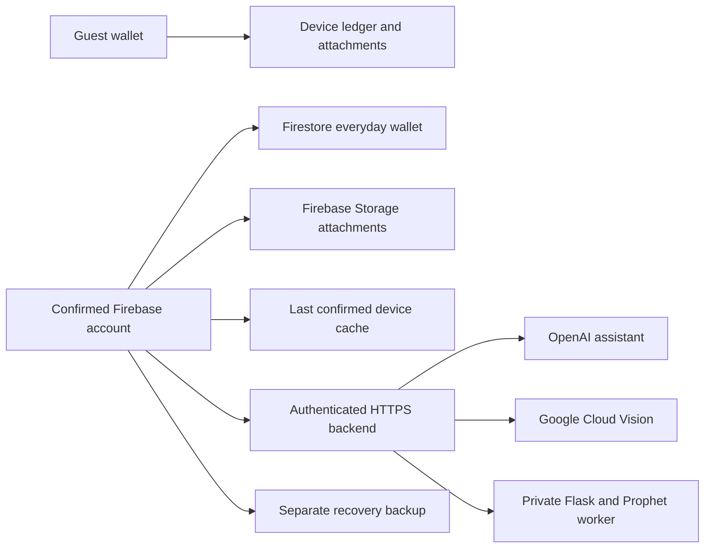

# Original service integrations

My Money Management began as a 2024 final-year project using Firebase, OpenAI, Google Cloud Vision and Flask/Prophet. The current app includes these integrations alongside a guest wallet that needs no account and optional local tools. To use the connected features, configure your own projects and backend. The repository includes no original account or provider credentials.

The service adapters and account-storage paths are implemented. Live OpenAI/Vision access, hosted Firebase availability, email delivery, model quality and public deployment remain unverified. The dated [verification record](../VERIFICATION.md) lists the local checks that have been completed.

## Architecture and setup

| Original technology | Current role                                                                                        | Configuration authority                                                                                                                              |
| ------------------- | --------------------------------------------------------------------------------------------------- | ---------------------------------------------------------------------------------------------------------------------------------------------------- |
| Firebase Auth       | Registration, sign-in, account identity and password-reset requests                                 | [Firebase guide](../tools/firebase-backup/README.md), [account access](ACCOUNT_ACCESS.md)                                                            |
| Cloud Firestore     | Everyday account ledger, server revisions and immutable operation receipts; separate backup indexes | [Firebase guide](../tools/firebase-backup/README.md)                                                                                                 |
| Firebase Storage    | Owner-scoped, content-addressed account attachments and explicitly selected backup photos           | [Transaction details](TRANSACTION_CONTEXT.md), [Firebase guide](../tools/firebase-backup/README.md)                                                  |
| OpenAI              | Summary-based spending explanations and practical budgeting/saving suggestions                      | [Backend setup](../tools/backend/README.md), [assistant guide](FINANCIAL_ASSISTANT.md), [adapter contract](../scripts/companion/assistant/OPENAI.md) |
| Google Cloud Vision | Receipt text recognition followed by editable review and explicit expense confirmation              | [Backend setup](../tools/backend/README.md), [receipt guide](RECEIPT_CAPTURE.md), [Vision adapter](../scripts/companion/ocr/GOOGLE_VISION.md)        |
| Flask and Prophet   | Six future monthly expense estimates from completed expense history                                 | [Backend setup](../tools/backend/README.md), [forecast guide](MONTHLY_FORECAST.md), [model setup/evaluation](../tools/forecast/README.md)            |

Hosted Firebase Storage requires the billing setup described in the [Firebase guide](../tools/firebase-backup/README.md), including when usage stays within no-cost allowances. Local demo emulators run separately.

The phone can use a separately deployed backend; it does not need a Windows computer beside it in this configuration. The backend verifies the current Firebase identity, binds requests to their owner and selected provider, enforces usage/concurrency bounds and keeps provider credentials on the server. Source setup does not create a cloud project, deploy a server or make a paid provider request.

Qwen through Lemonade, Windows OCR, local Prophet and the standalone Auth-only emulator remain explicit alternatives for development or local use. Their pairing and lifecycle are documented in the [Windows companion guide](../scripts/companion/README.md) and [Auth helper guide](../tools/auth-emulator/README.md). A failed hosted request never silently switches to a local provider, and a failed local request never selects a paid provider.

## Everyday Firebase records

A normal first launch creates an empty guest wallet. Enabling Firebase does not upload that wallet. Sign-in selects the account's own cloud wallet, identified by Firebase project and UID. Existing guest and earlier account-local stores are kept separate. Equal UIDs in different projects do not share device caches, drafts, photos or conversations.

Normal saves in a configured account use a server transaction with the expected revision and content hash. Financial data is reported saved only after confirmation. A lost acknowledgement leaves a durable operation record; reconciliation checks the server's operation receipt rather than treating a candidate local copy as proof. Repeated recovery uses the same operation identity. Another device's intervening edit produces a conflict and retains the attempted change for review.

The last server-confirmed wallet can be viewed offline. This is not an offline synchronization queue: edits require a connection to become confirmed financial records, and conflicting versions are not automatically merged. Unfinished transaction, budget and goal fields have separate local drafts with explicit Resume/Discard. Their captured financial base is rechecked before submission so a resumed form cannot silently overwrite newer data.

Cloud Wallet offers an explicit preview and confirmation to copy a guest or earlier account-local wallet into an unchanged empty cloud target. The original source stays intact. Attached photos included in that confirmed copy enter the target account's private Storage area. Changing an account or retiring the financial binding invalidates old previews and pending preparation.

The supported cloud ledger is a validated versioned document, with a 768 KiB payload limit and at most 100 attached photos. This preserves the original cloud-storage purpose without reproducing the original collection layout. It is not an automatic importer for a historical Firebase project. Rules enforce owner access, revision/receipt relationships and immutable attachment objects; configure and deploy those rules to the future user's own project.

## Attachments and recovery backups

Choosing a photo in the editor does not upload it. Saving an attachment with a configured account transaction uploads it to the owner's Firebase Storage before the corresponding financial commit is confirmed. Managed device references and content hashes are used instead of storing arbitrary file URIs or tokenized download URLs in the cloud ledger. Downloaded attachments are checked against their manifest and copied into owned local storage.

If an image cannot be downloaded, confirmed financial records can remain visible with a photo-download warning. Cleanup preserves original device images, retained source-wallet references and attachments used by pending operations. Remote attachment-orphan deletion is not implemented; removing a transaction reference does not immediately delete the immutable remote object.

Manual backup is an additional recovery snapshot, separate from everyday saves. Backup photos are selected explicitly. Restore requires the exact unchanged empty target; when that target is a live Firebase wallet, confirming restore writes the restored financial records and selected attachments to Firebase. It does not import Auth sessions, profile extras, notification schedules, exports or local conversations. See the [Firebase guide](../tools/firebase-backup/README.md) for supported limits and recovery steps.

## OpenAI assistant and local history

The assistant calculates facts before asking a model. Its selected period, category totals, budget progress, savings target and previous-period comparisons support practical suggestions about recorded spending. It does not execute transactions or modify budgets/goals. Raw transaction titles, notes, contacts, locations, photos and receipt text are excluded from automatic assistant context. Category names and text typed into questions can still contain user-provided details.

Reports supplies the initial dates. The user can change and apply a date range and choose summary groups. A complete month compares with the preceding calendar month; a custom range compares with the preceding equal number of days. The interface identifies partial/missing-record limits and the meaning of each calculated amount.

Accepted exchanges are retained locally, separately for each account/guest family: up to 20 conversations, with the latest 12 exchanges in each. A follow-up sends at most the latest three exchanges from that conversation with the current selected facts. Previous answers provide conversational context, not verified financial evidence. Viewing history sends nothing. Continue is offered only when the saved wallet/context/provider still match; changed figures remain visible as historical context rather than a new assessment. Deletion requires an explicit confirmation. History is not synchronized to Firebase.

The OpenAI model is explicitly configured for the adapter's structured Chat Completions contract. The app preserves the requested/returned provider identity and uses bounded response checks. Those checks do not establish general factual accuracy or that a future user's selected model is available to their account. The local Qwen option uses the same user-facing financial boundary but runs on the explicitly connected Windows host.

## Vision receipt recognition

Google Cloud Vision receives a selected image only when the user requests recognition. The service path preserves the actual provider identity, image limits and recognition warnings. The app treats title, date, currency and total as suggestions; uncertain fields remain editable. The user chooses an expense category, reviews the image and confirms the ordinary expense. Choosing an image or reading OCR text does not itself save a transaction.

Keeping the receipt photo is a separate choice. In guest mode it remains local; saving it with a live account expense uses the account attachment workflow. Provider configuration is separate from an inference request and does not verify real receipt accuracy. Windows OCR remains an optional local provider with its own capabilities and recorded evidence.

## Prophet and device estimates

Prophet receives only the applied currency, dates and completed monthly expense totals. Income, debt payments, the partial current month, future entries, transaction descriptions, photos and account profile fields are excluded from model input. Account authentication is handled separately by the backend.

The contract requires 8 to 120 completed months and at least three active expense months, and returns exactly six future target months. The linear configuration has no seasonal components or prediction intervals. Negative predictions are preserved and labelled as model output. The separate device methods remain available offline; their historical error figures and bounds must not be attributed to Prophet.

Windows has actual local Prophet execution evidence. The deployable backend also has Linux worker source with ownership/resource limits and mocked supervisor checks. Native Linux execution and a Docker image build have not been established on the development machine. See [Verification](../VERIFICATION.md) and the provider-specific guides for the precise execution evidence.

## Configuration and privacy boundaries

| Location                      | Appropriate content                                                                          | Excluded content                                                                                 |
| ----------------------------- | -------------------------------------------------------------------------------------------- | ------------------------------------------------------------------------------------------------ |
| Mobile build configuration    | Selected service modes, own-project Firebase client settings and exact backend origin        | OpenAI/Vision secrets, privileged Firebase credentials and reusable backend administrator tokens |
| Private backend configuration | Provider keys, compatible model identifier, project/service identity and deployment settings | Original accounts, real financial fixtures or secrets committed to source                        |
| Device runtime                | Confirmed SDK identity, scoped cache/drafts/history and private local pairing where selected | Provider keys embedded as substitute user authorization                                          |
| Repository                    | Source, placeholder setup, rules, synthetic examples and accurately labelled screenshots     | Actual runtime data, Auth exports, personal records or original credentials                      |

Anything named `EXPO_PUBLIC_*` can appear in the mobile bundle. Firebase client configuration does not replace authentication or access rules. Provider keys belong only in private server configuration. The hosted backend authenticates Firebase tokens and applies durable request quotas; cancellation cannot undo a cloud provider's completed processing or guarantee that a charge was avoided.

## Worked scope check

A visitor runs the app with no account/service configuration, records a guest expense and closes a partially completed budget form. The expense is a local financial record; the budget text is a local draft until explicitly saved. No external service is contacted by those actions.

After configuring their own Firebase project, the visitor signs in and sees that account's separate cloud wallet. They may preview and confirm copying the guest wallet into an empty account target; the guest source remains. Later account edits require server confirmation. Asking OpenAI is still a separate action: it sends the selected summaries, current question and bounded conversation context, not the whole cloud ledger or its photos.

See the [verification record](../VERIFICATION.md) for completed source checks, emulator/native runs and their limits. Screenshots and injected provider responses do not establish a live hosted OpenAI/Vision result.
