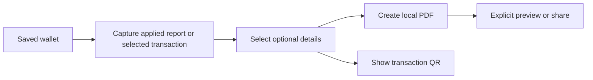

# PDF reports and transaction sharing

Reports can become a local PDF. Each saved transaction also has **Details & share**, which can create a transaction PDF or display a QR summary. These outputs describe recorded data; they do not change a transaction or initiate a payment.

Android PDF creation requires the project's updated installed app, including its native printing repair. Expo Go and older project binaries show an unavailable message. QR display is independent of that printing capability.

## Export a report

1. Open Reports and select a month or apply a custom date range. Export uses the applied range; an unfinished date draft does not change it.
2. Choose Export applied report. The panel captures the displayed period and its financial values at that moment.
3. Choose Create PDF. The PDF includes opening balance, income, expenses, debt payments, outflow, net change, closing balance and the separately labelled all-record balance, followed by category and monthly tables.
4. Open Preview / print PDF to inspect the system preview, or Share PDF to choose a destination yourself. Closing either system surface leaves the generated file available in the panel.

The chart shows at most the latest 12 selected months; the numeric table contains the whole accepted range. Reports are limited to 120 months and 500 category rows. A report is a summary, not a full transaction statement or restorable backup.

## Share one transaction

Choose Details & share next to an Activity entry. The title, transaction type, date, category and currency amount appear before export. Notes, person name, place label and photo start excluded. Select only the details intended for that output, then create its PDF. Changing an option hides the old PDF actions until a new PDF is created, so a previous selection cannot be shared by mistake.

The photo is read from the app's owned attachment and checked again before printing. A missing or unreadable selected photo produces an explicit omission notice. The original phone-gallery path, attachment identifier, account identity and internal storage keys are never printed. HTML text is escaped and images are embedded locally; the PDF template loads no remote resources.

QR choices are separate from PDF choices. Choose the optional textual details and press Show QR code. The code contains a versioned JSON summary with the currency code, integer minor amount and currency precision. It contains neither a photo nor a local file path. Anyone who scans it can read the selected text. There is no scanner, import action or payment behavior in this feature.

The payload limit is 1,024 serialized bytes. Multilingual text is preserved using JSON escapes; those escapes can occupy several bytes per character. If selected details exceed the limit, the app offers Show summary QR or PDF, without shortening the text. Changing a QR option hides the previous code until Show is pressed again.

## Understand the captured output

Later edits to the saved record do not change an already-open export snapshot. Close it and open a new one to capture those edits. Closing the panel, changing wallet ownership or entering a storage-recovery state prevents a pending export from appearing in the wrong session. A native print operation already underway may finish into temporary cache after the panel closes; it is not automatically shared.

A resolved sharing call means the system sharing surface was requested. It does not prove that another application received the file, and the API does not reliably distinguish cancellation from delivery. The interface therefore retains a PDF-ready state rather than claiming it was sent.

## Temporary files and limits

PDFs are stored in the app's cache, with a separate ownership journal. The device can remove cache files. A missing file requires deliberate regeneration; it is not silently recreated during sharing. Registered exports are retained for at least seven days after creation or the latest preview/share request. Cleanup deletes only registered expired files. Recent exports are not evicted to make space for another one.

The cache permits at most 20 files and 100 MiB in total, with a 25 MiB and 500-page limit per PDF. Interrupted or uncertain writes are recovered by reading the journal and checking the exact file. Unidentified cache contents are not swept away. No PDF bytes are saved inside the financial ledger.

## Worked example and exercise

For the report verification wallet, October opens at RM750.00. Income of RM2,000.00, expenses of RM250.00 and debt payments of RM300.00 give a net increase of RM1,450.00 and a closing balance of RM2,200.00. Later November records make the all-record balance RM2,680.00. The PDF must keep those two balances separately labelled.

To check that PDF and QR choices stay separate, use a JPY transaction for 1,234 yen with notes and a photo. Select the photo for PDF, leave every QR option off, and display the QR. The decoded summary should contain `currency: "JPY"`, `amountMinor: 1234`, `fractionDigits: 0`, and the transaction's title, type, date and category. It should contain no notes, photo, attachment path or person/place details. Selecting a PDF photo does not change QR options.

See [Verification](../VERIFICATION.md) for the native checks actually completed on each checkpoint. Automated control-flow and failure tests do not by themselves establish PDF pagination, QR readability or iOS behavior.
