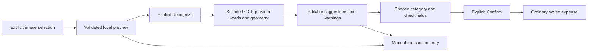

# Review a receipt before saving an expense

Wallet > Tools > Connections > Review receipt turns a selected image into editable suggestions. Recognition uses the explicitly configured Windows OCR or Google Cloud Vision provider through the Windows companion. The phone previews and reviews the result; it does not run an on-device OCR model or automatically create a transaction. The selected provider and data destination appear before the recognition action.

The final result is an ordinary expense in the existing wallet currency and selected expense category. Reports, budgets and achievements use the same transaction model as manual entry. Receipt capture adds no new financial schema, conversion rate, special receipt-origin field or automatically generated notes.

## The review flow

1. Open Review receipt from Connections, or its shortcut when receipt recognition is configured. Choose one image, or choose Take receipt photo when the installed build and camera permission support it. Cancelling selection leaves the current draft unchanged.
2. Inspect the preview, expanding it if needed. A failed preview prevents recognition/confirmation until a usable image is selected.
3. Read the provider disclosure, then choose Recognize receipt for Windows OCR or Recognize with Google Vision for cloud OCR. Only this explicit action sends the selected image. Windows OCR stays on the computer; Vision forwards the image to Google. A configured connection alone does not establish that the service is reachable.
4. Check the suggested title, receipt date, amount and currency against the image. Choose an expense category; the app does not infer one. Ambiguous dates and labelled totals are offered as alternatives rather than silently selected.
5. Optionally select Keep the receipt photo. It starts off. Review the fields and select the explicit acknowledgement, then choose Confirm and save expense.

Editing any reviewed field or changing photo retention clears the acknowledgement. Confirm validates the normal transaction before copying a retained photo or saving financial data. Repeated taps during a pending save cannot create duplicate entries. A failed save keeps its staged photo pinned for an explicit retry instead of making another copy.



## What the suggestions mean

OCR reads characters; it does not know that the receipt is accurate. The parser reconstructs rows from word positions, because receipt totals can appear in a separate amount column. It distinguishes labelled totals from subtotal, tax, cash, change and savings rows. Multiple distinct totals remain ambiguous. Identical repeated totals can agree, but still require review.

Dates such as `03/04/2026` can mean different calendar days. The app shows valid alternatives and does not substitute today's date for an unreadable, invalid or future receipt date. A blank image fills no vendor, date or amount. There is no confidence percentage presented as proof that a suggestion is correct.

Currency follows the wallet's existing precision: MYR uses sen, while JPY uses whole yen. A missing or ambiguous currency prevents automatic total selection and requires explicit review. A known currency that does not match the wallet, or an unsupported currency marker, blocks receipt confirmation. Total choices retain their own interpreted currency, and only matching choices can fill the wallet amount. The feature performs no exchange-rate conversion or silent currency relabelling.

Recognize again deliberately replaces a successful review with a new result. If that request fails, the earlier valid review and manual corrections remain available. Cancel recognition stops waiting and rejects late results; it does not claim that a native host process has already exited. Enter transaction manually opens the ordinary editor without copying OCR guesses.

## Image ownership and cancellation

The native adapter checks actual JPEG, PNG or WebP bytes and dimensions before accepting a preview. Local image selection is limited to 10 MiB, 16,384 pixels per side and 40 million pixels overall. Google Cloud Vision requests have a narrower 6 MiB limit, checked before upload; Windows OCR retains the 10 MiB limit. Unsupported, malformed or oversized results are rejected. The app copies an accepted selection into a temporary owned receipt area; it does not delete gallery originals or save a camera result to the camera roll.

Keep photo creates a separate permanent attachment only during a validated confirmation. If it is off, the saved expense has no receipt photo. Raw OCR rows are temporary review data and are not added to notes or the ledger. This is not an image-metadata removal feature: the selected file bytes may still contain embedded image metadata.

Closing a review, changing account/wallet ownership, replacing the companion connection/provider or losing the active storage state invalidates its asynchronous callbacks. An old response cannot enter a new account's review. Temporary image release waits for any permanent-photo copy to drain. Uncertain cleanup retains the exact owned files and exposes Retry receipt image cleanup; it does not sweep unrelated cache files.

The Windows OCR host uses an owned temporary OCR job. Successful confirmed process closure permits cleanup. If termination is unconfirmed, the job is retained and new OCR is blocked until the owned helper is inspected/recovered. No result is invented while waiting. Manual financial entry remains available when the companion is missing or unavailable.

## Camera capability

The receipt branch declares Android camera permission and a camera-purpose string for ImagePicker. It continues blocking microphone recording, contact writes and background location. Permission is requested only after Take receipt photo; gallery selection and manual entry do not require granting camera access.

The visible camera action requires both native platform availability and `EXPO_PUBLIC_RECEIPT_CAMERA_ENABLED=1`. The installed APK must contain the corresponding native configuration; changing a Metro flag cannot add a missing Android permission to an older binary. Emulator camera input is configured outside the app as its virtual scene. This implementation has no host-webcam control or camera-roll-save call. Physical-camera and iOS behavior need their own verification.

## Connect the Windows companion

The [public companion guide](../scripts/companion/README.md) provides the exact prerequisites, ownership checks, pairing and stop commands. OCR-only mode needs the Windows `en-US` OCR language component, Python and Node; it does not need an LLM, model download or another npm project.

From the app directory, start a uniquely named OCR run explicitly:

```powershell
python scripts/companion/run_companion.py --mode ocr --run-name receipts-001 --node "C:\path\to\node.exe"
```

After that run is verified ready, use the documented pairing command with the exact debug emulator and tool paths. Pairing writes one bounded connection file to the installed app's private files through stdin, and creates only its owned device-port 8787 reverse mapping. The per-run token belongs neither in source control nor in Metro environment variables. The service binds host loopback, requires the token, and rejects browser-origin requests.

Enable the development UI before starting a new Metro process:

```powershell
$env:EXPO_PUBLIC_LOCAL_COMPANION = '1'
$env:EXPO_PUBLIC_RECEIPT_CAMERA_ENABLED = '1'
npm.cmd run android -- --project-app
```

The local companion connection additionally requires a development runtime. Restart Metro after changing these flags, then open Wallet > Tools > Connections, choose Setup beside Review receipt, and choose Recheck after pairing. Its accessible name is Recheck connection. The app reads only its known private connection file, validates the exact loopback URL and schema, and sends no recognition request merely because that file exists. Restarting or repairing the helper needs a new verified pairing/recheck; the app never substitutes a remote endpoint.

Clear that run's matching device pairing before requesting its owned stop, following the companion guide. Do not remove another run's forwarding or stop a process by a broad name. A confirmed post-stop summary can support explicit cleanup of that same stale pairing; uncertain evidence remains available for inspection.

## Optional Google Cloud Vision

Select Vision explicitly in the companion's private configuration and pair its version 2 connection. The provider key remains server-side; the app receives only the declared provider, limit and private loopback connection. See the [Vision guide](../scripts/companion/ocr/GOOGLE_VISION.md) for exact bounds and normalized evidence.

The panel identifies Google Cloud Vision before recognition and explains that the image leaves the device, with possible provider usage charges. Cancel prevents late review results but cannot guarantee that Google stopped already submitted processing or charging. There is no automatic fallback from failed Windows OCR to Vision.

Vision results retain their original provider identity, pixel polygons, axis-aligned bounds, language evidence and optional confidence values. Missing confidence remains unknown. These values do not replace manual review. Unknown or non-English recognition language adds a warning because the field parser primarily recognizes English receipt labels. Switching providers retires the pending capture session; mismatched provider responses cannot produce editable guesses.

Offline integration checks use the reviewed adapter with fake upstream responses, actual owned loopback routes, the real client and the normal confirmation gate. They do not establish live Google account access, general OCR accuracy or a completed native cloud-provider walkthrough. The historical Android checks below exercised Windows OCR.

## Worked example

The included synthetic receipt A has a subtotal of RM11.50, tax of RM1.00 and a labelled total of RM12.50 dated 2026-10-17. A review should propose the total, not the subtotal or tax. After choosing Food, checking the fields and confirming, the saved amount is 1,250 sen and the wallet balance decreases by RM12.50. If an applicable Food budget has RM13.60 remaining, this expense leaves RM1.10.

Exercise: recognition shows two distinct labelled totals and the date `03/04/2026`. The image preview is readable. What should happen before a transaction is saved?

Answer: neither ambiguity authorizes a save. Read the image, choose or type the correct total and ISO date, select the expense category, verify the wallet currency and explicitly acknowledge the fields before Confirm. If the receipt cannot be read confidently, cancel or use the separate manual editor. No guessed amount or today's date should be inserted as a fallback.

The completed Android gate contains 11 recorded checks. A selected receipt image passed through real Windows OCR, review, acknowledgement, explicit expense/photo save and restart. Its retained photo still matched the source bytes after the owned gallery source was deleted. Camera denial/grant, real emulated capture preview and later cancellation were verified separately. Blank OCR and a stopped service created no expense, manual fallback stayed reachable, and final temporary-capture cleanup left zero owned files.

See [Verification](../VERIFICATION.md) for the exact scope. The successful OCR/save path used the selected synthetic receipt image; camera capture/preview verification does not establish general camera-photo OCR accuracy. Parser/unit tests, a rebuilt camera APK and a configured connection are different kinds of evidence. Physical-device camera behavior, iOS and full receipt-form large-text coverage remain unverified.
