# Screenshot tour

The images use real app captures with fictional financial records. A fresh installation starts empty. Phone frames and captions were added for presentation; application pixels, amounts and dates are unchanged. Some captures retain their original scroll position.

[Project overview](../README.md) | [Features and navigation](FEATURES.md) | [Verification](../VERIFICATION.md)

## Financial score and what-if analysis

[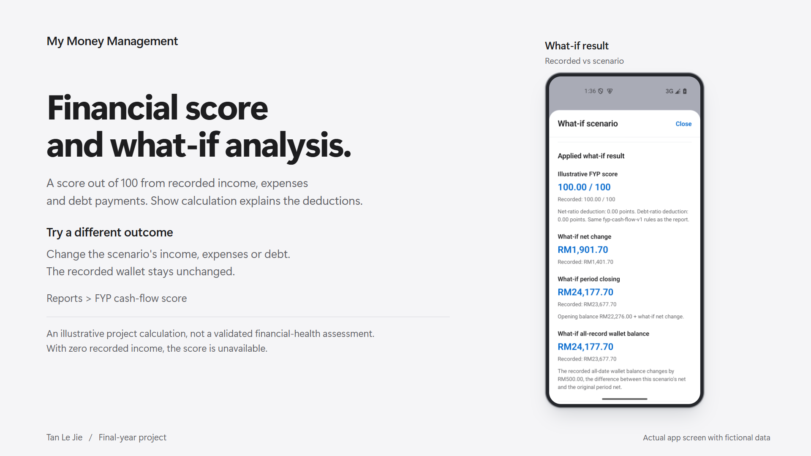](images/portfolio/financial-score.png)

Reports includes the **FYP cash-flow score**, its calculation breakdown and **Try a what-if scenario**. The screenshot above shows the simulator's recorded-versus-scenario result, not a new capture of the Reports score panel. In this example, reducing October expenses by RM500 changes the calculated net and balances; the recorded and hypothetical scores both remain 100.00. The score uses project assumptions and is not a validated assessment of someone's complete financial health. [Score and simulator guide](HEALTH_AND_SIMULATOR.md)

## Financial assistant

[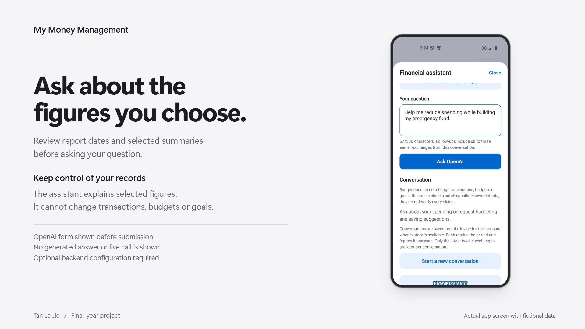](images/portfolio/assistant.png)

The OpenAI form is shown before submission. No generated answer or live provider call is shown. The assistant receives selected report summaries and cannot change transactions, budgets or goals. [Assistant guide](FINANCIAL_ASSISTANT.md)

## Expense forecasts

[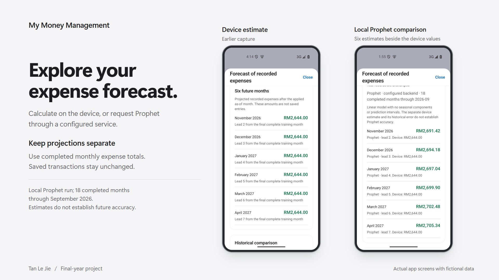](images/portfolio/forecasts.png)

The device image is retained from an earlier checkpoint. The Prophet image shows a local run using 18 completed expense months through September 2026, with estimates for November 2026 through April 2027. Its device comparison does not establish Prophet accuracy. [Forecast guide](MONTHLY_FORECAST.md)

## Goals and calculations

[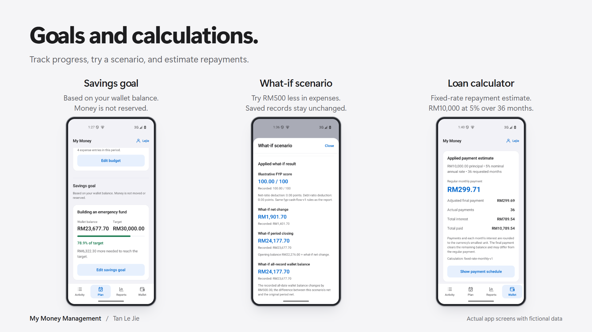](images/portfolio/planning.png)

Savings progress follows the recorded wallet balance without reserving money. The simulator changes hypothetical totals only. The loan example uses RM10,000 at a 5% nominal annual rate over 36 months. [Budgets and goals](BUDGETS_AND_GOALS.md) | [Loan calculator](LOAN_CALCULATOR.md)

## Receipt review and details

[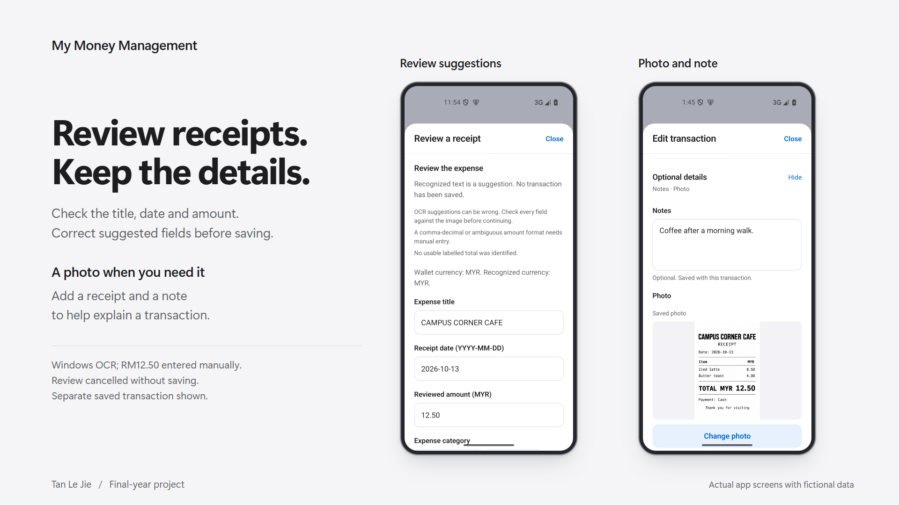](images/portfolio/receipts.png)

Windows OCR suggested the title, date and currency; RM12.50 was entered manually. The pictured review was cancelled without saving. The photo-and-note screen is a separate saved transaction, not the result of that captured OCR review. Google Cloud Vision is the configured hosted recognition option; this capture does not demonstrate a live Vision call. [Receipt guide](RECEIPT_CAPTURE.md)

## Manual cloud backup

[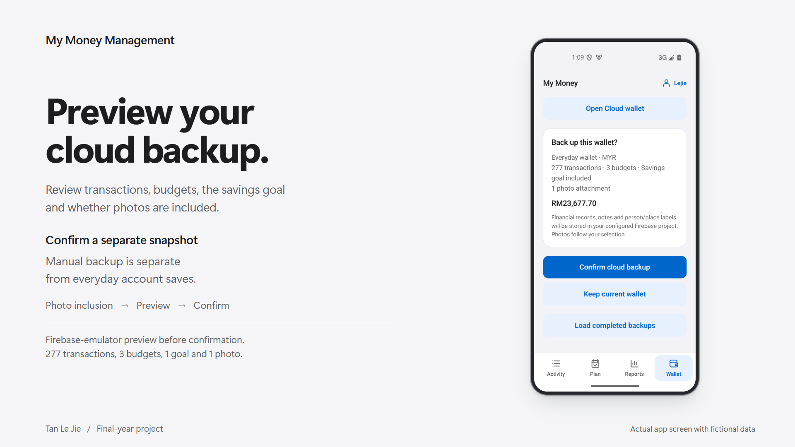](images/portfolio/backup.png)

This Firebase-emulator preview includes 277 transactions, three budgets, a savings goal and one selected photo. Photo inclusion is chosen before preview and confirmation. Manual backup creates a separate recovery snapshot; it is distinct from everyday account saves. [Firebase setup](../tools/firebase-backup/README.md)

## Balances and PDF reports

[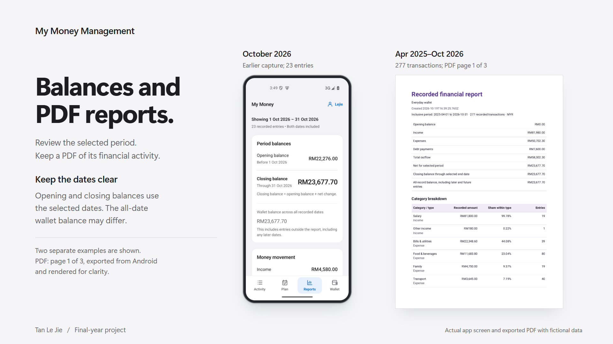](images/portfolio/reports-export.png)

The earlier balance capture covers October 2026 and 23 entries. The separate PDF export covers April 2025 through October 2026, with 277 transactions and 19 monthly rows. Its first page is faithfully rendered from a three-page Android export. [Financial reports](FINANCIAL_REPORTS.md) | [PDF and QR](PDF_AND_QR.md)

## Original captures

The original files and their detailed captions remain available below. The [UI guide](UI_DESIGN.md#supplementary-views-from-the-earlier-checkpoint) contains three additional views from the earlier checkpoint.

Open the original captures and captions

The screenshots use fictional financial records; a fresh installation starts empty. They show real Android screens and the first page of an app-generated report. Captions identify the service used for each connected feature.

#### Record and plan

| Activity                                                                                                                 | Transaction details                                                                                                                                         |
| ------------------------------------------------------------------------------------------------------------------------ | ----------------------------------------------------------------------------------------------------------------------------------------------------------- |
| <a href="images/activity.png">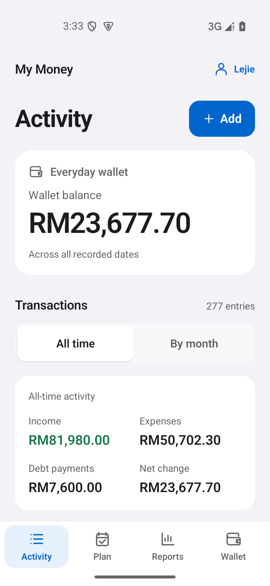</a> | <a href="images/transaction-details.png">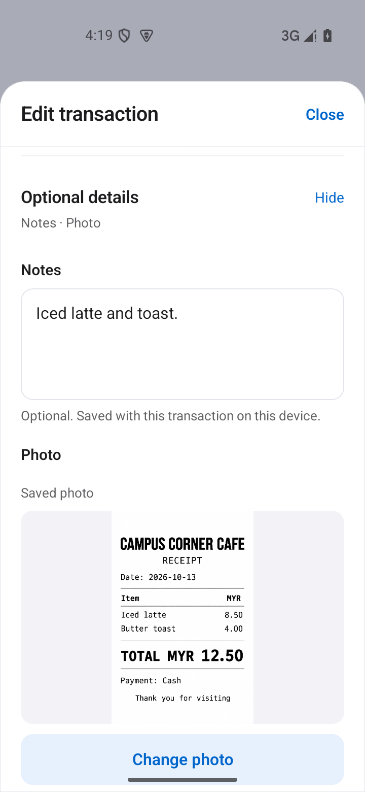</a> |
| View the all-date wallet balance and select October 2026 activity, containing 23 recorded entries.                       | Keep a receipt photo and optional details with an ordinary transaction.                                                                                     |

| Category budgets                                                                                                               | Savings goal                                                                                                                       |
| ------------------------------------------------------------------------------------------------------------------------------ | ---------------------------------------------------------------------------------------------------------------------------------- |
| <a href="images/plan.png">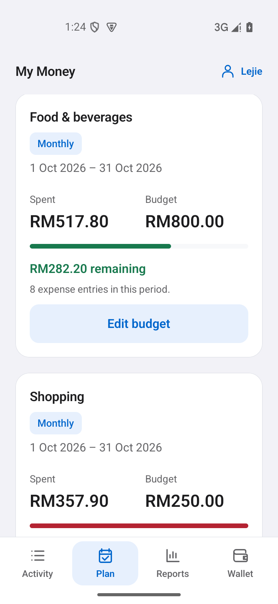</a> | <a href="images/goal.png">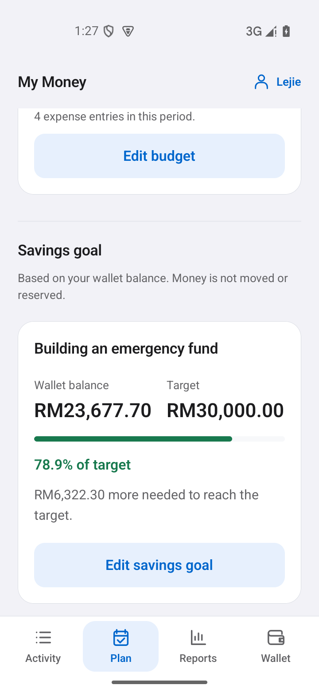</a> |
| Compare category spending with its own budget, dates and remaining amount.                                                     | Follow progress toward a savings target using the recorded wallet balance.                                                         |

#### Understand and explore

| Reports                                                                                                                                               | What-if simulator                                                                                                                            |
| ----------------------------------------------------------------------------------------------------------------------------------------------------- | -------------------------------------------------------------------------------------------------------------------------------------------- |
| <a href="images/reports.png">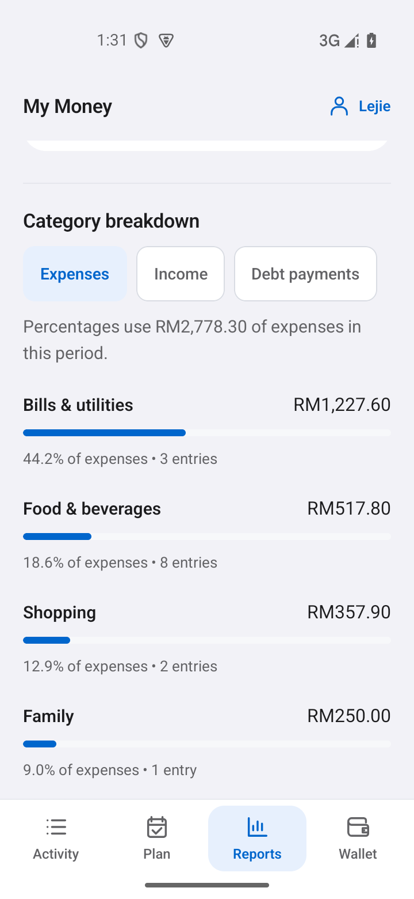</a> | <a href="images/simulator.png">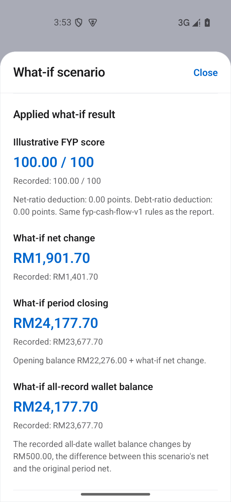</a> |
| The leading four of seven October expense categories. Shares use the full RM2,778.30 expense total.                                                   | Explore how RM500 less in October expenses changes the calculated result, without changing saved records.                                    |

| Loan calculator                                                                                                          | Expense forecast                                                                                                                                   |
| ------------------------------------------------------------------------------------------------------------------------ | -------------------------------------------------------------------------------------------------------------------------------------------------- |
| <a href="images/loan.png">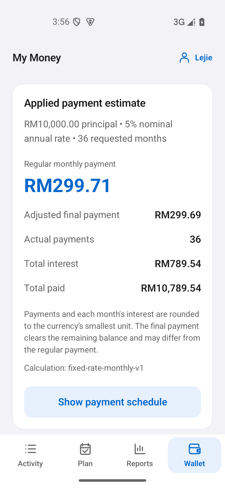</a> | <a href="images/forecast.png">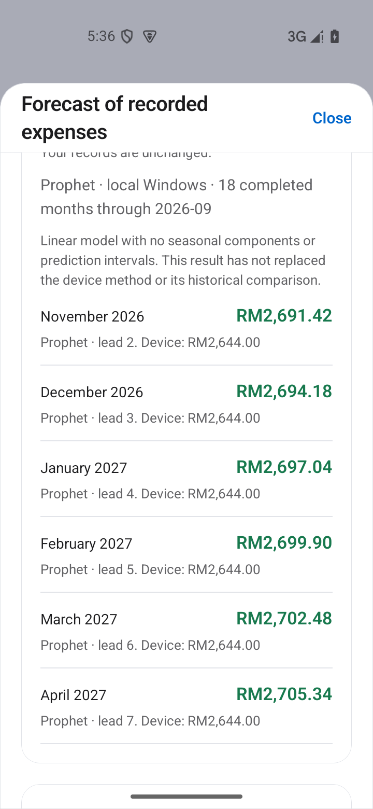</a> |
| Calculate fixed-rate payments, interest and repayment totals from explicit inputs.                                       | Six local Prophet estimates trained on 18 completed expense months through September 2026, shown beside the device method.                         |

#### Capture, explain and preserve

| Receipt review                                                                                                                                                      | Financial assistant                                                                                                                                             |
| ------------------------------------------------------------------------------------------------------------------------------------------------------------------- | --------------------------------------------------------------------------------------------------------------------------------------------------------------- |
| <a href="images/receipt.png">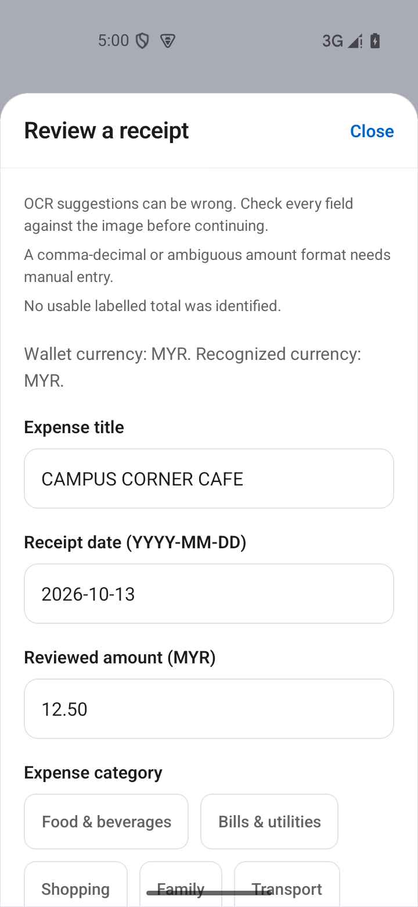</a> | <a href="images/assistant.png">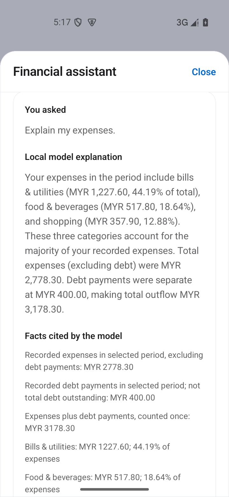</a>                          |
| Windows OCR suggested the title, date and currency. No total was auto-filled; RM12.50 was entered manually after checking the receipt.                              | Review the applied dates and selected financial summaries before asking OpenAI. The question form is shown before submission; no generated answer is displayed. |

| Backup preview                                                                                                                                                  | Exported report                                                                                                                                                                      |
| --------------------------------------------------------------------------------------------------------------------------------------------------------------- | ------------------------------------------------------------------------------------------------------------------------------------------------------------------------------------ |
| <a href="images/cloud-backup.png">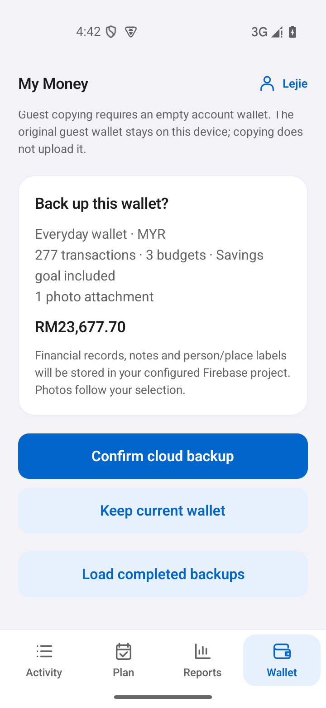</a> | <a href="images/report-export.png">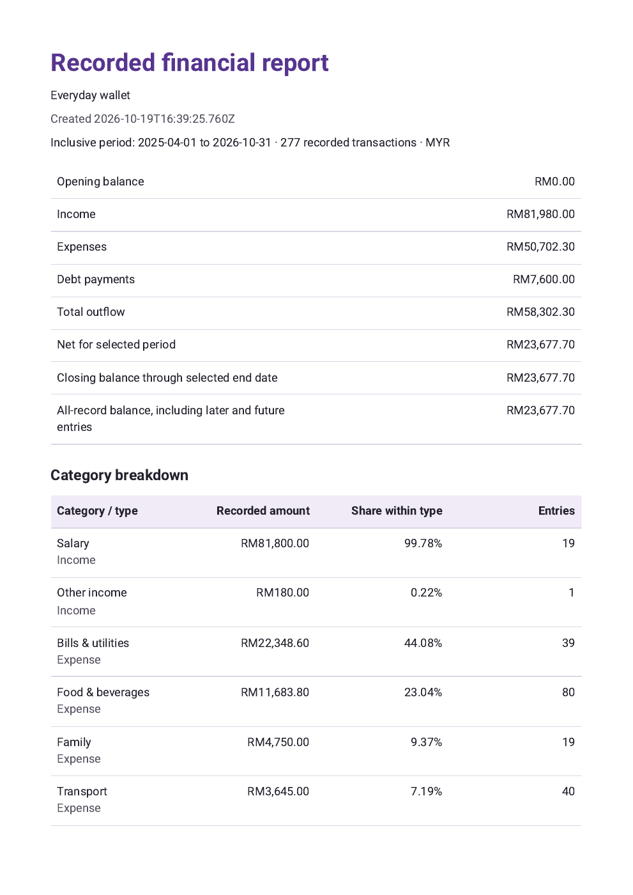</a> |
| Preview the wallet and selected receipt photo before confirming a separate recovery backup. This view uses local Firebase emulators.                            | First of three pages of the app-exported report for April 2025 through October 2026, covering 277 transactions and 19 monthly rows. Rendered locally for readability.                |

The captions distinguish local Windows OCR and Prophet runs from the OpenAI form before submission and the Firebase-emulator preview. Eleven images are native Android captures; the report image is a faithful rendering of the exported PDF page. Click an image for full resolution. The [UI guide](UI_DESIGN.md#native-android-gallery) has three more views from an earlier checkpoint, and [Verification](../VERIFICATION.md) records the checks behind them.

