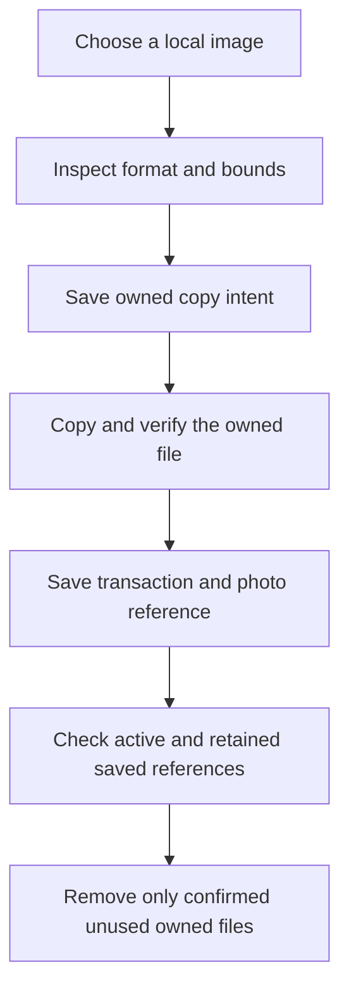

# Transaction notes, photos, people and places

Open a transaction, then expand Optional details. Notes, one photo, a person name and a place label are optional. Saving these details does not change the amount, category, date or financial calculations. Changing an amount later preserves the saved details unless you explicitly remove them.

## What is kept

| Detail | Saved value | Purpose |
| --- | --- | --- |
| Notes | Up to 2,000 characters, including meaningful line breaks | Record why the transaction happened. |
| Photo | A generated reference to one app-owned JPEG, PNG or WebP file | Keep an image available after the temporary picker file is gone. |
| Person | A confirmed name and its manual/contact source | Remember who the transaction involved without saving a contact record. |
| Place | A confirmed label and its manual/device/map source | Remember a place without keeping coordinates or location history. |

The app does not save the contact's phone number, email or native contact ID. A place lookup's coordinate and accuracy remain temporary. Manually changing a suggested name or place marks it as entered manually. A contact is a name snapshot; later address-book edits do not silently change a transaction.

Photos must be at most 10 MiB, no more than 16,384 pixels on either side, and at most 40 million pixels. The adapter checks actual PNG/JPEG/WebP container bytes and asks the native image loader to confirm dimensions. Filename extensions and picker MIME labels alone do not establish a supported image. Animated images, HEIC, AVIF, GIF and video are not accepted in this version. No conversion or removal of embedded metadata is promised. Selecting a photo does not perform receipt OCR or upload it.

## Explicit native actions

Add photo from library opens the system picker. Cancelling keeps the previous draft. If Android reports an interrupted older selection without a restored originating form, the app asks you to choose again; it never attaches that result to an unrelated transaction.

Choose from contacts requests the permission needed to read the chosen name, opens the native picker, and reads that selected name only. Review the candidate and choose Use this name. The app does not enumerate or modify the address book. Manual entry remains available when permission or the picker is unavailable.

Use current location requests a foreground fix. Choose on map opens an online map where you can select a point and request its place name. Review the returned label before confirming it. A missing address, denied permission or service error leaves manual entry available. The app does not replace a failed current fix with an undisclosed old fix. A timeout stops the UI waiting; it does not claim to cancel the underlying platform request.

Obtaining a current fix and looking up its name each have a 20-second service deadline. The picker has a 50-second overall backstop so both stages can finish; Cancel ends the UI wait immediately. Map rendering has its own separate 15-second deadline and retry.

The map uses [MapLibre React Native](https://maplibre.org/maplibre-react-native/) and the [OpenFreeMap Liberty style](https://openfreemap.org/quick_start/). OpenFreeMap requires no account or API key and offers no service-level guarantee. OpenMapTiles and OpenStreetMap attribution remain visible. Map rendering and platform address lookup need their respective network/provider availability; no offline tile download is implemented. The installed project app is required for MapLibre, and Expo Go shows a manual-entry fallback.

## A photo save has two parts

The phone's files and financial store cannot share one atomic save. The photo manager records its owned copy intent, copies and verifies the image, then lets the ordinary transaction save reference it. The original gallery file is never deleted.

A failed transaction save keeps the draft's verified copy available for retry. Cancelling closes that draft and requests reference-aware cleanup. Replacement, removal and deletion save the financial change first. If file cleanup fails, the financial save remains valid and the app offers Retry photo cleanup. Uncertain storage reads retain files instead of guessing that they are unused.

Cleanup checks both the active wallet and retained migration stores under the same queue as financial writes. A photo still referenced by an older retained snapshot is intentionally kept. It is not restored as a new transaction. Only journaled files belonging to the current storage family can be deleted; cleanup never scans and empties arbitrary directories.

## Migration and example

Schema v5 uses a new active key and preserves the original v4, v3, v2 and v1 bytes. Valid v4 wallet identity, achievements and financial values remain the same. Compatible old textual notes/person/place fields can be promoted as recorded details while retaining their original metadata. Old image URLs are neither downloaded nor treated as owned local photos. Malformed reserved data or an unsupported newer format stops migration without replacement.

For example, an RM12.50 lunch with the note Shared lunch, person Alex and place Campus cafe reduces the balance by RM12.50. Adding a receipt photo changes no total. Editing the amount to RM15.00 reduces the balance by a further RM2.50 and keeps the details. Removing the photo and saving keeps the note, person and place.

Exercise: if an image copy succeeded but the financial save reported an error, can Cancel safely delete that file immediately? No. The financial write may have taken effect before its error was returned. The existing commit readback and reference scan must establish the actual saved state first.

## Verification limits

All 339 application/launcher checks and TypeScript passed. The API35 Android gate exercised manual details, source-independent owned-photo persistence, removal/reattachment, contact permission and name-only storage, actual map tiles/point selection/platform address lookup, explicit label confirmation, and restart at font scale 1.3. The old v4 store remained byte-identical throughout v5 edits. See the [verification record](../VERIFICATION.md) for the exact scope and the local debug-network trust setup. Windows Android builds do not establish iOS or physical-device behavior.
