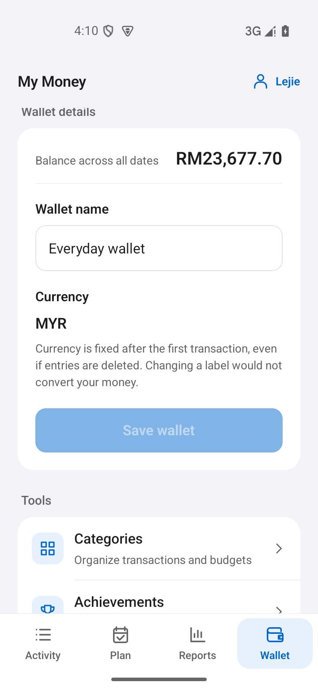
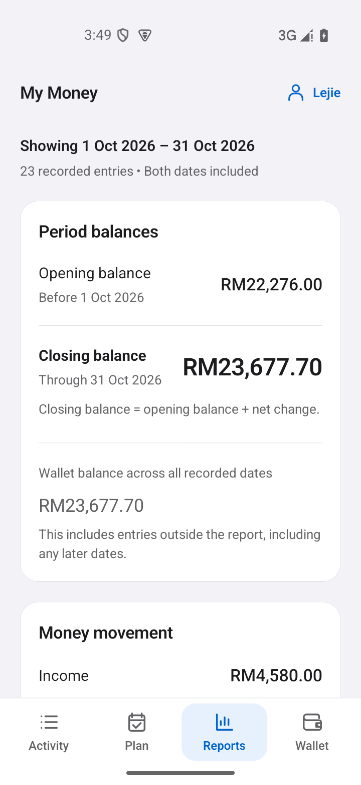
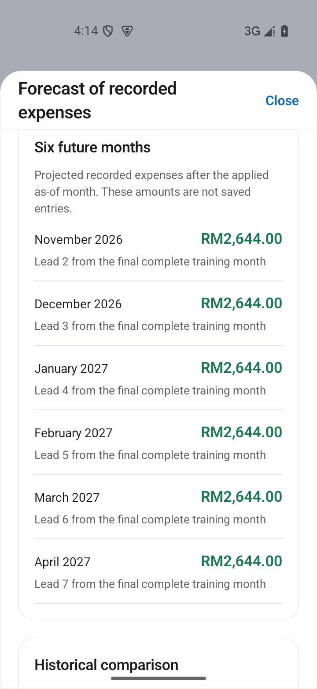

# Apple-inspired mobile interface

The interface uses light grouped surfaces, platform typography, readable money and consistent controls across Activity, Plan, Reports and Wallet. The current design keeps ordinary local tracking prominent and puts optional service setup under Wallet > Connections, in the Tools group. Android is the current development target; visual styling does not establish iOS behavior.

## First launch and saved data

An ordinary first launch creates an empty local wallet with predefined categories, no transactions, no budgets and no savings target. No account or companion is needed. Existing wallets take precedence over the default seed, including supported migration stores. Changing the default does not clear data, convert an existing sample wallet into a real one or fabricate a new history.

Existing sample wallets remain explicitly labelled because sample mode has different achievement behavior. Verification fixtures and the gallery dataset are separate, deliberately prepared data. The ordinary empty state must remain useful without them.

## Shared visual language

| Role              | Value     | Purpose                                               |
| ----------------- | --------- | ----------------------------------------------------- |
| Canvas            | `#F2F2F7` | Separate white content groups without heavy outlines  |
| Surface           | `#FFFFFF` | Forms, grouped rows and financial content             |
| Main text         | `#1C1C1E` | Headings, primary values and entry titles             |
| Secondary text    | `#636366` | Dates, labels and supporting explanations             |
| Action            | `#0066CC` | Enabled actions, selected controls and focused fields |
| Positive          | `#18794E` | Income and progress, accompanied by signs or labels   |
| Destructive/error | `#B42332` | Destructive actions and errors, accompanied by text   |

Platform system fonts avoid a bundled font dependency. Page titles use 32/40 size/line-height, section headings 17/24, body text 15/23 and hints 13/19. Monetary values use tabular numerals and retain their exact currency precision instead of approximate abbreviations. Outline icons use the existing SVG library and supplement visible labels and accessible names.

Selected text/action contrast pairs were checked during the earlier design work; those checks are not a complete accessibility audit. Disabled states, native text scaling and screen-reader behavior still need appropriate device verification.

## Activity

Activity is the home screen. Add opens the ordinary transaction form, and the wallet balance is labelled Across all recorded dates. All time / By month controls precede period totals and the transaction list. Editing and Details & share remain separate targets.

An empty wallet offers its first entry rather than displaying invented transactions. The edit/delete hint appears only when entries exist. A configured receipt connection adds a compact Review receipt shortcut; it does not claim recognition has succeeded. Full setup and manual receipt access remain under Connections.

When account access is unconfigured, the persistent header shows the wallet name and opens wallet settings. Configured accounts retain their account shortcut. Exact idle restore/seed messages are omitted from the header; meaningful save results, errors and recovery actions remain.

## Plan

Each budget keeps its category, calendar period, exact dates, spending, limit and remaining/over amount together. Amount rows can stack for larger text. Empty states explain how to add a budget or savings target.

The savings goal stays separate and follows the wallet balance without moving or reserving money. Overlapping weekly, monthly and yearly plans are not combined into an invented remaining allowance. Progress always has a textual explanation rather than relying on color alone.

## Reports

The applied dates and reconciled balances precede report actions. Opening, closing and all-date wallet balances remain distinct. Category breakdowns preserve their denominators; zero-income ratios remain unavailable rather than inventing a value.

Date edits require Apply. Invalid edits preserve the displayed report, and exports and explanations use its applied range. A configured assistant provider adds the assistant shortcut. The explicit Choose a report route from Connections also exposes that action with guidance; it never guesses a range or sends a question merely by navigating.

The score, simulator and expense forecast remain distinct from recorded facts. The simulator captures its baseline, while forecast selection has its own as-of date and category. The device forecast works without a service. An optional Prophet comparison uses the applied completed-month history only after the user chooses Run local Prophet; its provider result stays distinct from the device forecast and its historical error figures. Insufficient history stays an honest unavailable state.

## Wallet and Connections

Wallet groups everyday settings and tools. Categories, achievements, reminders and the loan calculator remain under Tools, alongside Connections. Account access is promoted as a wallet shortcut only when configured. Start fresh stays separate and requires its existing disclosure and confirmation.

Connections keeps optional accounts and services discoverable without making them prerequisites for ordinary tracking:

- **Account:** open the configured Firebase account service or the standalone local Auth emulator. When unconfigured, explain that the current wallet works without signing in instead of presenting unusable sign-in buttons. Signing in opens a separate account wallet; it does not copy or upload guest records.
- **Cloud backup:** preview a guest-wallet copy, a manual backup or a restore before explicitly confirming it. Copy and restore require an unchanged empty account wallet. Copying preserves the original guest wallet and does not upload it. Backup photos are a separate opt-in choice, and pending uploads remain visible for deliberate reconciliation.
- **Receipts:** choose/review an image, inspect connection details or open ordinary manual entry. The screen identifies Windows OCR or Google Cloud Vision and explains the destination before the recognition action. Choosing an image alone sends nothing. Suggestions remain editable and require the existing field, currency and category review before saving an ordinary expense.
- **Financial assistant:** choose a report, inspect its applied facts and explicitly ask the selected local model or OpenAI through the Windows companion. The screen discloses the selected provider and any cloud destination. Only the current question and selected fact rows are sent; earlier conversation turns are not sent. Calculated facts remain usable without a model, and answers cannot change saved finances.
- **Expense forecasts:** open the device forecast, review its applied as-of date and category, and optionally request a local Prophet comparison through the configured Windows companion. The service receives the selected completed-month totals after that explicit request; opening the forecast does not start a model fit.

Configured means connection settings are present, not that a provider is reachable or has been verified. OpenAI and Google Vision credentials are configured on the Windows host, not entered in the mobile UI; the paired connection declares the selected capabilities and provider identities. Firebase client setup and its project access rules have their own configuration path. The [original service integration guide](ORIGINAL_SERVICE_INTEGRATIONS.md) explains the implemented options and their prerequisites. Hosted Firebase and live OpenAI/Vision behavior remain outside the completed verification evidence; setup availability is not a claim of a successful live request.

## Sheets, forms and feedback

Shared sheets sit at the bottom on phone layouts and center on spacious layouts. Their title and Close action remain above scrolling content. Keyboard avoidance, handled-tap scrolling and focus styling preserve access to fields and actions. Explicit Close and Android Back retain busy guards, and the assistant retains its opening-session key.

There is no drag-to-dismiss claim or decorative drag handle. The existing Modal uses a static transition. Shared actions retain at least 48dp targets; important text can wrap, and decorative icons are excluded from accessibility focus.

Loading, error, empty and content states stay distinct. Unconfirmed saved data must not appear as a newly empty wallet. Recovery, cleanup retry and explicit save feedback remain reachable even though routine readiness text has been removed.

## Behavior preserved by presentation

- Financial screens stay behind confirmed owner/session gates.
- Existing records and migration bytes are retained; a new default is not a reset.
- Applied selections remain distinct from pending form edits.
- Optional photo retention, export details and QR text require explicit choices.
- Recognition and explanations do not save transactions automatically.
- Currency restrictions, reset confirmation and owned-resource cleanup retain their existing behavior.
- An inactive period can carry an earlier balance, and missing records do not prove real-world inactivity.

## Verification

At the earlier empty-wallet UI checkpoint, focused source tests covered shortcut visibility, Connections navigation, manual fallback, applied report dates, idle-message suppression, account recovery and the empty Activity state. That checkpoint passed 850 JavaScript tests and TypeScript before the current optional-provider integration. The current [verification record](../VERIFICATION.md) tracks the later integrated source gate and native checks; the earlier count does not describe the final integration gate.

At that earlier checkpoint, seven native check groups covered empty first launch, invalid/cancelled and confirmed entry, optional-tool discovery, budget/goal saves, app-process restoration, navigation at font scale 1.3, and a freshly built APK with native PDF generation. Ledger bytes remained identical across read-only tool navigation and across the later restart, font-scale and APK-update checks. [Verification](../VERIFICATION.md) separates these observations from older provider-backed feature evidence.

## Native Android gallery

The [README tour](../README.md#screenshots) groups twelve main workflows into everyday recording and planning, analysis, and optional connected tools. Three supplementary views below show wallet settings, period balances and the device forecast.

The views use fictional records in a 277-transaction MYR wallet. The wallet balance is RM23,677.70; its October report opens at RM22,276.00 and closes at RM23,677.70. A saved cafe receipt and note belong to an ordinary transaction. The display name is Lejie. Read-only walkthroughs compare the account, guest-wallet and managed-photo bytes before and after each view.

| View                | What it shows                                                                                                                                                                                                                                                                 |
| ------------------- | ----------------------------------------------------------------------------------------------------------------------------------------------------------------------------------------------------------------------------------------------------------------------------- |
| Activity            | All-time wallet balance and recorded activity, with income, expenses and debt payments distinguished.                                                                                                                                                                         |
| Transaction details | The saved receipt photo and note within an ordinary transaction's optional details.                                                                                                                                                                                           |
| Category budgets    | Food & beverages spending of RM517.80 against an October budget of RM800.00, leaving RM282.20.                                                                                                                                                                                |
| Savings goal        | Progress derived from the recorded wallet balance, without moving or reserving money.                                                                                                                                                                                         |
| Reports             | The leading four of seven October expense categories: Bills & utilities RM1,227.60, Food & beverages RM517.80, Shopping RM357.90 and Family RM250.00. Shares use the full RM2,778.30 expense total, including the three categories below this scroll view.                    |
| What-if simulator   | A hypothetical RM500 reduction in October expenses gives RM1,901.70 net change and RM24,177.70 calculated closing balance. No transaction is saved.                                                                                                                           |
| Loan calculator     | A RM10,000 loan calculation at 5% nominal annual interest over 36 months, with explicit payment, interest and repayment totals.                                                                                                                                               |
| Expense forecast    | All six local Prophet estimates from November 2026 through April 2027, using an as-of date of 18 October and 18 completed months through September. Each displayed value matches the actual service response; the RM2,644.00 device comparison is separately labelled.        |
| Receipt review      | Windows OCR suggested the cafe title, 13 October 2026 and MYR. No total was auto-filled; RM12.50 was entered manually after visually checking the receipt. Recognition warnings remain visible, confirmation stays unchecked, and the review is cancelled without saving.     |
| Financial assistant | A real local Qwen explanation of October expenses with the three largest expense categories explicitly selected. The displayed amounts, percentages and cited facts were checked against the report. Future answers still require review; the model cannot change the wallet. |
| Backup preview      | A Firebase-emulator preview of 277 records, three budgets, the savings goal and one selected photo attachment. The preview is cancelled without uploading.                                                                                                                    |
| Exported report     | The first page of the genuine two-page October PDF generated by the Android app, rendered locally for readability. Both pages were checked against the applied report.                                                                                                        |

The README displays linked images at a fixed 320-pixel width in two columns. Native phone images keep their original 720-by-1560 pixels, system bars and aspect ratio. The report image is a faithful PDF page rendering. Labels, amounts and application pixels are not replaced for presentation; the links open the original full-resolution images.

### Supplementary views

These three views complement the twelve main README features.

| Wallet settings                                                                                                 | Period balances                                                                                                                                         | Device forecast                                                                                                                                    |
| --------------------------------------------------------------------------------------------------------------- | ------------------------------------------------------------------------------------------------------------------------------------------------------- | -------------------------------------------------------------------------------------------------------------------------------------------------- |
|  |  |  |
| Everyday wallet, MYR and its recorded balance.                                                                  | October opens at RM22,276.00 and closes at RM23,677.70; the all-date balance remains separately labelled.                                               | The device method projects RM2,644.00 for each of six future months. This is separate from Prophet output.                                         |

Achievements, reminders, QR sharing and additional transaction tools are covered in their feature guides. The showcase does not imply that every feature appears in one gallery.

See [Android setup](ANDROID_SETUP.md) for the build path and [Verification](../VERIFICATION.md) for workflow evidence and limits. Hosted Firebase, live OpenAI and Google Vision requests, physical-device behavior, iOS and a full screen-reader audit remain unverified.
