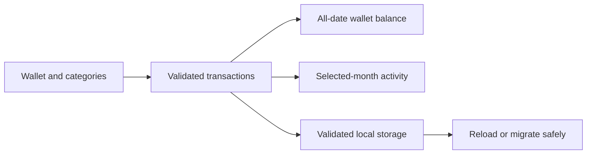

# Wallet and transaction foundation

The app supports one active wallet. A wallet has a name and one currency; it does not convert between currencies. The original eight currency choices are available. JPY uses whole yen, while MYR, USD, EUR, GBP, AUD, CAD, and CNY use two decimal places.

## Money, categories, and dates

Amounts are positive integers in the currency's smallest unit. The transaction type determines whether the amount adds to income, expenses, or debt payments. Debt reduces the wallet balance once. Currency becomes fixed after the wallet records its first transaction, including when those transactions are later deleted. The explicit Start fresh flow creates a new empty wallet and allows a different currency.

Transactions reference stable category IDs. Renaming a category updates its displayed name without breaking existing records. A category used by a transaction cannot be deleted. New category names must be unique within their transaction type.

Dates are calendar values in `YYYY-MM-DD` form. The model rejects impossible dates such as 2026-02-30 instead of allowing JavaScript to roll them into another month. Month navigation is bounded to the model's supported 1900–2100 range.

The wallet balance always includes all recorded dates. The activity section can show all dates or one selected month. This prevents a filtered month's net change from being mistaken for the wallet's total balance.

## Saved-data migration

The current core v5 store uses a separate key. When it is absent, migration checks v4, v3, v2, and the initial v1 preview in that order. It validates the first present source, preserves transaction IDs, dates, amounts, and category spellings, then writes a new copy. The original bytes remain unchanged. Invalid data does not fall back to stale history or reset records. Failed writes are checked against the active saved key before their outcome is reported. See [Budgets and savings goals](BUDGETS_AND_GOALS.md) for the planning fields added in v3 and [Achievements and reminders](ACHIEVEMENTS_AND_REMINDERS.md) for the ownership and milestone fields added in v4.

Native verification uses a separate synthetic namespace through `EXPO_PUBLIC_TEST_DATA_NAMESPACE`. That test store does not read or migrate any canonical store. The environment variable is for local verification; it is not an account or security boundary.

## Worked example

Record RM1,000 income in October, RM80 food in October, RM50 food in September, RM20 food in November, RM30 transport in October, and RM40 debt payment in October.

- All-date wallet balance: `1000 - 80 - 50 - 20 - 30 - 40 = RM780`.
- October activity: income RM1,000, expenses RM110, debt RM40, net change RM850.
- Editing October food to RM120 changes the all-date balance to RM740.

Exercise: rename Food to Meals. The October expenses should remain RM110 and the all-date balance should remain RM780. The labels change; transaction references and amounts do not.

## Checks completed

The full automated suite contains 25 passing tests, including 17 core currency, date, reference, migration, and storage cases. TypeScript passes. Independent review found an unbounded month-navigation edge case; both arrows now clamp and disable at the supported boundaries.

Headless Android checks passed for the initial balance, wallet rename/save/restart, custom category creation, previous-month navigation, explicit fresh-wallet confirmation with JPY, and fresh-wallet persistence. These checks used only an isolated synthetic store. iOS remains unverified.
