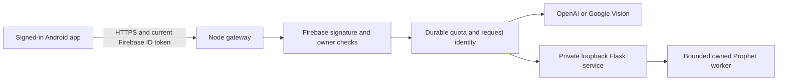

# Portable financial-services backend

This backend connects the Android app to OpenAI, Google Cloud Vision and Flask/Prophet without requiring a Windows companion on the user's computer. Ordinary guest tracking stays on the device. Signed-in clients use their current Firebase ID token; provider keys remain on the server. Configuring a provider does not submit an image or question. The user must request each operation.

The optional Qwen/Windows OCR companion remains a separate local route. A failed hosted request never switches providers or falls back to that companion.

## Request path



`GET /v1/services` authenticates the caller and returns the configured project, owner, service revision and provider descriptors. The app checks that metadata against its current account before creating clients. Each subsequent request includes a binding covering the service, project, owner, capability and exact provider descriptor. A changed account, provider or metadata record requires a fresh check. Provider credentials are never present in the metadata or mobile configuration.

The gateway exposes `POST /v1/assistant/explain`, `/v1/recognize`, `/v1/forecast`, and the assistant/forecast cancellation routes. The assistant reuses the app's bounded summary/history protocol and structured response validation. OCR reuses the reviewed Google Vision adapter and image-header validation. Prophet receives only validated completed-month expense totals and returns six estimates. The backend does not store conversations, images or financial records. Its SQLite database contains hashed owner counters and request IDs only.

## Prerequisites and configuration

Use Node 24.22.0. No npm package is required by the backend itself: HTTP, TLS, cryptography and SQLite use Node's standard library, and model/provider adapters are repository source. The app's dependencies are still required to run its full test suite.

For Prophet, prepare a separate Python 3.12 environment with `requirements-python312.txt`. The file pins the reviewed package versions, including Prophet 1.5.0 and Flask 3.1.3. It does not contain audited Linux wheel hashes. Windows can instead use the existing hash-pinned [forecast setup](../forecast/README.md). Installing these packages or building the container downloads third-party software; neither action happens on backend startup.

Copy `.env.example` to a private location and supply your Firebase project, a stable service ID, an absolute data directory and the selected server-side provider settings. Leave unused provider keys empty. At least one provider must be explicitly enabled. For OpenAI, select a model that supports the adapter's Chat Completions structured-output contract. A subscription to a chat or coding product is not a credential configured by this source.

Start from the repository root after loading those variables into the process environment:

```text
node tools/backend/main.cjs
```

On Windows, keep the backend data directory inside the checkout's ignored `.runtime` directory when Prophet is enabled; its reviewed Windows Job runner preserves that ownership boundary. On Linux the container uses `/data`. Retain the SQLite data volume across restarts, or the stored usage counters will be lost. Run one gateway process per database; do not scale this reference implementation across independent data volumes and claim a shared quota.

## HTTPS and deployment boundary

Hosted mode requires either direct TLS using `TLS_KEY_FILE` and `TLS_CERT_FILE`, or an explicitly trusted HTTPS ingress. Direct TLS does not depend on forwarded headers. Proxy mode requires both `TRUSTED_TLS_PROXY=1` and an exact `TRUSTED_PROXY_PEERS` match for the actual TCP peer; only then is `X-Forwarded-Proto: https` accepted. The default peer list is loopback. Keep the backend HTTP listener private to that ingress. A header by itself is not evidence of TLS, and exposing the raw backend port publicly is not a supported deployment.

The container recipe uses official Node and Python images and Debian runtime libraries. From the repository root:

```text
docker build -f tools/backend/Dockerfile -t my-money-services .
```

The root `.dockerignore` is an allowlist for the required source. Runtime folders, Git history, installed packages, native builds, private JSON configuration and credentials are excluded. Supply runtime secrets through the deployment platform or a private environment file, mount TLS files read-only when using direct TLS, and mount durable storage at `/data`. Do not bake keys or certificates into an image. Review image digests and Linux wheel provenance before publishing an image.

No deployment, image push, live provider request or charge is performed by this repository setup. The container recipe is source for a future deployment; a successful local JavaScript test does not establish that a Linux image has been built or deployed.

## Mobile selection

The app reads public build-time location settings:

```text
EXPO_PUBLIC_SERVICES_MODE=hosted
EXPO_PUBLIC_SERVICES_ORIGIN=https://your-service.example
EXPO_PUBLIC_SERVICES_PROJECT_ID=your-firebase-project
```

Use an exact HTTPS origin without a path, query, fragment or embedded credentials. These values identify the service; no OpenAI or Vision key belongs in them. Missing hosted configuration selects the existing optional local companion route. `EXPO_PUBLIC_SERVICES_MODE=off` explicitly selects that local route. Partial or invalid hosted configuration fails visibly and does not fall back.

A signed-in, confirmed account supplies a short-lived authentication binding. The client obtains a current Firebase token for every request and checks account and wallet ownership before and after token retrieval, network work and response validation. Closing or retiring that binding cancels work and rejects late replies. Hosted metadata is not requested for a guest or disabled configuration.

## Limits and lifecycle

The default model-operation quotas are six requests per minute and sixty per day per owner, with global limits of thirty per minute and six hundred per day. One operation per owner and four globally may run concurrently. Metadata/cancellation controls also have bounded per-owner/global rates. Quotas are consumed when an operation is accepted, including attempts that later fail; deliberate retries use new IDs. Repeated IDs cannot spend twice. Cancellation is scoped to the authenticated owner.

JSON requests are at most 64 KiB; receipt images are at most 6 MiB. Uploads, reads, chunk counts, provider time and shutdown have separate bounds. A provider that ignores cancellation or cannot confirm cleanup retires the gateway instead of allowing unbounded work or reporting success. The adapters track underlying local fetch, body-read and cancellation completion separately from their caller-facing deadlines. Standalone shutdown reports failure and exits within its bound when cleanup cannot be confirmed. This establishes local lifecycle handling only: cancellation does not prove that a remote provider stopped processing or reversed usage charges. No raw provider exception, token, question, receipt text or private configuration is logged by the gateway.

Firebase production authentication verifies RS256 signatures against the fixed Google signing-certificate endpoint, exact issuer/audience, expiry, issued/authentication times and subject. Certificate caching follows the advertised lifetime with a one-hour cap; unknown keys cannot trigger unbounded refreshes. Tenant-bearing tokens are unsupported. Signature verification does not perform an account lookup or immediate token-revocation check; an already issued token can remain valid until expiry. See [Firebase's verification requirements](https://firebase.google.com/docs/auth/admin/verify-id-tokens).

Unsigned Auth-emulator tokens are accepted only with explicit emulator mode, a `demo-` project and an actual loopback listener/caller. That mode is not valid for deployment. The mobile emulator configuration likewise permits HTTP only for explicit loopback origins in a development build.

The internal Flask listener is loopback-only and uses a private generated token. Windows fits use the existing Job runner. Linux fits use a new session/process group, bounded pipes, resource limits and a guardian that kills its group when the owning service disappears. The service retains/reaps owned descendants and refuses further work when cleanup is unconfirmed. Importing modules does not start a listener or load a model.

## Verification and reading exercise

From the repository root:

```text
node --test --test-concurrency=1 tools/backend/tests/*.test.cjs
python -B tools/backend/tests/test_supervisor.py -v
```

Explicit local integration checks start temporary owned loopback listeners and stop them afterward:

```text
node tools/backend/verify-local.cjs
node tools/backend/verify-prophet.cjs /absolute/path/to/installed/python
```

The Prophet command requires the installed pinned model environment; it does not install packages. The first command injects the external model response, while the second fits real Prophet locally. Both write bounded proof under ignored `.runtime/backend-verification`.

The JavaScript tests use generated RSA keys, synthetic owners and injected provider transports. They cover signature/project/tenant rejection, strict JSON, quotas, owner-isolated cancellation, provider binding, stale mobile results, ignored aborts and hung cleanup. The supervisor tests mock Linux native effects on Windows and verify owned-group selection, output bounds, timeout/cancellation and blocked recovery. They do not claim actual Linux process execution. This machine has no installed Docker engine or WSL distribution; container build and native Linux lifecycle verification remain outstanding. The real Windows smoke also passed through the hosted HTTP protocol and private Flask service: it denied missing authentication and another owner's binding, fit 18 synthetic months, observed a newly assigned worker before cancellation, confirmed that worker stopped, and matched the subsequent fit's six results. Input data stayed unchanged and both owned services stopped. The separate loopback assistant smoke used the real gateway/mobile/OpenAI-adapter path with an injected upstream response; it verified metadata ownership and cancellation followed by retry without any live cloud call.

Reading exercise: account A starts a forecast, then account B sends a cancellation with the same request ID. Which operation stops? Answer: none of A's work. The gateway keys active operations by authenticated owner, capability and request ID; B can retire only B's matching ID. The mobile binding also rejects A's late result after an account switch. Follow `server.cjs`, `quota.cjs` and `src/services/client.js` to inspect both boundaries.
